# We are remarkably good at order.

<!-- pause -->

A regular expression. A parser. A protocol handshake. A checkout that moves one
careful step at a time.

<!-- pause -->

Every one of them is a state machine, and reaching for one is a good instinct.
Decades of theory stand behind it.

<!-- end_slide -->

# And the map is complete

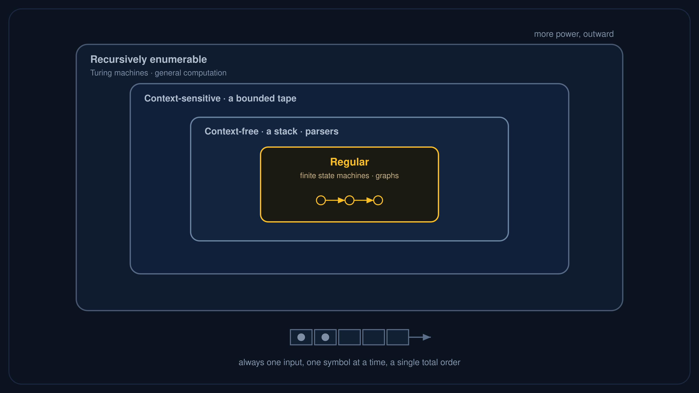

<!-- pause -->

State machines sit at the base. Climb for more power: a stack, a bounded tape, a
full Turing machine. The whole tower rests on one quiet assumption: a single
thread of control, stepping through one configuration at a time. For sequential
work, the territory is fully charted.

<!-- end_slide -->

# Then the inputs stop arriving in order

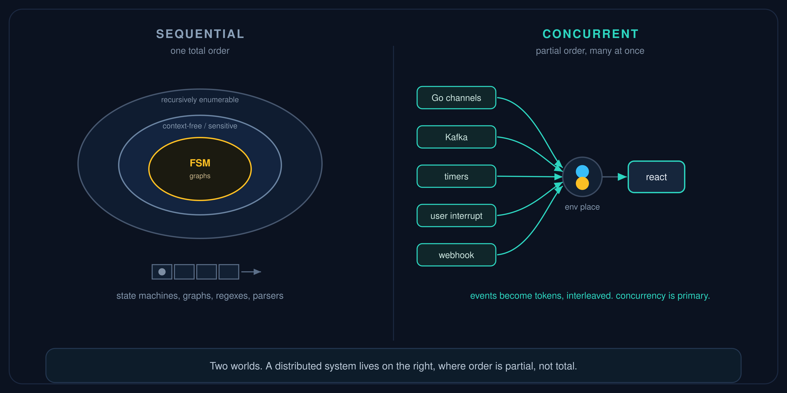

<!-- pause -->

A distributed system does not receive one ordered stream. It receives concurrent
events: channels, Kafka, a timer, a user who interrupts mid-sentence. There is no
single order left to read.

<!-- pause -->

This is a different world, and the map from before does not cover it. It needs a
model where concurrency comes first.

<!-- end_slide -->

# Eight things, at once

```
Customer: "Show me red sneakers under €100"
```

<!-- pause -->

Behind that one sentence, all at the same time, in a second or two:

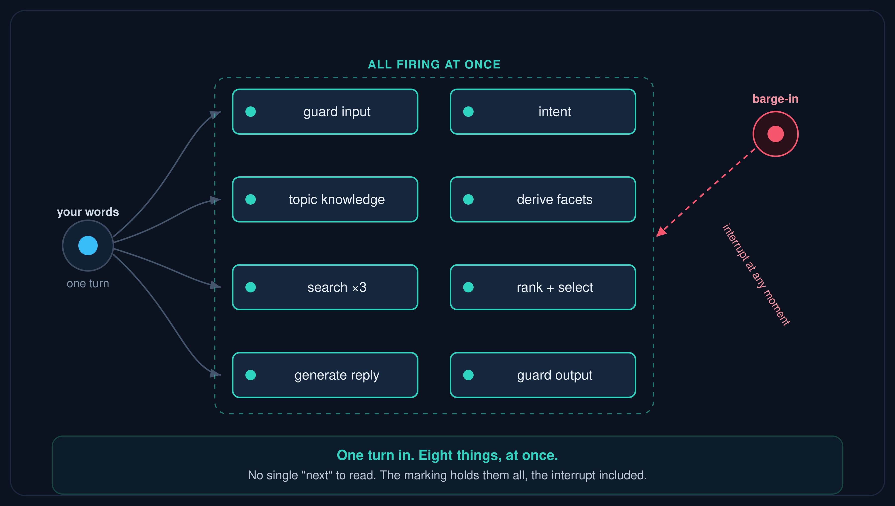

<!-- pause -->

This is **Polaris Marvin**. A state machine asks "what comes next?" Here, many things come next, at once.

<!-- end_slide -->

# Then the model breaks

Model real parallelism on a state machine and the states multiply: seven parallel
paths, two states each, become 2⁷ = 128 combined states.

<!-- pause -->

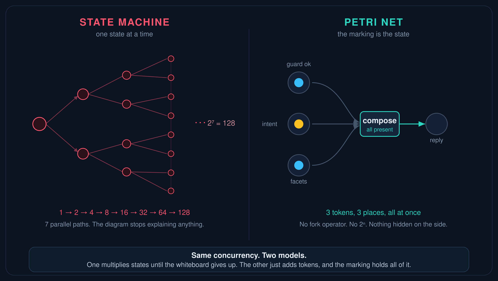

<!-- pause -->

The whiteboard stops explaining anything. There is another way to draw this.

<!-- end_slide -->

# And the bugs creep in

- <span style="color: #f5556d">race</span> · two things touch the same state at once
- <span style="color: #f5556d">TOCTOU</span> · you check, then you act, and the world moved in between
- <span style="color: #f5556d">lost update</span> · two writers, one silently wins
- <span style="color: #f5556d">deadlock</span> · everyone waits for everyone, forever

<!-- pause -->

You can chase each of these with a lock, a flag, a latch.
You will miss one. In production... -> post mortem

<!-- end_slide -->

# The problem is not your code

<!-- pause -->

<!-- new_lines: 3 -->
<!-- alignment: center -->
<!-- font_size: 2 -->

It is <span style="color: #2dd4bf">the model</span>.

<!-- font_size: 1 -->
<!-- alignment: left -->

<!-- pause -->

> A single sequence is the wrong primitive for concurrent systems.

A sequence answers "what comes next." A concurrent system has no single next.
We need a primitive built for **causality**, not order.

<!-- end_slide -->

# 1962: causality, not order

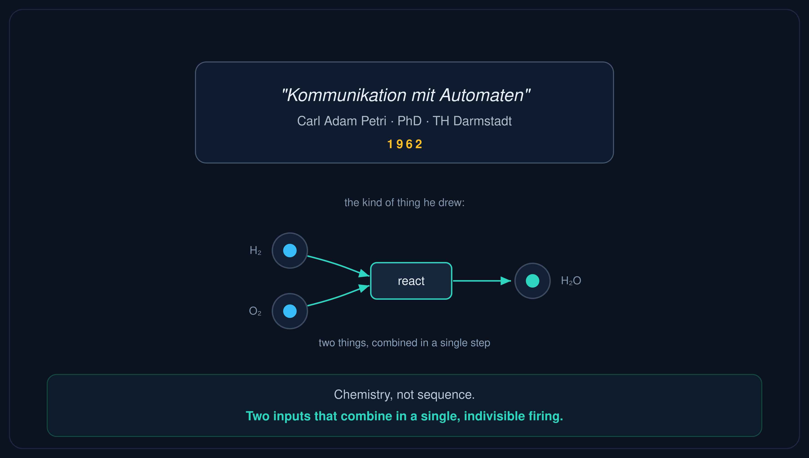

<!-- pause -->

**Carl Adam Petri** sketched it at **age 13**, in 1939, to draw chemical reactions:
things that genuinely happen at the same time. The foundations came in his 1962
dissertation.

<!-- pause -->

Every machine on that map had one thread of control, one global state stepping
forward. Petri threw the global clock away. He modelled the world as **causal**:
this can happen once that has. Concurrency is primary. Sequence is just one path
through it.

<!-- end_slide -->

# Places, tokens, transitions

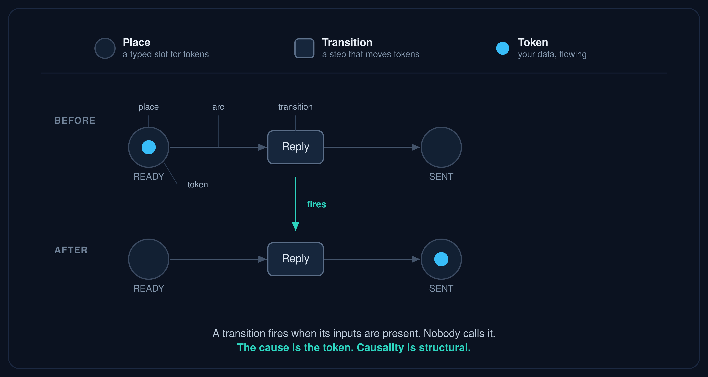

<!-- pause -->

A place holds tokens. A transition is **enabled** when its input places hold the
tokens it needs. An enabled transition **may fire**: atomically consuming them and
producing new ones, in one indivisible step.

<!-- pause -->

If two transitions reach for the same token, only one can fire. That choice **is**
the coordination. Nobody *calls* a transition; its inputs being present is the trigger.

<!-- end_slide -->

# Two kinds of node, one rule

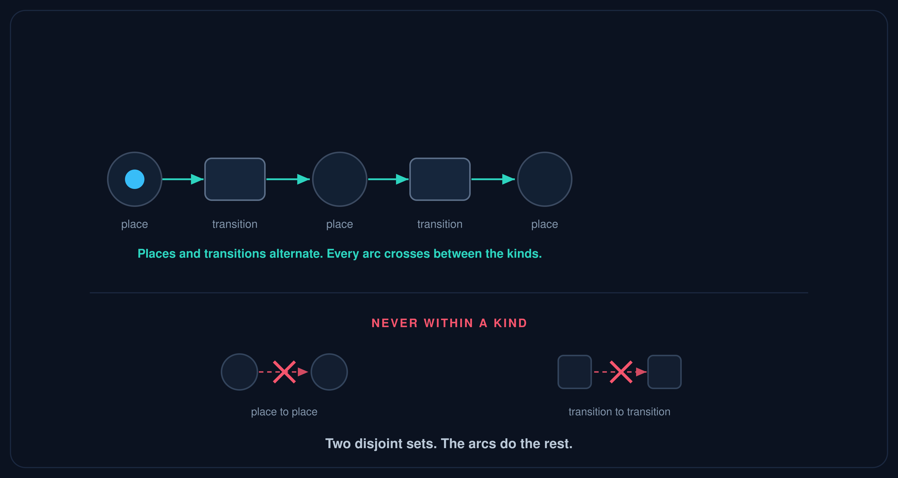

<!-- pause -->

Places and transitions, kept apart. An arc only ever crosses **between** the kinds.
Never place to place. Never transition to transition.

<!-- pause -->

Tokens sit on the places, and the arrangement of tokens across them all is the
**marking**: the whole state, in the open. They move by one local rule: a transition
**consumes its inputs and produces its outputs**. No clock. No controller.

> Not a drawing. A structure with a rule.

<!-- end_slide -->

# The full alphabet

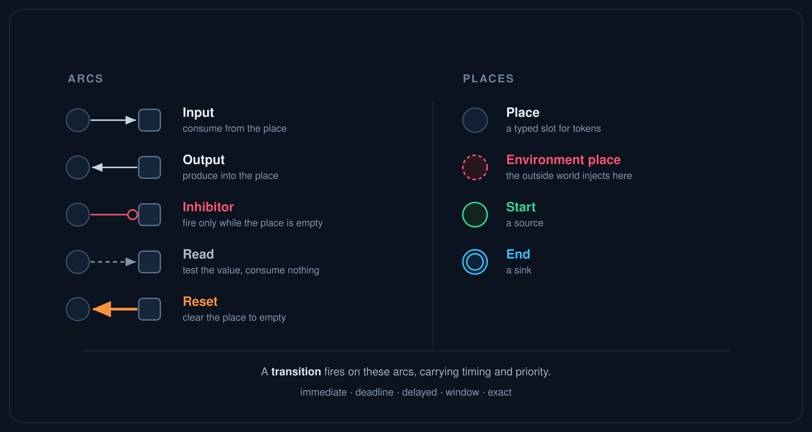

<!-- pause -->

Five arcs, not one: move, **block** (an inhibitor arc), test, clear. Places are
typed, and the **environment place** is where the outside world's events enter:
channels, timers, a user who interrupts.

> One small alphabet. Every coordination pattern is spelled in it.

<!-- end_slide -->

# Parallel, with no explosion

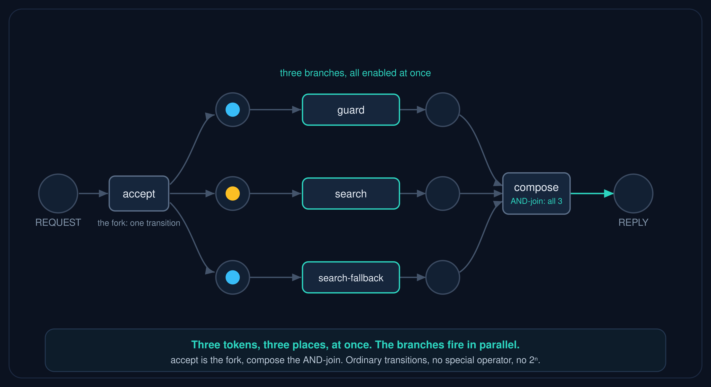

<!-- pause -->

No fork operator. No join operator. The places and arcs already say who waits
for whom. **The marking is the state**, all of it. Nothing hidden on the side.

<!-- pause -->

The *drawing* stays flat. The behaviour you prove over is still rich, which is
why we verify it symbolically, not by enumerating every state.

<!-- end_slide -->

# Coordination by consumption

Two tasks, one permit. Both need it.

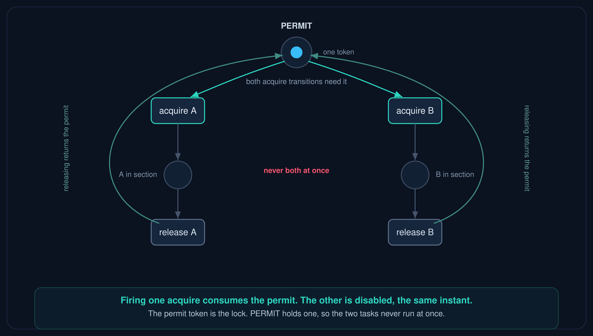

<!-- pause -->

Acquiring the permit **is** consuming it: firing one task disables the other in
the same indivisible step. The permit token *is* the lock, held for the duration
and released on completion. Nothing to take, and nothing to forget to release.
PERMIT holds one, so the two never run at once.

<!-- end_slide -->

# Whole classes of races, designed out

- <span style="color: #2dd4bf">race</span> → one token, one consumer; the rest are disabled
- <span style="color: #2dd4bf">TOCTOU</span> → check and act are the SAME firing; there is no gap
- <span style="color: #2dd4bf">lost update</span> → the place is the single owner of that state
- <span style="color: #2dd4bf">deadlock</span> → provable: no reachable state where all is stuck

<!-- pause -->

Atomic because one orchestrator thread fires transitions serially: actions run
concurrently, state transitions do not. Not "we were careful." **Designed out of
existence**, by the model.

<!-- pause -->

The races you would chase with locks are gone. The hard part **moves to net
design**, and for the bugs that survive you get a proof instead of a postmortem.

<!-- end_slide -->

# Composable, Turing-complete

Coloured (typed tokens) + Timed (deadlines) + inhibitor arcs.

<!-- pause -->

Turing-complete: it can model any computation, not just finite states. And you
**can't decide everything** about a Turing-complete model.

<!-- pause -->

You don't need to.

<!-- end_slide -->

# But the bugs that matter are provable

On the bounded nets you actually ship, the bugs that page you are decidable, and
you **prove them before it runs**: deadlock-freedom, mutual exclusion, bounds,
unreachability.

<!-- pause -->

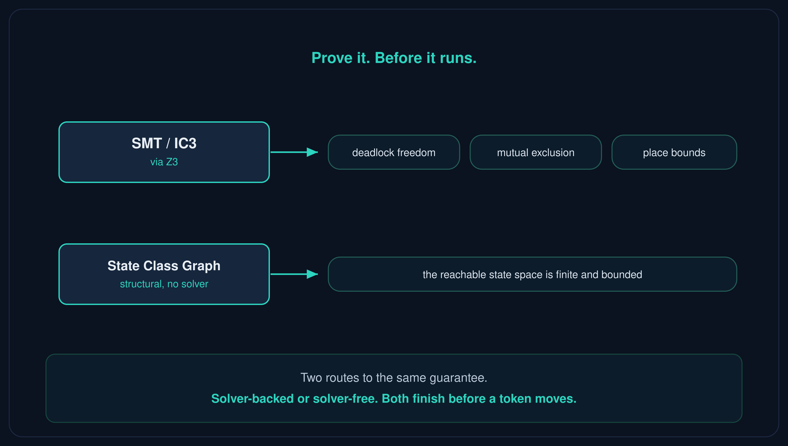

<!-- pause -->

Many nets are proven **structurally**, without ever calling the solver; the rest
go to Z3, with an explicit "unknown" verdict on timeout.

> A graph runtime reports state after the fact.
> The marking lets you prove it first.

<!-- end_slide -->

# You don't evolve it. You rewire it.

<!-- pause -->

Imperative order **cements** behaviour. The sequence *is* the logic, tangled through
flags and callbacks. Change one step and the blast radius is anyone's guess: which of
those 128 combined states just moved under you?

<!-- pause -->

The other model is topology. You change who waits for whom by **moving an arc, adding
a place**. Local. In the open. And you **re-prove** the new net before it ships: a
unit test in CI, asserting it is still deadlock-free, still mutually exclusive.

> Rewire, not rewrite. And know it still holds.

<!-- end_slide -->

# Why it took 60 years

The math has been right since 1962. The tools stayed in the lab: CPN Tools,
TINA, LoLA. Beautiful for analysis, never meant to ship.

<!-- pause -->

That is **libpetri**. Three implementations, Java, TypeScript, Rust, all verified
against one 203-requirement spec, plus Python as a binding on the Rust core. A
precompiled executor runs 1.4 to 4x faster than the reference one, about 190
nanoseconds per transition. Executable, not a simulator: the net *is* the program.

<!-- pause -->

Already in production: **Polaris Marvin**, OTTO.de's voice and text assistant.

<!-- end_slide -->

# What you get

<!-- column_layout: [1, 1] -->

<!-- column: 0 -->

- races designed out
- behaviour never hidden
- bugs provably gone

<!-- column: 1 -->

- coordination by consumption
- every state change is an event
- SMT before, replay after

<!-- reset_layout -->

<!-- pause -->

Every state change is an event, so you replay any production incident frame by frame, and
a live net inspector shows you exactly where a token is stuck. Transitions run your
normal async code; the net only governs coordination.

<!-- end_slide -->

# The point

Next time you reach for a state machine, ask what you are really building:

- Is it ever in **more than one state at once**?
- Is it **event-driven**, not a single ordered input?
- Are you holding it together with **nested callbacks, flags, and locks**?
- Does a timer, a retry, or someone interrupting break the happy path?

<!-- pause -->

If any of these is yes, you are forcing <span style="color: #f5556d">order</span>
onto a <span style="color: #2dd4bf">causal</span> system, by hand.

<!-- pause -->

The primitive that fixes it is 60 years old. Causality, not order. And the way you
get it is coordination by consumption.

<!-- end_slide -->

# Questions?

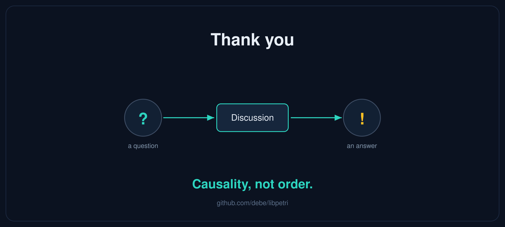

<!-- alignment: center -->

maven · npm · cargo · pip

**github.com/debe/libpetri**
