# CONC-004

Generated by `scripts/proof-graph.py` from `proof-graph.json`. Do not edit.

Theorems carrying this ID:

- `Libpetri.Spec.denseEnable_maskCheck` (theorem, `Libpetri/Spec/Req/PERF_042.lean:474`)

```mermaid
flowchart TD
  subgraph g0["Libpetri/Novel/Seam/Net.lean"]
    n1878["Libpetri.Novel.Seam.NInSpec"]
    n1881["Libpetri.Novel.Seam.NInSpec.place"]
    n1896["Libpetri.Novel.Seam.NTransition"]
    n1897["Libpetri.Novel.Seam.NTransition.inhibitors"]
    n1898["Libpetri.Novel.Seam.NTransition.inputs"]
    n1901["Libpetri.Novel.Seam.NTransition.reads"]
  end
  subgraph g1["Libpetri/Reference/Semantics.lean"]
    n2924["Libpetri.Reference.Trans"]
    n2925["Libpetri.Reference.Trans.core"]
  end
  subgraph g2["Libpetri/Spec/Glossary.lean"]
    n3884["Libpetri.Spec.InhibitorArc"]
    n4036["Libpetri.Spec.ReadArc"]
    n5022["Libpetri.Spec.inPlaces"]
  end
  subgraph g3["Libpetri/Spec/GlossaryEnable.lean"]
    n3885["Libpetri.Spec.InhibitorMask"]
    n3903["Libpetri.Spec.MaskCheck"]
    n3995["Libpetri.Spec.NeedsMask"]
  end
  subgraph g4["Libpetri/Spec/Req/PERF_042.lean"]
    n4017["Libpetri.Spec.PacksTo"]
    n4315["Libpetri.Spec.Words"]
    n4849["Libpetri.Spec.denseContainsAll"]
    n4850["Libpetri.Spec.denseContainsAll_iff"]
    n4851["Libpetri.Spec.denseEnable"]
    n4852["Libpetri.Spec.denseEnable_iff_bits"]
    n4853["Libpetri.Spec.denseEnable_iff_places"]
    n4854["Libpetri.Spec.denseEnable_maskCheck"]
    n4855["Libpetri.Spec.denseIntersects"]
    n4856["Libpetri.Spec.denseIntersects_iff"]
    n5986["Libpetri.Spec.wordAt"]
    n5987["Libpetri.Spec.wordAt_ge"]
    n5988["Libpetri.Spec.word_and_eq_iff_bits"]
    n5989["Libpetri.Spec.word_and_ne_zero_iff_bits"]
  end
  n1881 --> n1878
  n1897 --> n1896
  n1898 --> n1878
  n1898 --> n1896
  n1901 --> n1896
  n2925 --> n1896
  n2925 --> n2924
  n3884 --> n1897
  n3884 --> n2925
  n3885 --> n3884
  n3903 --> n3885
  n3903 --> n3995
  n3995 --> n4036
  n3995 --> n5022
  n4017 --> n5986
  n4036 --> n1901
  n4036 --> n2925
  n4849 --> n5986
  n4850 --> n4849
  n4850 --> n5987
  n4850 --> n5988
  n4851 --> n4849
  n4851 --> n4855
  n4852 --> n4850
  n4852 --> n4851
  n4852 --> n4856
  n4853 --> n4017
  n4853 --> n4852
  n4854 --> n3903
  n4854 --> n4853
  n4855 --> n5986
  n4856 --> n4855
  n4856 --> n5987
  n4856 --> n5989
  n5022 --> n1881
  n5022 --> n1898
  n5022 --> n2925
  n5986 --> n4315
  n5987 --> n5986
  classDef root stroke-width:3px
  classDef locked fill:#fff3cd,stroke:#b8860b
  classDef collapsed fill:#eeeeee,stroke-dasharray:4 4
  class n4854 root
```

Axioms used:

- `Libpetri.Spec.denseEnable_maskCheck`: `Classical.choice`, `Quot.sound`, `propext`
