# CONC-004

Generated by `scripts/proof-graph.py` from `proof-graph.json`. Do not edit.

Theorems carrying this ID:

- `Libpetri.Spec.conc007_presence_iff` (theorem, `Libpetri/Spec/Req/CONC_007.lean:291`)
- `Libpetri.Spec.denseEnable_maskCheck` (theorem, `Libpetri/Spec/Req/PERF_042.lean:474`)

```mermaid
flowchart TD
  subgraph g0["Libpetri/Novel/Seam/Net.lean"]
    n1878["Libpetri.Novel.Seam.NInSpec"]
    n1881["Libpetri.Novel.Seam.NInSpec.place"]
    n1896["Libpetri.Novel.Seam.NTransition"]
    n1897["Libpetri.Novel.Seam.NTransition.inhibitors"]
    n1898["Libpetri.Novel.Seam.NTransition.inputs"]
    n1901["Libpetri.Novel.Seam.NTransition.reads"]
  end
  subgraph g1["Libpetri/Reference/Semantics.lean"]
    n2924["Libpetri.Reference.Trans"]
    n2925["Libpetri.Reference.Trans.core"]
  end
  subgraph g2["Libpetri/Spec/Glossary.lean"]
    n3884["Libpetri.Spec.InhibitorArc"]
    n4036["Libpetri.Spec.ReadArc"]
    n5022["Libpetri.Spec.inPlaces"]
  end
  subgraph g3["Libpetri/Spec/GlossaryEnable.lean"]
    n3885["Libpetri.Spec.InhibitorMask"]
    n3903["Libpetri.Spec.MaskCheck"]
    n3995["Libpetri.Spec.NeedsMask"]
  end
  subgraph g4["Libpetri/Spec/Req/PERF_042.lean"]
    n4017["Libpetri.Spec.PacksTo"]
    n4315["Libpetri.Spec.Words"]
    n4849["Libpetri.Spec.denseContainsAll"]
    n4850["Libpetri.Spec.denseContainsAll_iff"]
    n4851["Libpetri.Spec.denseEnable"]
    n4852["Libpetri.Spec.denseEnable_iff_bits"]
    n4853["Libpetri.Spec.denseEnable_iff_places"]
    n4854["Libpetri.Spec.denseEnable_maskCheck"]
    n4855["Libpetri.Spec.denseIntersects"]
    n4856["Libpetri.Spec.denseIntersects_iff"]
    n5986["Libpetri.Spec.wordAt"]
    n5987["Libpetri.Spec.wordAt_ge"]
    n5988["Libpetri.Spec.word_and_eq_iff_bits"]
    n5989["Libpetri.Spec.word_and_ne_zero_iff_bits"]
  end
  n1881 --> n1878
  n1897 --> n1896
  n1898 --> n1878
  n1898 --> n1896
  n1901 --> n1896
  n2925 --> n1896
  n2925 --> n2924
  n3884 --> n1897
  n3884 --> n2925
  n3885 --> n3884
  n3903 --> n3885
  n3903 --> n3995
  n3995 --> n4036
  n3995 --> n5022
  n4017 --> n5986
  n4036 --> n1901
  n4036 --> n2925
  n4849 --> n5986
  n4850 --> n4849
  n4850 --> n5987
  n4850 --> n5988
  n4851 --> n4849
  n4851 --> n4855
  n4852 --> n4850
  n4852 --> n4851
  n4852 --> n4856
  n4853 --> n4017
  n4853 --> n4852
  n4854 --> n3903
  n4854 --> n4853
  n4855 --> n5986
  n4856 --> n4855
  n4856 --> n5987
  n4856 --> n5989
  n5022 --> n1881
  n5022 --> n1898
  n5022 --> n2925
  n5986 --> n4315
  n5987 --> n5986
  classDef root stroke-width:3px
  classDef locked fill:#fff3cd,stroke:#b8860b
  classDef collapsed fill:#eeeeee,stroke-dasharray:4 4
  class n4854 root
```

> **Note:** the full tree has 73 nodes (limit 60), so it is drawn as one diagram per theorem (2 theorems).

### `Libpetri.Spec.conc007_presence_iff`

> Rule: this theorem's whole tree, 59 nodes.

```mermaid
flowchart TD
  subgraph g0["Libpetri/Basic.lean"]
    n8["Libpetri.Card"]
    n9["Libpetri.Card.all"]
    n10["Libpetri.Card.atLeast"]
    n12["Libpetri.Card.exactly"]
    n13["Libpetri.Card.one"]
    n14["Libpetri.Card.required"]
  end
  subgraph g1["Libpetri/Novel/Seam/Net.lean"]
    n1936["Libpetri.Novel.Seam.NInSpec"]
    n1937["Libpetri.Novel.Seam.NInSpec.card"]
    n1939["Libpetri.Novel.Seam.NInSpec.place"]
    n1954["Libpetri.Novel.Seam.NTransition"]
    n1955["Libpetri.Novel.Seam.NTransition.inhibitors"]
    n1956["Libpetri.Novel.Seam.NTransition.inputs"]
    n1959["Libpetri.Novel.Seam.NTransition.reads"]
    n1960["Libpetri.Novel.Seam.NTransition.resets"]
  end
  subgraph g2["Libpetri/Reference/Compiled.lean"]
    n2953["Libpetri.Reference.CompiledNet"]
    n2954["Libpetri.Reference.CompiledNet.affected"]
    n2955["Libpetri.Reference.CompiledNet.card"]
    n2956["Libpetri.Reference.CompiledNet.consumption"]
    n2957["Libpetri.Reference.CompiledNet.hasMatch"]
    n2958["Libpetri.Reference.CompiledNet.indexBits"]
    n2959["Libpetri.Reference.CompiledNet.inhibitor"]
    n2963["Libpetri.Reference.CompiledNet.needs"]
    n2964["Libpetri.Reference.CompiledNet.placeAt"]
    n2965["Libpetri.Reference.CompiledNet.placeCount"]
    n2966["Libpetri.Reference.CompiledNet.placeId"]
    n2967["Libpetri.Reference.CompiledNet.presence"]
    n2968["Libpetri.Reference.CompiledNet.trans"]
    n2969["Libpetri.Reference.CompiledNet.transCount"]
    n3488["Libpetri.Reference.mem_netPlaceList"]
    n3489["Libpetri.Reference.mem_netPlaceList_of_arc"]
    n3512["Libpetri.Reference.netPlaceList"]
  end
  subgraph g3["Libpetri/Reference/Semantics.lean"]
    n3047["Libpetri.Reference.Net"]
    n3049["Libpetri.Reference.Net.places"]
    n3050["Libpetri.Reference.Net.transitions"]
    n3067["Libpetri.Reference.Out"]
    n3068["Libpetri.Reference.Out.and"]
    n3071["Libpetri.Reference.Out.brecOn.go"]
    n3073["Libpetri.Reference.Out.forward"]
    n3074["Libpetri.Reference.Out.place"]
    n3075["Libpetri.Reference.Out.timeout"]
    n3077["Libpetri.Reference.Out.xor"]
    n3226["Libpetri.Reference.Trans"]
    n3227["Libpetri.Reference.Trans.core"]
    n3229["Libpetri.Reference.Trans.out"]
  end
  subgraph g4["Libpetri/Reference/Timed.lean"]
    n3274["Libpetri.Reference.arcPlaces"]
  end
  subgraph g5["Libpetri/Spec/Glossary.lean"]
    n6448["Libpetri.Spec.InhibitorArc"]
    n6740["Libpetri.Spec.OutputArc"]
    n6836["Libpetri.Spec.ReadArc"]
    n6892["Libpetri.Spec.ResetArc"]
    n11006["Libpetri.Spec.inPlaces"]
    n11736["Libpetri.Spec.outPlaces"]
    n12121["Libpetri.Spec.requiredCount"]
  end
  subgraph g6["Libpetri/Spec/GlossaryEnable.lean"]
    n6449["Libpetri.Spec.InhibitorMask"]
    n6511["Libpetri.Spec.MaskCheck"]
    n6671["Libpetri.Spec.NeedsMask"]
  end
  subgraph g7["Libpetri/Spec/GlossaryTime.lean"]
    n3959["Libpetri.Spec.ArcPlace"]
    n7613["Libpetri.Spec.arcPlace_iff"]
  end
  subgraph g8["Libpetri/Spec/Req/CONC_007.lean"]
    n4122["Libpetri.Spec.CONC_007"]
    n8076["Libpetri.Spec.conc007_presence_iff"]
  end
  n9 --> n8
  n10 --> n8
  n12 --> n8
  n13 --> n8
  n14 --> n9
  n14 --> n10
  n14 --> n12
  n14 --> n13
  n1937 --> n8
  n1937 --> n1936
  n1939 --> n1936
  n1955 --> n1954
  n1956 --> n1936
  n1956 --> n1954
  n1959 --> n1954
  n1960 --> n1954
  n2954 --> n2953
  n2955 --> n2953
  n2956 --> n2953
  n2957 --> n2953
  n2958 --> n2964
  n2959 --> n2953
  n2963 --> n2953
  n2964 --> n2953
  n2965 --> n2953
  n2966 --> n2953
  n2967 --> n2959
  n2967 --> n2963
  n2967 --> n2965
  n2968 --> n2953
  n2968 --> n3226
  n2969 --> n2968
  n3049 --> n3047
  n3050 --> n3047
  n3050 --> n3226
  n3068 --> n3067
  n3071 --> n3068
  n3071 --> n3073
  n3071 --> n3074
  n3071 --> n3075
  n3071 --> n3077
  n3073 --> n3067
  n3074 --> n3067
  n3075 --> n3067
  n3077 --> n3067
  n3227 --> n1954
  n3227 --> n3226
  n3229 --> n3067
  n3229 --> n3226
  n3274 --> n1939
  n3274 --> n1955
  n3274 --> n1956
  n3274 --> n1959
  n3274 --> n1960
  n3274 --> n3227
  n3488 --> n3512
  n3488 --> n6740
  n3488 --> n7613
  n3489 --> n3488
  n3512 --> n3049
  n3512 --> n3050
  n3512 --> n3229
  n3512 --> n3274
  n3512 --> n11736
  n3959 --> n6448
  n3959 --> n6836
  n3959 --> n6892
  n3959 --> n11006
  n4122 --> n1937
  n4122 --> n2954
  n4122 --> n2955
  n4122 --> n2956
  n4122 --> n2957
  n4122 --> n2959
  n4122 --> n2963
  n4122 --> n2964
  n4122 --> n2965
  n4122 --> n2966
  n4122 --> n2969
  n4122 --> n3512
  n4122 --> n3959
  n4122 --> n6449
  n4122 --> n6671
  n4122 --> n12121
  n6448 --> n1955
  n6448 --> n3227
  n6449 --> n6448
  n6511 --> n6449
  n6511 --> n6671
  n6671 --> n6836
  n6671 --> n11006
  n6740 --> n3229
  n6740 --> n11736
  n6836 --> n1959
  n6836 --> n3227
  n6892 --> n1960
  n6892 --> n3227
  n7613 --> n3274
  n7613 --> n3959
  n8076 --> n2958
  n8076 --> n2967
  n8076 --> n3489
  n8076 --> n4122
  n8076 --> n6511
  n11006 --> n1939
  n11006 --> n1956
  n11006 --> n3227
  n11736 --> n3071
  n12121 --> n14
  classDef root stroke-width:3px
  classDef locked fill:#fff3cd,stroke:#b8860b
  classDef collapsed fill:#eeeeee,stroke-dasharray:4 4
  class n8076 root
```

### `Libpetri.Spec.denseEnable_maskCheck`

> Rule: this theorem's whole tree, 28 nodes.

Axioms used:

- `Libpetri.Spec.conc007_presence_iff`: `Classical.choice`, `Quot.sound`, `propext`
- `Libpetri.Spec.denseEnable_maskCheck`: `Classical.choice`, `Quot.sound`, `propext`
