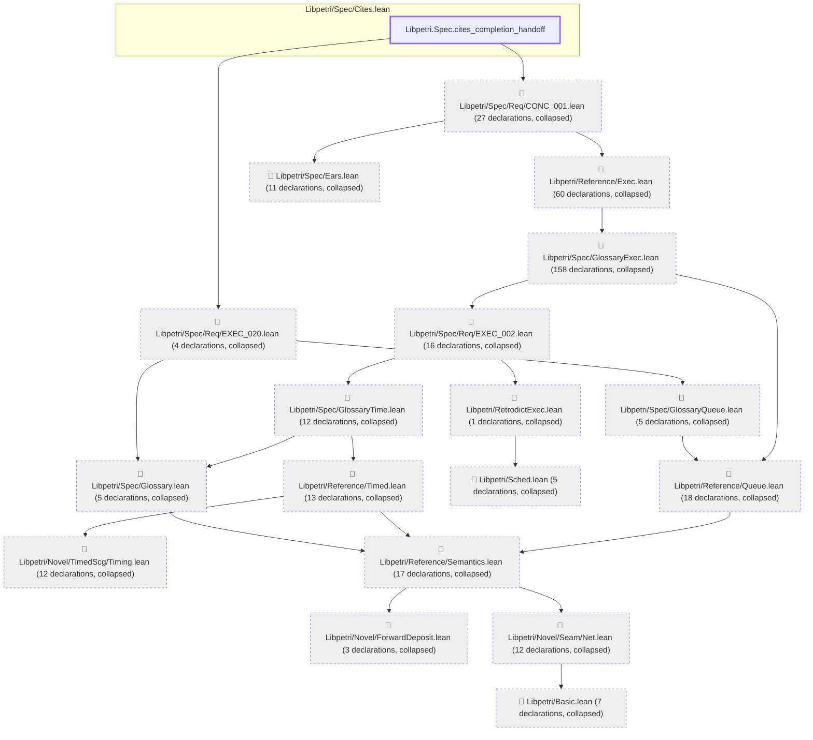

# CONC-006

Generated by `scripts/proof-graph.py` from `proof-graph.json`. Do not edit.

Theorems carrying this ID:

- `Libpetri.Spec.cites_completion_handoff` (theorem, `Libpetri/Spec/Cites.lean:72`)

> **Note:** the full tree has 387 nodes (limit 60).

> Rule: this theorem's tree has 387 nodes (limit 60); every file other than its own is collapsed into one node, leaving 19.

Axioms used:

- `Libpetri.Spec.cites_completion_handoff`: `Classical.choice`, `Quot.sound`, `propext`
