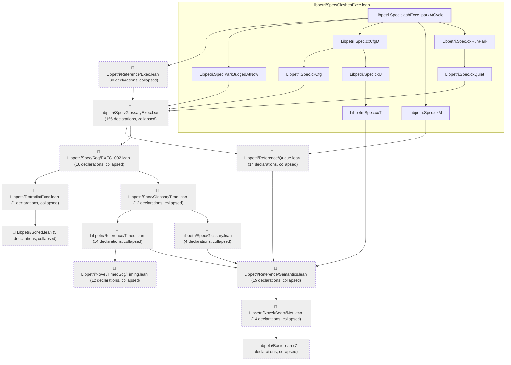
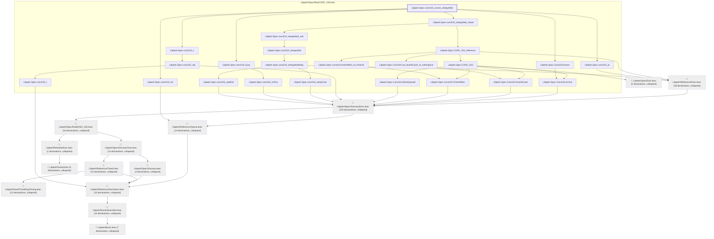

# CONC-010

Generated by `scripts/proof-graph.py` from `proof-graph.json`. Do not edit.

Theorems carrying this ID:

- `Libpetri.Spec.clashExec_parkAtCycle` (theorem, `Libpetri/Spec/ClashesExec.lean:267`)
- `Libpetri.Spec.conc010_covers_sleepyWait` (theorem, `Libpetri/Spec/Req/CONC_010.lean:506`)

> **Note:** the full tree has 343 nodes (limit 60), so it is drawn as one diagram per theorem (2 theorems).

### `Libpetri.Spec.clashExec_parkAtCycle`

> Rule: this theorem's tree has 308 nodes (limit 60); every file other than its own is collapsed into one node, leaving 22.

### `Libpetri.Spec.conc010_covers_sleepyWait`

> Rule: this theorem's tree has 334 nodes (limit 60); every file other than its own is collapsed into one node, leaving 37.

Axioms used:

- `Libpetri.Spec.clashExec_parkAtCycle`: `Quot.sound`, `propext`
- `Libpetri.Spec.conc010_covers_sleepyWait`: `Quot.sound`, `propext`
