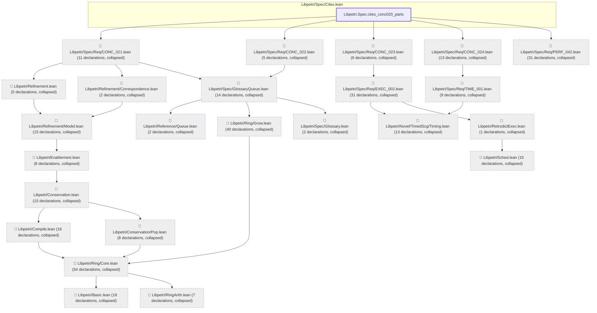
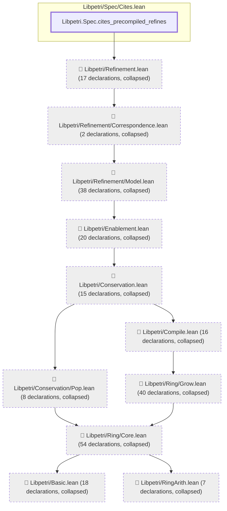

# CONC-020

Generated by `scripts/proof-graph.py` from `proof-graph.json`. Do not edit.

Theorems carrying this ID:

- `Libpetri.Spec.cites_conc020_parts` (theorem, `Libpetri/Spec/Cites.lean:107`)
- `Libpetri.Spec.cites_precompiled_refines` (theorem, `Libpetri/Spec/Cites.lean:96`)

> **Note:** the full tree has 391 nodes (limit 60), so it is drawn as one diagram per theorem (2 theorems).

### `Libpetri.Spec.cites_conc020_parts`

> Rule: this theorem's tree has 342 nodes (limit 60); every file other than its own is collapsed into one node, leaving 25.

### `Libpetri.Spec.cites_precompiled_refines`

> Rule: this theorem's tree has 236 nodes (limit 60); every file other than its own is collapsed into one node, leaving 12.

Axioms used:

- `Libpetri.Spec.cites_conc020_parts`: `Classical.choice`, `Quot.sound`, `propext`
- `Libpetri.Spec.cites_precompiled_refines`: `Quot.sound`, `propext`
