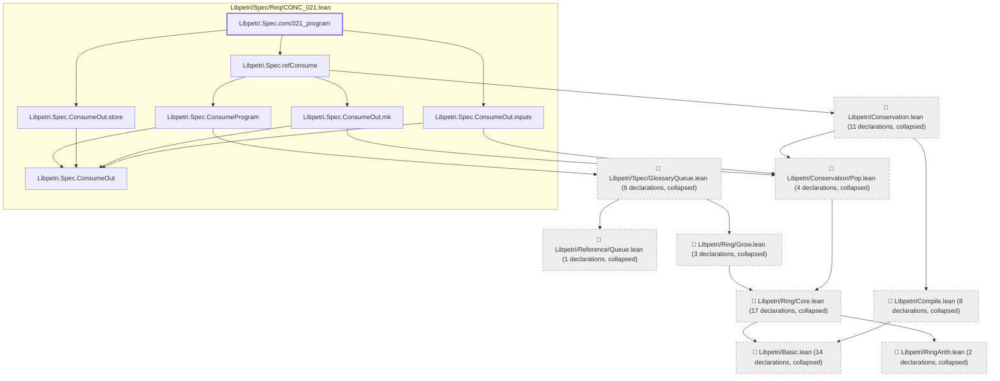
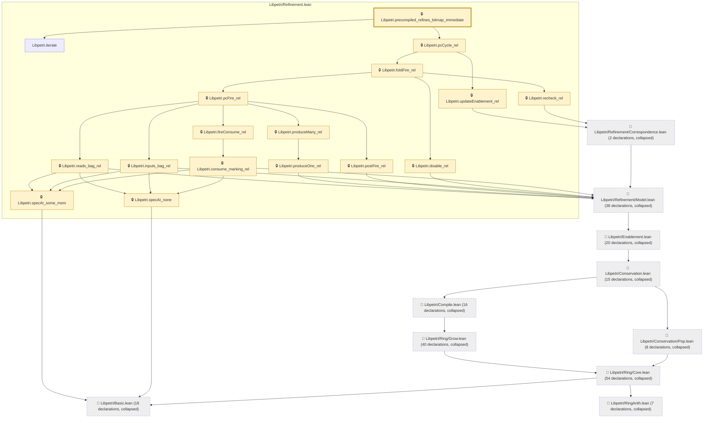

# CONC-021

Generated by `scripts/proof-graph.py` from `proof-graph.json`. Do not edit.

Theorems carrying this ID:

- `Libpetri.Spec.conc021_program` (theorem, `Libpetri/Spec/Req/CONC_021.lean:192`)
- `Libpetri.precompiled_refines_bitmap_immediate` (theorem, `Libpetri/Refinement.lean:411`) 🔒 locked

> **Note:** the full tree has 252 nodes (limit 60), so it is drawn as one diagram per theorem (2 theorems).

### `Libpetri.Spec.conc021_program`

> Rule: this theorem's tree has 73 nodes (limit 60); every file other than its own is collapsed into one node, leaving 16.

### `Libpetri.precompiled_refines_bitmap_immediate`

> Rule: this theorem's tree has 235 nodes (limit 60); every file other than its own is collapsed into one node, leaving 27.

Axioms used:

- `Libpetri.Spec.conc021_program`: `Quot.sound`, `propext`
- `Libpetri.precompiled_refines_bitmap_immediate`: `Quot.sound`, `propext`
