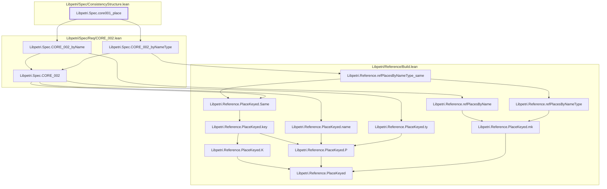

# CORE-001

Generated by `scripts/proof-graph.py` from `proof-graph.json`. Do not edit.

Theorems carrying this ID:

- `Libpetri.Spec.core001_place` (theorem, `Libpetri/Spec/ConsistencyStructure.lean:242`)

Axioms used:

- `Libpetri.Spec.core001_place`: none
