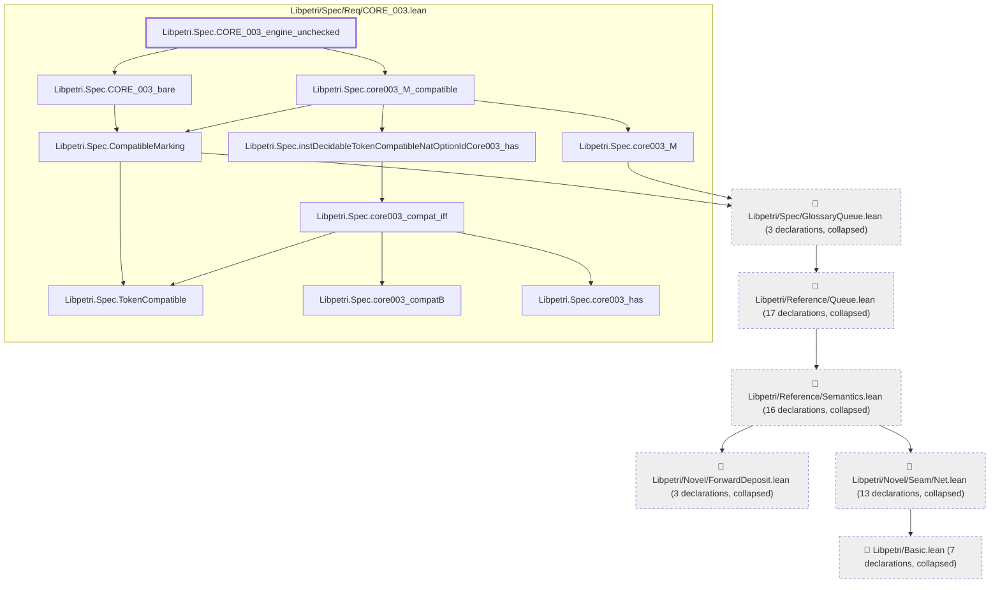

# CORE-003

Generated by `scripts/proof-graph.py` from `proof-graph.json`. Do not edit.

Theorems carrying this ID:

- `Libpetri.Spec.CORE_003_engine_unchecked` (theorem, `Libpetri/Spec/Req/CORE_003.lean:503`)
- `Libpetri.Spec.CORE_003_unit_compatible` (theorem, `Libpetri/Spec/Req/CORE_003.lean:157`)
- `Libpetri.Spec.core003_lines123_of_CORE_010` (theorem, `Libpetri/Spec/Req/CORE_003.lean:205`)

> **Note:** the full tree has 84 nodes (limit 60), so it is drawn as one diagram per theorem (3 theorems).

### `Libpetri.Spec.CORE_003_engine_unchecked`

> Rule: this theorem's tree has 69 nodes (limit 60); every file other than its own is collapsed into one node, leaving 16.

### `Libpetri.Spec.CORE_003_unit_compatible`

Shared leaves of `Libpetri.Spec.CORE_003_unit_compatible` (direct dependencies too small for a diagram of their own, fewer than 3 nodes):

- `Libpetri.Spec.TokenCompatible` (`Libpetri/Spec/Req/CORE_003.lean`)

### `Libpetri.Spec.core003_lines123_of_CORE_010`

> Rule: this theorem's whole tree, 29 nodes.

```mermaid
flowchart TD
  subgraph g0["Libpetri/Novel/Seam/Net.lean"]
    n1936["Libpetri.Novel.Seam.NInSpec"]
    n1939["Libpetri.Novel.Seam.NInSpec.place"]
    n1954["Libpetri.Novel.Seam.NTransition"]
    n1956["Libpetri.Novel.Seam.NTransition.inputs"]
    n1959["Libpetri.Novel.Seam.NTransition.reads"]
    n1960["Libpetri.Novel.Seam.NTransition.resets"]
  end
  subgraph g1["Libpetri/Reference/Queue.lean"]
    n2964["Libpetri.Reference.NoInputRead"]
    n2990["Libpetri.Reference.QDelivered"]
    n2991["Libpetri.Reference.QDelivered.inputs"]
    n2993["Libpetri.Reference.QDelivered.reads"]
    n2994["Libpetri.Reference.QMarking"]
    n3187["Libpetri.Reference.qEmittedTo"]
  end
  subgraph g2["Libpetri/Reference/Semantics.lean"]
    n3064["Libpetri.Reference.Trans"]
    n3065["Libpetri.Reference.Trans.core"]
  end
  subgraph g3["Libpetri/Spec/Ears.lean"]
    n4756["Libpetri.Spec.StepShall"]
  end
  subgraph g4["Libpetri/Spec/Glossary.lean"]
    n4679["Libpetri.Spec.ReadArc"]
    n4712["Libpetri.Spec.ResetArc"]
    n6195["Libpetri.Spec.inPlaces"]
  end
  subgraph g5["Libpetri/Spec/GlossaryQueue.lean"]
    n3828["Libpetri.Spec.Delivered"]
    n3979["Libpetri.Spec.EmittedTo"]
    n4675["Libpetri.Spec.QFireRel"]
    n4677["Libpetri.Spec.QueueMarking"]
  end
  subgraph g6["Libpetri/Spec/Req/CORE_003.lean"]
    n3491["Libpetri.Spec.CORE_003_lines123"]
    n3792["Libpetri.Spec.CompatibleDeposit"]
    n3793["Libpetri.Spec.CompatibleMarking"]
    n4940["Libpetri.Spec.TokenCompatible"]
    n5580["Libpetri.Spec.core003_lines123_of_CORE_010"]
    n5581["Libpetri.Spec.core003_mem_emittedTo"]
  end
  subgraph g7["Libpetri/Spec/Req/CORE_010.lean"]
    n3496["Libpetri.Spec.CORE_010"]
  end
  n1939 --> n1936
  n1956 --> n1936
  n1956 --> n1954
  n1959 --> n1954
  n1960 --> n1954
  n2964 --> n1939
  n2964 --> n1956
  n2964 --> n1959
  n2964 --> n3065
  n2991 --> n2990
  n2993 --> n2990
  n3065 --> n1954
  n3065 --> n3064
  n3491 --> n2964
  n3491 --> n2991
  n3491 --> n2993
  n3491 --> n3792
  n3491 --> n3793
  n3491 --> n4675
  n3491 --> n4679
  n3491 --> n4756
  n3491 --> n6195
  n3496 --> n2964
  n3496 --> n2991
  n3496 --> n2993
  n3496 --> n3979
  n3496 --> n4675
  n3496 --> n4679
  n3496 --> n4712
  n3496 --> n4756
  n3496 --> n6195
  n3792 --> n4940
  n3793 --> n4677
  n3793 --> n4940
  n3828 --> n2990
  n3979 --> n3187
  n4675 --> n3064
  n4675 --> n3828
  n4675 --> n4677
  n4677 --> n2994
  n4679 --> n1959
  n4679 --> n3065
  n4712 --> n1960
  n4712 --> n3065
  n5580 --> n3491
  n5580 --> n3496
  n5580 --> n5581
  n5581 --> n3979
  n6195 --> n1939
  n6195 --> n1956
  n6195 --> n3065
  classDef root stroke-width:3px
  classDef locked fill:#fff3cd,stroke:#b8860b
  classDef collapsed fill:#eeeeee,stroke-dasharray:4 4
  class n5580 root
```

Axioms used:

- `Libpetri.Spec.CORE_003_engine_unchecked`: `Quot.sound`, `propext`
- `Libpetri.Spec.CORE_003_unit_compatible`: `propext`
- `Libpetri.Spec.core003_lines123_of_CORE_010`: `Quot.sound`, `propext`
