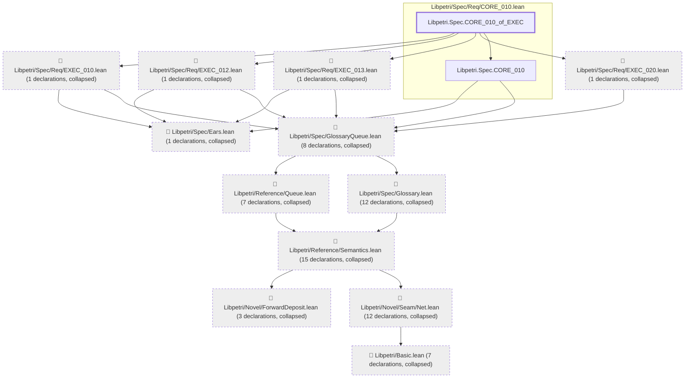

# CORE-010

Generated by `scripts/proof-graph.py` from `proof-graph.json`. Do not edit.

Theorems carrying this ID:

- `Libpetri.Spec.CORE_010_of_EXEC` (theorem, `Libpetri/Spec/Req/CORE_010.lean:156`)

> **Note:** the full tree has 71 nodes (limit 60).

> Rule: this theorem's tree has 71 nodes (limit 60); every file other than its own is collapsed into one node, leaving 14.

Axioms used:

- `Libpetri.Spec.CORE_010_of_EXEC`: `propext`
