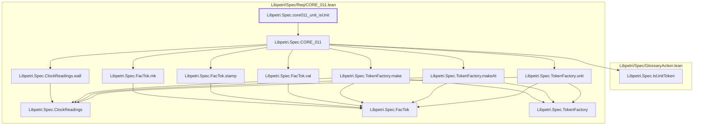

# CORE-012

Generated by `scripts/proof-graph.py` from `proof-graph.json`. Do not edit.

Theorems carrying this ID:

- `Libpetri.Spec.core011_unit_isUnit` (theorem, `Libpetri/Spec/Req/CORE_011.lean:228`)

Axioms used:

- `Libpetri.Spec.core011_unit_isUnit`: none
