# CORE-035

Generated by `scripts/proof-graph.py` from `proof-graph.json`. Do not edit.

Theorems carrying this ID:

- `Libpetri.Spec.core011b_output_stamp` (theorem, `Libpetri/Spec/Req/CORE_011_B.lean:684`)

```mermaid
flowchart TD
  subgraph g0["Libpetri/Reference/Queue.lean"]
    n3330["Libpetri.Reference.QDelivered"]
    n3331["Libpetri.Reference.QDelivered.inputs"]
    n3335["Libpetri.Reference.QMarking"]
    n4202["Libpetri.Reference.qEmittedTo"]
  end
  subgraph g1["Libpetri/Reference/Semantics.lean"]
    n3288["Libpetri.Reference.Out"]
    n3289["Libpetri.Reference.Out.and"]
    n3292["Libpetri.Reference.Out.brecOn.go"]
    n3293["Libpetri.Reference.Out.findTimeout"]
    n3294["Libpetri.Reference.Out.forward"]
    n3295["Libpetri.Reference.Out.place"]
    n3296["Libpetri.Reference.Out.timeout"]
    n3298["Libpetri.Reference.Out.xor"]
    n3454["Libpetri.Reference.Trans"]
    n3457["Libpetri.Reference.Trans.out"]
  end
  subgraph g2["Libpetri/Spec/Ears.lean"]
    n9910["Libpetri.Spec.StepShall"]
  end
  subgraph g3["Libpetri/Spec/GlossaryExec.lean"]
    n5874["Libpetri.Spec.Cfg"]
    n7513["Libpetri.Spec.Firing"]
    n7514["Libpetri.Spec.Firing.buf"]
    n7515["Libpetri.Spec.Firing.deliv"]
    n7516["Libpetri.Spec.Firing.id"]
    n7518["Libpetri.Spec.Firing.out"]
    n7523["Libpetri.Spec.Firing.t"]
    n9540["Libpetri.Spec.Outcome"]
    n9742["Libpetri.Spec.Reply"]
    n12038["Libpetri.Spec.XLbl"]
    n12050["Libpetri.Spec.XLbl.expire"]
    n12061["Libpetri.Spec.XLbl.request"]
    n12069["Libpetri.Spec.XLbl.write"]
    n12090["Libpetri.Spec.XSt"]
    n12091["Libpetri.Spec.XSt.M"]
    n12095["Libpetri.Spec.XSt.eq"]
    n12096["Libpetri.Spec.XSt.fl"]
    n12104["Libpetri.Spec.XSt.pq"]
  end
  subgraph g4["Libpetri/Spec/Req/CORE_011.lean"]
    n5951["Libpetri.Spec.ClockReadings"]
    n5952["Libpetri.Spec.ClockReadings.epoch"]
    n7507["Libpetri.Spec.FacTok"]
    n7508["Libpetri.Spec.FacTok.mk"]
    n7509["Libpetri.Spec.FacTok.stamp"]
  end
  subgraph g5["Libpetri/Spec/Req/CORE_011_B.lean"]
    n5309["Libpetri.Spec.CORE_011_B"]
    n7203["Libpetri.Spec.EpochLbl"]
    n7204["Libpetri.Spec.EpochLbl.requestVal"]
    n7205["Libpetri.Spec.EpochLbl.step"]
    n7206["Libpetri.Spec.EpochLbl.tick"]
    n7207["Libpetri.Spec.EpochLbl.writeVal"]
    n7215["Libpetri.Spec.EpochRel"]
    n7216["Libpetri.Spec.EpochSt"]
    n7218["Libpetri.Spec.EpochSt.rd"]
    n7219["Libpetri.Spec.EpochSt.x"]
    n13072["Libpetri.Spec.core011b_QStamped"]
    n13075["Libpetri.Spec.core011b_Stamped"]
    n13076["Libpetri.Spec.core011b_buffers"]
    n13078["Libpetri.Spec.core011b_bufsAdd"]
    n13079["Libpetri.Spec.core011b_bufsKept"]
    n13083["Libpetri.Spec.core011b_eqAdd"]
    n13084["Libpetri.Spec.core011b_eqKept"]
    n13099["Libpetri.Spec.core011b_keepsRest"]
    n13113["Libpetri.Spec.core011b_output_stamp"]
    n13118["Libpetri.Spec.core011b_queues"]
    n13120["Libpetri.Spec.core011b_rdAfter"]
  end
  n3289 --> n3288
  n3292 --> n3289
  n3292 --> n3294
  n3292 --> n3295
  n3292 --> n3296
  n3292 --> n3298
  n3293 --> n3292
  n3294 --> n3288
  n3295 --> n3288
  n3296 --> n3288
  n3298 --> n3288
  n3331 --> n3330
  n3457 --> n3288
  n3457 --> n3454
  n5309 --> n5952
  n5309 --> n7215
  n5309 --> n7218
  n5309 --> n7219
  n5309 --> n7508
  n5309 --> n7515
  n5309 --> n7523
  n5309 --> n9910
  n5309 --> n12050
  n5309 --> n12061
  n5309 --> n12069
  n5309 --> n13072
  n5309 --> n13076
  n5309 --> n13118
  n5309 --> n13120
  n5952 --> n5951
  n7204 --> n7203
  n7204 --> n9742
  n7205 --> n7203
  n7205 --> n7507
  n7205 --> n12038
  n7206 --> n5951
  n7206 --> n7203
  n7207 --> n7203
  n7215 --> n5874
  n7215 --> n7203
  n7215 --> n7216
  n7215 --> n7507
  n7218 --> n5951
  n7218 --> n7216
  n7219 --> n7216
  n7219 --> n7507
  n7219 --> n12090
  n7508 --> n7507
  n7509 --> n7507
  n7514 --> n7513
  n7515 --> n3330
  n7515 --> n7513
  n7516 --> n7513
  n7518 --> n7513
  n7518 --> n9540
  n7523 --> n3454
  n7523 --> n7513
  n12050 --> n12038
  n12061 --> n9742
  n12061 --> n12038
  n12069 --> n12038
  n12091 --> n3335
  n12091 --> n12090
  n12095 --> n12090
  n12096 --> n7513
  n12096 --> n12090
  n12104 --> n12090
  n13072 --> n3293
  n13072 --> n3457
  n13072 --> n4202
  n13072 --> n13075
  n13075 --> n3292
  n13075 --> n3331
  n13075 --> n7509
  n13076 --> n13078
  n13076 --> n13084
  n13076 --> n13099
  n13078 --> n7514
  n13078 --> n7516
  n13078 --> n12096
  n13079 --> n7514
  n13079 --> n7516
  n13079 --> n12096
  n13083 --> n12095
  n13084 --> n12095
  n13099 --> n7516
  n13099 --> n7518
  n13099 --> n12091
  n13099 --> n12096
  n13099 --> n12104
  n13113 --> n5309
  n13118 --> n13079
  n13118 --> n13083
  n13118 --> n13099
  n13120 --> n7204
  n13120 --> n7205
  n13120 --> n7206
  n13120 --> n7207
  classDef root stroke-width:3px
  classDef locked fill:#fff3cd,stroke:#b8860b
  classDef collapsed fill:#eeeeee,stroke-dasharray:4 4
  class n13113 root
```

Axioms used:

- `Libpetri.Spec.core011b_output_stamp`: `propext`
