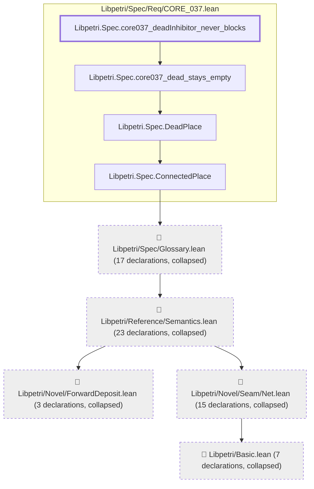
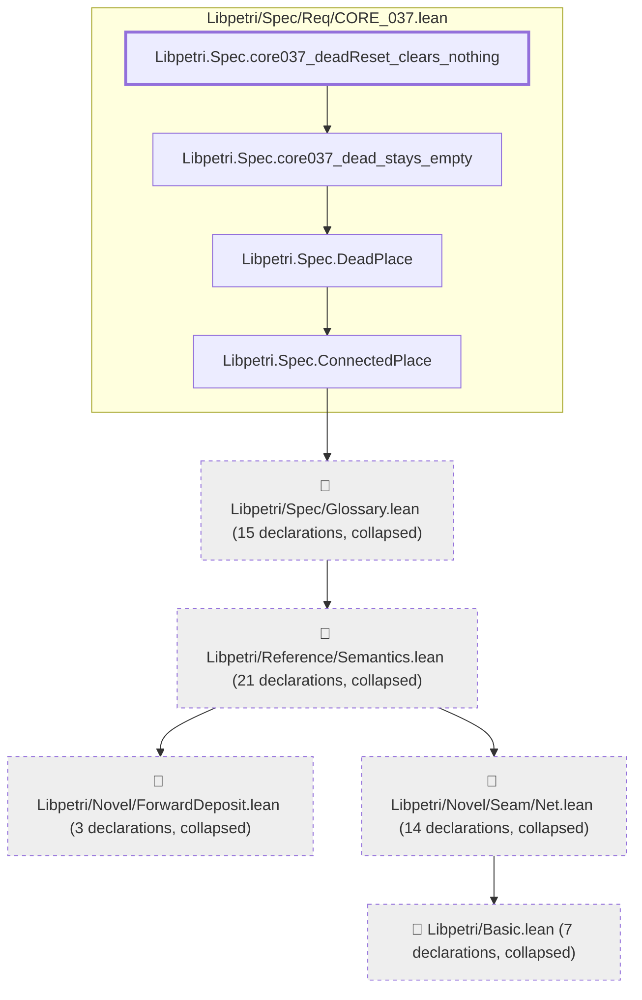
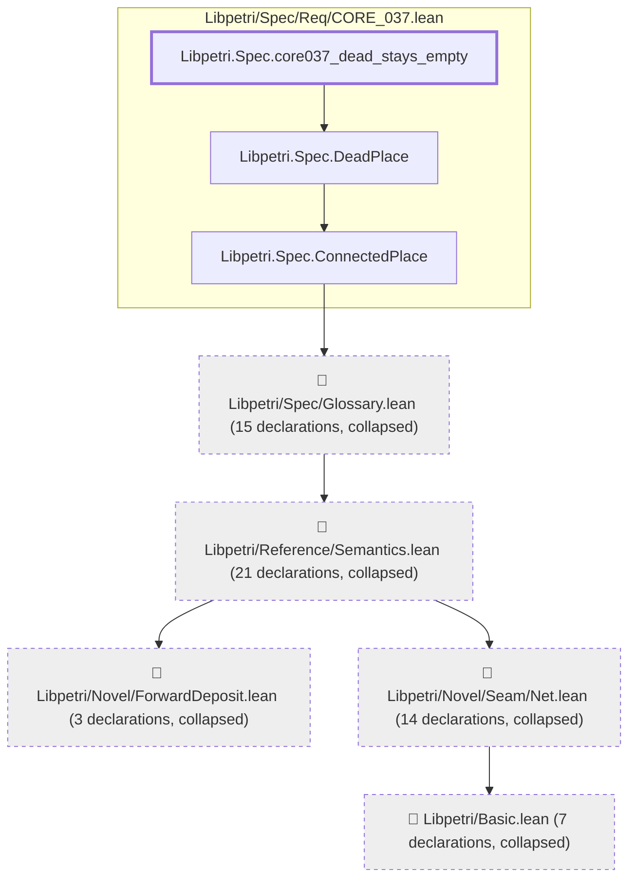

# CORE-037

Generated by `scripts/proof-graph.py` from `proof-graph.json`. Do not edit.

Theorems carrying this ID:

- `Libpetri.Spec.core037_deadInhibitor_never_blocks` (theorem, `Libpetri/Spec/Req/CORE_037.lean:323`)
- `Libpetri.Spec.core037_deadRead_never_enabled` (theorem, `Libpetri/Spec/Req/CORE_037.lean:312`)
- `Libpetri.Spec.core037_deadReset_clears_nothing` (theorem, `Libpetri/Spec/Req/CORE_037.lean:341`)
- `Libpetri.Spec.core037_dead_stays_empty` (theorem, `Libpetri/Spec/Req/CORE_037.lean:294`)

> **Note:** the full tree has 72 nodes (limit 60), so it is drawn as one diagram per theorem (4 theorems).

### `Libpetri.Spec.core037_deadInhibitor_never_blocks`

> Rule: this theorem's tree has 69 nodes (limit 60); every file other than its own is collapsed into one node, leaving 9.

### `Libpetri.Spec.core037_deadRead_never_enabled`

> Rule: this theorem's tree has 66 nodes (limit 60); every file other than its own is collapsed into one node, leaving 9.

### `Libpetri.Spec.core037_deadReset_clears_nothing`

> Rule: this theorem's tree has 64 nodes (limit 60); every file other than its own is collapsed into one node, leaving 9.

### `Libpetri.Spec.core037_dead_stays_empty`

> Rule: this theorem's tree has 63 nodes (limit 60); every file other than its own is collapsed into one node, leaving 8.

Axioms used:

- `Libpetri.Spec.core037_deadInhibitor_never_blocks`: `Quot.sound`, `propext`
- `Libpetri.Spec.core037_deadRead_never_enabled`: `Quot.sound`, `propext`
- `Libpetri.Spec.core037_deadReset_clears_nothing`: `Quot.sound`, `propext`
- `Libpetri.Spec.core037_dead_stays_empty`: `Quot.sound`, `propext`
