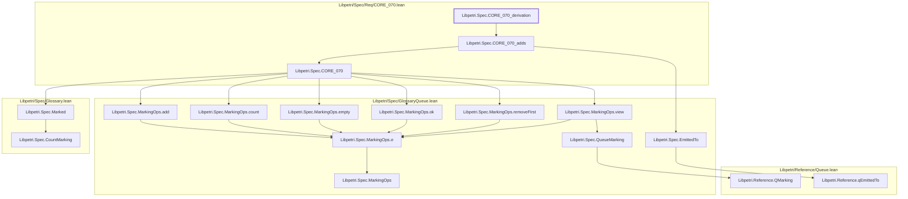
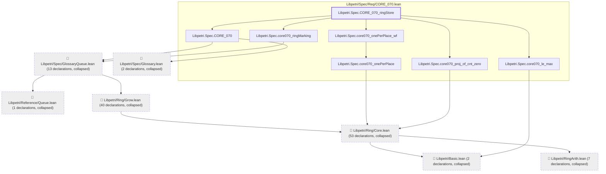

# CORE-070

Generated by `scripts/proof-graph.py` from `proof-graph.json`. Do not edit.

Theorems carrying this ID:

- `Libpetri.Spec.CORE_070_derivation` (theorem, `Libpetri/Spec/Req/CORE_070.lean:281`)
- `Libpetri.Spec.CORE_070_ringStore` (theorem, `Libpetri/Spec/Req/CORE_070.lean:357`)

> **Note:** the full tree has 129 nodes (limit 60), so it is drawn as one diagram per theorem (2 theorems).

### `Libpetri.Spec.CORE_070_derivation`

> Rule: this theorem's whole tree, 17 nodes.

### `Libpetri.Spec.CORE_070_ringStore`

> Rule: this theorem's tree has 125 nodes (limit 60); every file other than its own is collapsed into one node, leaving 14.

Axioms used:

- `Libpetri.Spec.CORE_070_derivation`: `Quot.sound`, `propext`
- `Libpetri.Spec.CORE_070_ringStore`: `Classical.choice`, `Quot.sound`, `propext`
