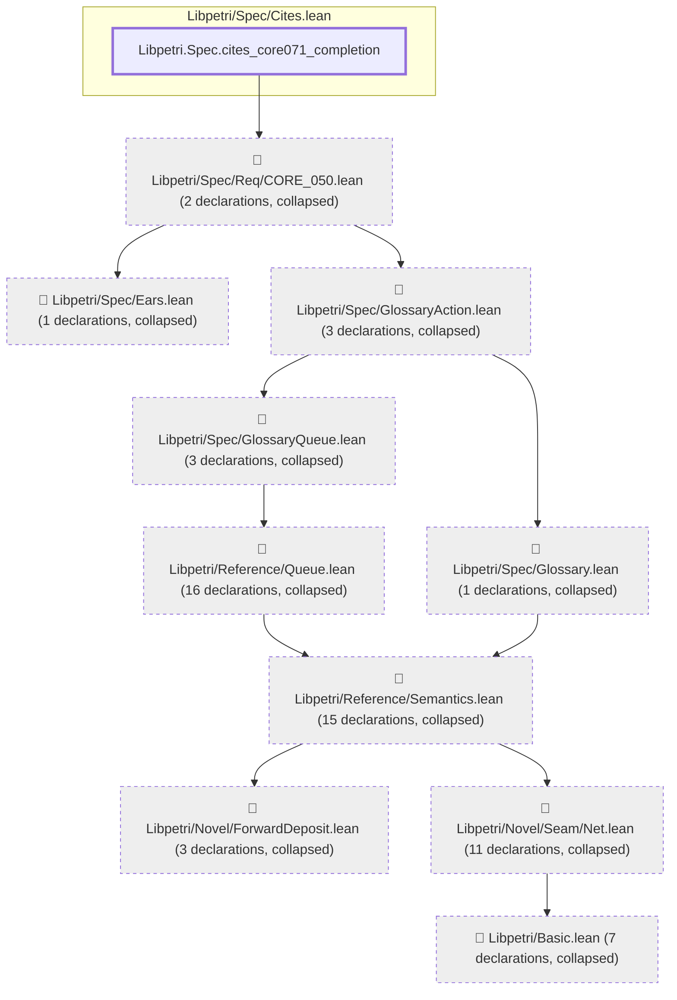
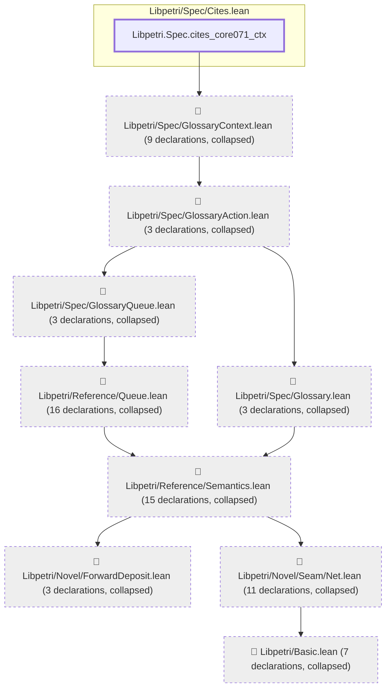

# CORE-071

Generated by `scripts/proof-graph.py` from `proof-graph.json`. Do not edit.

Theorems carrying this ID:

- `Libpetri.Spec.cites_core071_completion` (theorem, `Libpetri/Spec/Cites.lean:61`)
- `Libpetri.Spec.cites_core071_ctx` (theorem, `Libpetri/Spec/Cites.lean:50`)
- `Libpetri.Spec.env014_snapshot_frame` (theorem, `Libpetri/Spec/Req/ENV_014.lean:474`)

```mermaid
flowchart TD
  subgraph g0["Libpetri/Reference/Queue.lean"]
    n3114["Libpetri.Reference.QMarking"]
  end
  subgraph g1["Libpetri/Spec/Ears.lean"]
    n6949["Libpetri.Spec.StepShall"]
  end
  subgraph g2["Libpetri/Spec/GlossaryExec.lean"]
    n4830["Libpetri.Spec.Cause"]
    n4837["Libpetri.Spec.Cfg"]
    n6100["Libpetri.Spec.Firing"]
    n6522["Libpetri.Spec.Mode"]
    n6528["Libpetri.Spec.Mode.open"]
    n6774["Libpetri.Spec.Phase"]
    n6775["Libpetri.Spec.Phase.await"]
    n6776["Libpetri.Spec.Phase.completions"]
    n6777["Libpetri.Spec.Phase.deadline"]
    n6778["Libpetri.Spec.Phase.done"]
    n6779["Libpetri.Spec.Phase.events"]
    n6780["Libpetri.Spec.Phase.pass"]
    n6781["Libpetri.Spec.Phase.publications"]
    n6782["Libpetri.Spec.Phase.test"]
    n6783["Libpetri.Spec.Phase.update"]
    n7505["Libpetri.Spec.XLbl"]
    n7530["Libpetri.Spec.XLbl.snapshot"]
    n7554["Libpetri.Spec.XRel"]
    n7555["Libpetri.Spec.XRun"]
    n7557["Libpetri.Spec.XSt"]
    n7558["Libpetri.Spec.XSt.M"]
    n7562["Libpetri.Spec.XSt.eq"]
    n7563["Libpetri.Spec.XSt.fl"]
    n7565["Libpetri.Spec.XSt.mode"]
    n7570["Libpetri.Spec.XSt.phase"]
    n7571["Libpetri.Spec.XSt.pq"]
    n7574["Libpetri.Spec.XStep"]
    n11440["Libpetri.Spec.isExecPhase"]
  end
  subgraph g3["Libpetri/Spec/Req/ENV_014.lean"]
    n5070["Libpetri.Spec.ENV_014"]
    n9592["Libpetri.Spec.env014_snapshot_frame"]
  end
  n5070 --> n6528
  n5070 --> n6949
  n5070 --> n7530
  n5070 --> n7555
  n5070 --> n7562
  n5070 --> n7563
  n5070 --> n7565
  n5070 --> n7570
  n5070 --> n7571
  n5070 --> n11440
  n6528 --> n6522
  n6775 --> n6774
  n6776 --> n6774
  n6777 --> n6774
  n6778 --> n4830
  n6778 --> n6774
  n6779 --> n6774
  n6780 --> n6774
  n6781 --> n6774
  n6782 --> n6774
  n6783 --> n6774
  n7530 --> n7505
  n7554 --> n4837
  n7554 --> n7505
  n7554 --> n7557
  n7555 --> n7554
  n7555 --> n7574
  n7558 --> n3114
  n7558 --> n7557
  n7562 --> n7557
  n7563 --> n6100
  n7563 --> n7557
  n7565 --> n6522
  n7565 --> n7557
  n7570 --> n6774
  n7570 --> n7557
  n7571 --> n7557
  n7574 --> n7505
  n7574 --> n7557
  n9592 --> n5070
  n9592 --> n7558
  n11440 --> n6775
  n11440 --> n6776
  n11440 --> n6777
  n11440 --> n6778
  n11440 --> n6779
  n11440 --> n6780
  n11440 --> n6781
  n11440 --> n6782
  n11440 --> n6783
  classDef root stroke-width:3px
  classDef locked fill:#fff3cd,stroke:#b8860b
  classDef collapsed fill:#eeeeee,stroke-dasharray:4 4
  class n9592 root
```

> **Note:** the full tree has 105 nodes (limit 60), so it is drawn as one diagram per theorem (3 theorems).

### `Libpetri.Spec.cites_core071_completion`

> Rule: this theorem's tree has 63 nodes (limit 60); every file other than its own is collapsed into one node, leaving 11.

### `Libpetri.Spec.cites_core071_ctx`

> Rule: this theorem's tree has 71 nodes (limit 60); every file other than its own is collapsed into one node, leaving 10.

### `Libpetri.Spec.env014_snapshot_frame`

> Rule: this theorem's whole tree, 32 nodes.

Axioms used:

- `Libpetri.Spec.cites_core071_completion`: `propext`
- `Libpetri.Spec.cites_core071_ctx`: `Quot.sound`, `propext`
- `Libpetri.Spec.env014_snapshot_frame`: `propext`
