# ENV-001

Generated by `scripts/proof-graph.py` from `proof-graph.json`. Do not edit.

Theorems carrying this ID:

- `Libpetri.Spec.env002_registration_fixed` (theorem, `Libpetri/Spec/Req/ENV_002.lean:214`)

```mermaid
flowchart TD
  subgraph g0["Libpetri/Spec/GlossaryExec.lean"]
    n4830["Libpetri.Spec.Cause"]
    n4837["Libpetri.Spec.Cfg"]
    n4846["Libpetri.Spec.Cfg.envs"]
    n6522["Libpetri.Spec.Mode"]
    n6523["Libpetri.Spec.Mode.closed"]
    n6525["Libpetri.Spec.Mode.draining"]
    n6526["Libpetri.Spec.Mode.ofNat"]
    n6527["Libpetri.Spec.Mode.ofNat_ctorIdx"]
    n6528["Libpetri.Spec.Mode.open"]
    n6529["Libpetri.Spec.Mode.stopped"]
    n6774["Libpetri.Spec.Phase"]
    n6775["Libpetri.Spec.Phase.await"]
    n6776["Libpetri.Spec.Phase.completions"]
    n6777["Libpetri.Spec.Phase.deadline"]
    n6778["Libpetri.Spec.Phase.done"]
    n6779["Libpetri.Spec.Phase.events"]
    n6780["Libpetri.Spec.Phase.pass"]
    n6781["Libpetri.Spec.Phase.publications"]
    n6782["Libpetri.Spec.Phase.test"]
    n6783["Libpetri.Spec.Phase.update"]
    n6884["Libpetri.Spec.Reply"]
    n6885["Libpetri.Spec.Reply.accepted"]
    n6886["Libpetri.Spec.Reply.error"]
    n6887["Libpetri.Spec.Reply.ofNat"]
    n6888["Libpetri.Spec.Reply.ofNat_ctorIdx"]
    n6889["Libpetri.Spec.Reply.refused"]
    n7557["Libpetri.Spec.XSt"]
    n7565["Libpetri.Spec.XSt.mode"]
    n7570["Libpetri.Spec.XSt.phase"]
    n11058["Libpetri.Spec.instDecidableEqMode"]
    n11065["Libpetri.Spec.instDecidableEqReply"]
    n11440["Libpetri.Spec.isExecPhase"]
    n12113["Libpetri.Spec.replyFor"]
  end
  subgraph g1["Libpetri/Spec/Req/ENV_002.lean"]
    n9245["Libpetri.Spec.env002_registration_fixed"]
    n9246["Libpetri.Spec.env002_replyFor_reg"]
    n9247["Libpetri.Spec.env002_replyFor_unreg"]
  end
  n4846 --> n4837
  n6523 --> n6522
  n6525 --> n6522
  n6526 --> n6523
  n6526 --> n6525
  n6526 --> n6528
  n6526 --> n6529
  n6527 --> n6526
  n6528 --> n6522
  n6529 --> n6522
  n6775 --> n6774
  n6776 --> n6774
  n6777 --> n6774
  n6778 --> n4830
  n6778 --> n6774
  n6779 --> n6774
  n6780 --> n6774
  n6781 --> n6774
  n6782 --> n6774
  n6783 --> n6774
  n6885 --> n6884
  n6886 --> n6884
  n6887 --> n6885
  n6887 --> n6886
  n6887 --> n6889
  n6888 --> n6887
  n6889 --> n6884
  n7565 --> n6522
  n7565 --> n7557
  n7570 --> n6774
  n7570 --> n7557
  n9245 --> n9246
  n9245 --> n9247
  n9246 --> n11065
  n9246 --> n12113
  n9247 --> n12113
  n11058 --> n6527
  n11065 --> n6888
  n11440 --> n6775
  n11440 --> n6776
  n11440 --> n6777
  n11440 --> n6778
  n11440 --> n6779
  n11440 --> n6780
  n11440 --> n6781
  n11440 --> n6782
  n11440 --> n6783
  n12113 --> n4846
  n12113 --> n6885
  n12113 --> n6886
  n12113 --> n6889
  n12113 --> n7565
  n12113 --> n7570
  n12113 --> n11058
  n12113 --> n11440
  classDef root stroke-width:3px
  classDef locked fill:#fff3cd,stroke:#b8860b
  classDef collapsed fill:#eeeeee,stroke-dasharray:4 4
  class n9245 root
```

Axioms used:

- `Libpetri.Spec.env002_registration_fixed`: `propext`
