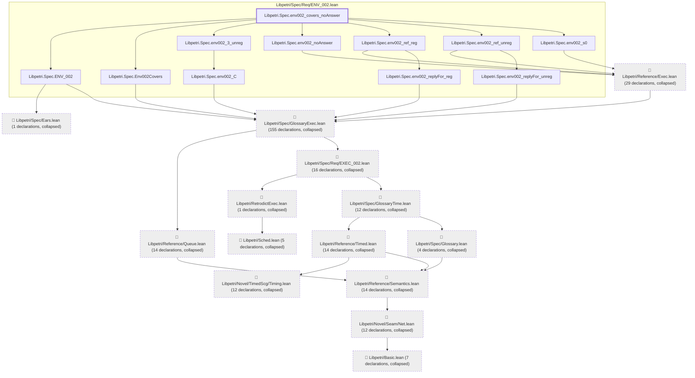
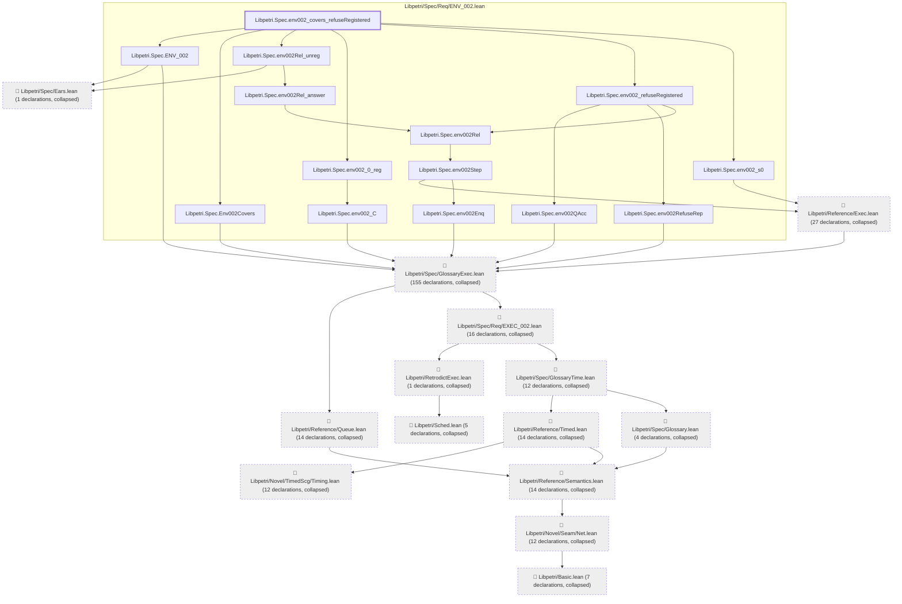
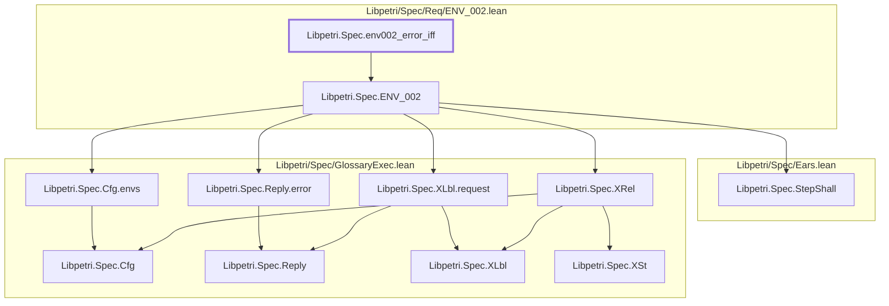
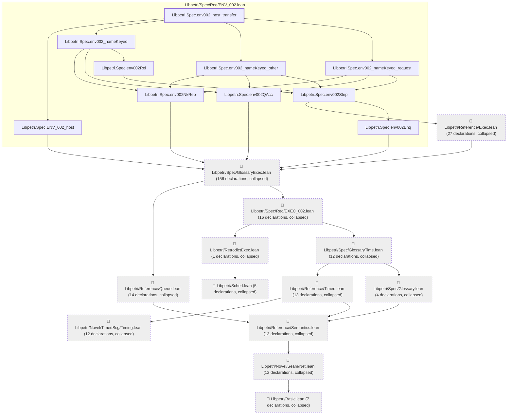
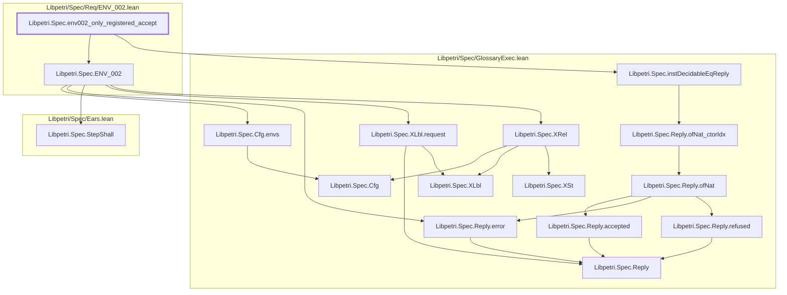

# ENV-002

Generated by `scripts/proof-graph.py` from `proof-graph.json`. Do not edit.

Theorems carrying this ID:

- `Libpetri.Spec.env002_covers_noAnswer` (theorem, `Libpetri/Spec/Req/ENV_002.lean:419`)
- `Libpetri.Spec.env002_covers_refuseRegistered` (theorem, `Libpetri/Spec/Req/ENV_002.lean:452`)
- `Libpetri.Spec.env002_error_iff` (theorem, `Libpetri/Spec/Req/ENV_002.lean:205`)
- `Libpetri.Spec.env002_host_transfer` (theorem, `Libpetri/Spec/Req/ENV_002.lean:568`)
- `Libpetri.Spec.env002_only_registered_accept` (theorem, `Libpetri/Spec/Req/ENV_002.lean:196`)

> **Note:** the full tree has 327 nodes (limit 60), so it is drawn as one diagram per theorem (5 theorems).

### `Libpetri.Spec.env002_covers_noAnswer`

> Rule: this theorem's tree has 307 nodes (limit 60); every file other than its own is collapsed into one node, leaving 25.

### `Libpetri.Spec.env002_covers_refuseRegistered`

> Rule: this theorem's tree has 308 nodes (limit 60); every file other than its own is collapsed into one node, leaving 28.

### `Libpetri.Spec.env002_error_iff`

> Rule: this theorem's whole tree, 11 nodes.

### `Libpetri.Spec.env002_host_transfer`

> Rule: this theorem's tree has 302 nodes (limit 60); every file other than its own is collapsed into one node, leaving 23.

### `Libpetri.Spec.env002_only_registered_accept`

> Rule: this theorem's whole tree, 16 nodes.

Axioms used:

- `Libpetri.Spec.env002_covers_noAnswer`: `Quot.sound`, `propext`
- `Libpetri.Spec.env002_covers_refuseRegistered`: `Quot.sound`, `propext`
- `Libpetri.Spec.env002_error_iff`: none
- `Libpetri.Spec.env002_host_transfer`: `Classical.choice`, `Quot.sound`, `propext`
- `Libpetri.Spec.env002_only_registered_accept`: `propext`
