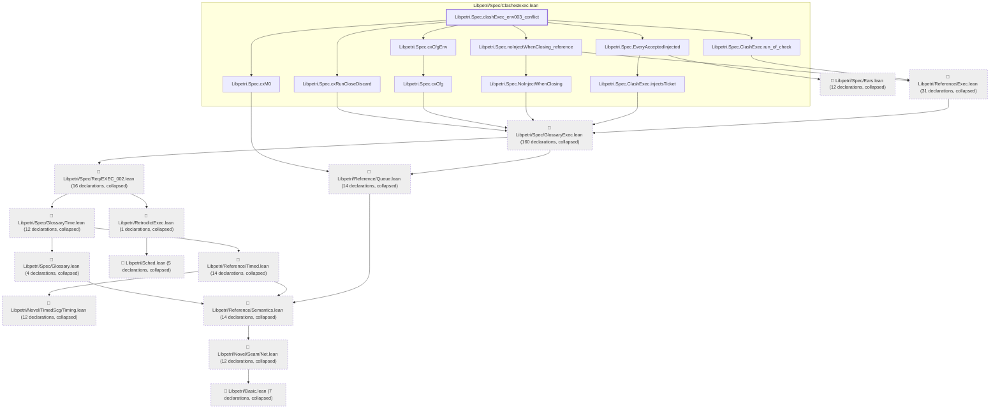

# ENV-003

Generated by `scripts/proof-graph.py` from `proof-graph.json`. Do not edit.

Theorems carrying this ID:

- `Libpetri.Spec.clashExec_env003_conflict` (theorem, `Libpetri/Spec/ClashesExec.lean:452`)
- `Libpetri.Spec.env003_covers_noInject` (theorem, `Libpetri/Spec/Req/ENV_003.lean:1003`)

> **Note:** the full tree has 383 nodes (limit 60), so it is drawn as one diagram per theorem (2 theorems).

### `Libpetri.Spec.clashExec_env003_conflict`

> Rule: this theorem's tree has 324 nodes (limit 60); every file other than its own is collapsed into one node, leaving 24.

### `Libpetri.Spec.env003_covers_noInject`

> Rule: this theorem's tree has 368 nodes (limit 60); every file other than its own is collapsed into one node, leaving 38.

```mermaid
flowchart TD
  subgraph g0["Libpetri/Spec/Req/ENV_003.lean"]
    n4989["Libpetri.Spec.ENV_003"]
    n5005["Libpetri.Spec.ENV_003_reference"]
    n5760["Libpetri.Spec.Env003.Pending"]
    n5761["Libpetri.Spec.Env003.accept_pending"]
    n5762["Libpetri.Spec.Env003.accepts"]
    n5763["Libpetri.Spec.Env003.drops"]
    n5764["Libpetri.Spec.Env003.dropsQueue"]
    n5765["Libpetri.Spec.Env003.exec_awaitOr"]
    n5766["Libpetri.Spec.Env003.frame"]
    n5768["Libpetri.Spec.Env003.keepsQueue"]
    n5769["Libpetri.Spec.Env003.last_cons"]
    n5771["Libpetri.Spec.Env003.pending_step"]
    n5772["Libpetri.Spec.Env003.scan_ok"]
    n5773["Libpetri.Spec.Env003.serves"]
    n5775["Libpetri.Spec.Env003.supply"]
    n5776["Libpetri.Spec.Env003Covers"]
    n9255["Libpetri.Spec.env003_c"]
    n9259["Libpetri.Spec.env003_covers_noInject"]
    n9274["Libpetri.Spec.env003_noInject"]
    n9275["Libpetri.Spec.env003_noInjectStep"]
    n9276["Libpetri.Spec.env003_noInject_sub"]
    n9280["Libpetri.Spec.env003_of_sub"]
    n9293["Libpetri.Spec.env003_run_sub"]
    n9294["Libpetri.Spec.env003_s0"]
  end
  c0["📁 Libpetri/Basic.lean (7 declarations, collapsed)"]
  c54["📁 Libpetri/Novel/Seam/Net.lean (12 declarations, collapsed)"]
  c66["📁 Libpetri/Novel/TimedScg/Timing.lean (12 declarations, collapsed)"]
  c74["📁 Libpetri/Reference/Exec.lean (61 declarations, collapsed)"]
  c80["📁 Libpetri/Reference/Queue.lean (14 declarations, collapsed)"]
  c83["📁 Libpetri/Reference/Semantics.lean (14 declarations, collapsed)"]
  c87["📁 Libpetri/Reference/Timed.lean (14 declarations, collapsed)"]
  c92["📁 Libpetri/RetrodictExec.lean (1 declarations, collapsed)"]
  c98["📁 Libpetri/Sched.lean (5 declarations, collapsed)"]
  c114["📁 Libpetri/Spec/Ears.lean (12 declarations, collapsed)"]
  c115["📁 Libpetri/Spec/Glossary.lean (4 declarations, collapsed)"]
  c120["📁 Libpetri/Spec/GlossaryExec.lean (160 declarations, collapsed)"]
  c126["📁 Libpetri/Spec/GlossaryTime.lean (12 declarations, collapsed)"]
  c194["📁 Libpetri/Spec/Req/EXEC_002.lean (16 declarations, collapsed)"]
  c54 --> c0
  c74 --> c120
  c80 --> c83
  c83 --> c54
  c87 --> c66
  c87 --> c83
  c92 --> c98
  c115 --> c83
  c120 --> c80
  c120 --> c194
  c126 --> c87
  c126 --> c115
  c194 --> c92
  c194 --> c126
  n4989 --> c114
  n4989 --> n5762
  n4989 --> n5764
  n4989 --> n5768
  n4989 --> n5773
  n5005 --> n4989
  n5005 --> n5763
  n5005 --> n5766
  n5005 --> n5772
  n5005 --> n5775
  n5760 --> c120
  n5761 --> c74
  n5761 --> n5760
  n5761 --> n5762
  n5762 --> c120
  n5763 --> c74
  n5763 --> n5764
  n5764 --> c120
  n5765 --> c120
  n5766 --> c74
  n5766 --> n5768
  n5768 --> c120
  n5769 --> c120
  n5771 --> c74
  n5771 --> n5760
  n5771 --> n5765
  n5771 --> n5773
  n5772 --> c114
  n5772 --> n5761
  n5772 --> n5769
  n5772 --> n5771
  n5773 --> c120
  n5775 --> c74
  n5776 --> c120
  n9255 --> c120
  n9259 --> n5776
  n9259 --> n9255
  n9259 --> n9276
  n9259 --> n9280
  n9259 --> n9294
  n9274 --> n9275
  n9275 --> c74
  n9276 --> n9274
  n9280 --> n5005
  n9280 --> n9293
  n9293 --> c120
  n9294 --> c74
  classDef root stroke-width:3px
  classDef locked fill:#fff3cd,stroke:#b8860b
  classDef collapsed fill:#eeeeee,stroke-dasharray:4 4
  class n9259 root
  class c0,c54,c66,c74,c80,c83,c87,c92,c98,c114,c115,c120,c126,c194 collapsed
```

Axioms used:

- `Libpetri.Spec.clashExec_env003_conflict`: `Quot.sound`, `propext`
- `Libpetri.Spec.env003_covers_noInject`: `Quot.sound`, `propext`
