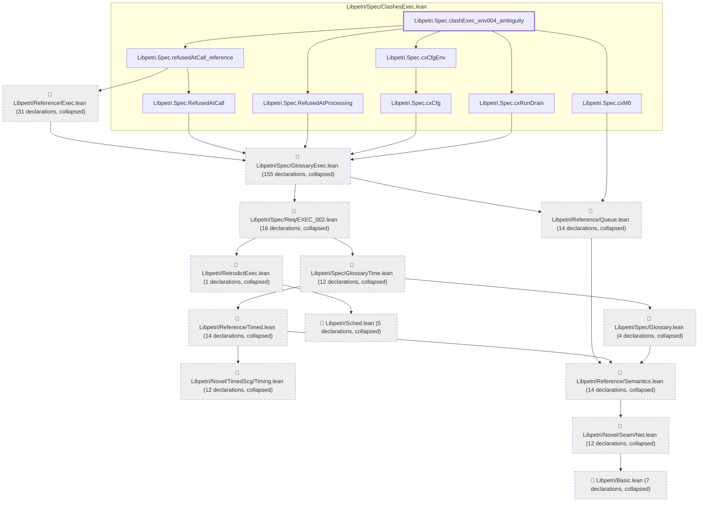

# ENV-004

Generated by `scripts/proof-graph.py` from `proof-graph.json`. Do not edit.

Theorems carrying this ID:

- `Libpetri.Spec.clashExec_env004_ambiguity` (theorem, `Libpetri/Spec/ClashesExec.lean:414`)

> **Note:** the full tree has 305 nodes (limit 60).

> Rule: this theorem's tree has 305 nodes (limit 60); every file other than its own is collapsed into one node, leaving 21.

Axioms used:

- `Libpetri.Spec.clashExec_env004_ambiguity`: `Quot.sound`, `propext`
