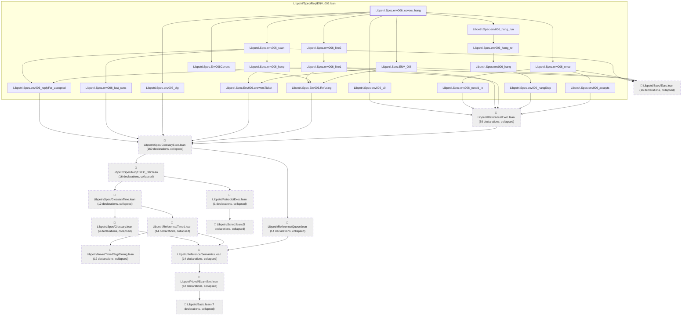

# ENV-006

Generated by `scripts/proof-graph.py` from `proof-graph.json`. Do not edit.

Theorems carrying this ID:

- `Libpetri.Spec.env006_covers_hang` (theorem, `Libpetri/Spec/Req/ENV_006.lean:691`)

> **Note:** the full tree has 366 nodes (limit 60).

> Rule: this theorem's tree has 366 nodes (limit 60); every file other than its own is collapsed into one node, leaving 34.

Axioms used:

- `Libpetri.Spec.env006_covers_hang`: `Quot.sound`, `propext`
