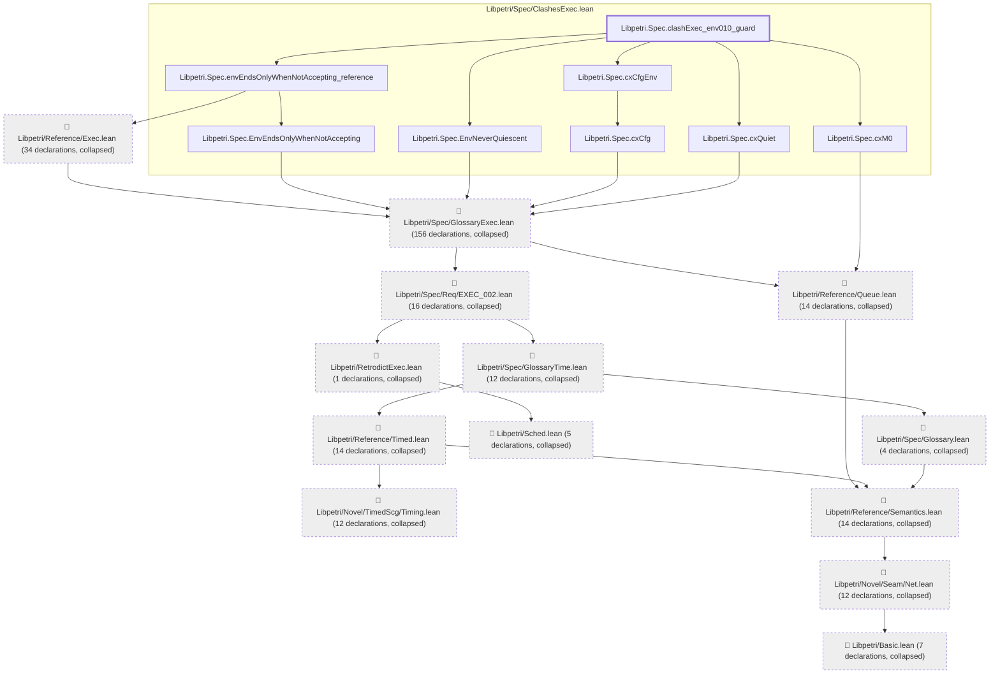
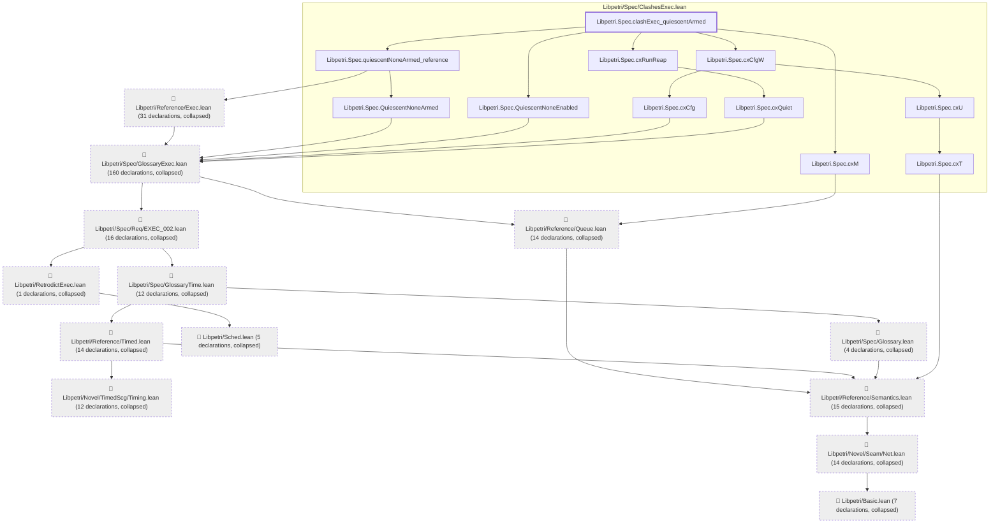
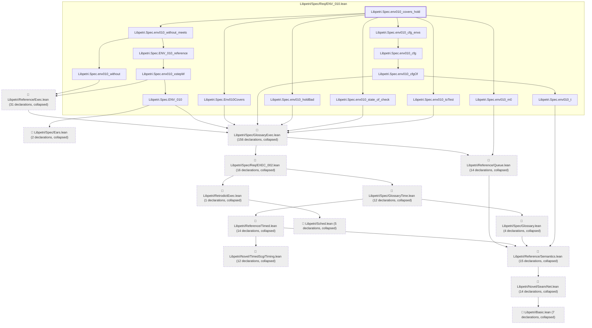
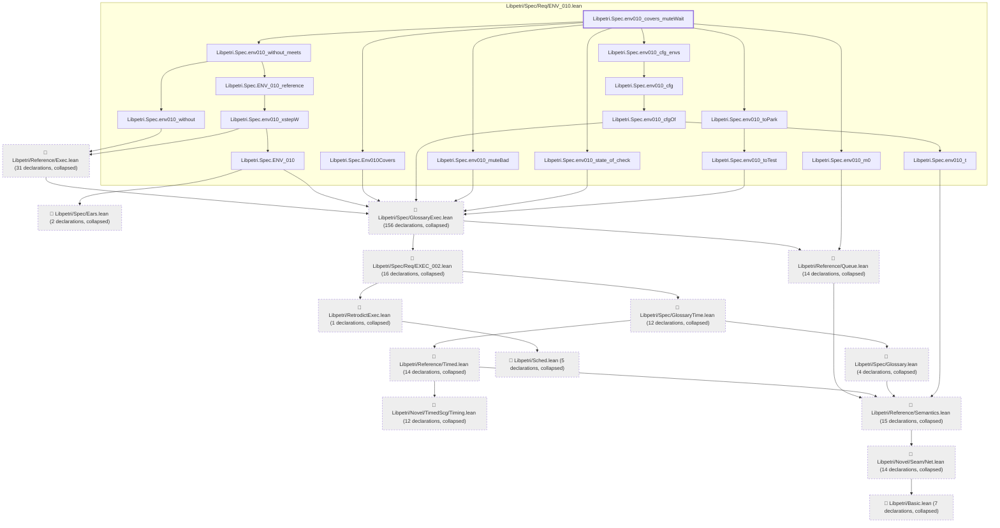
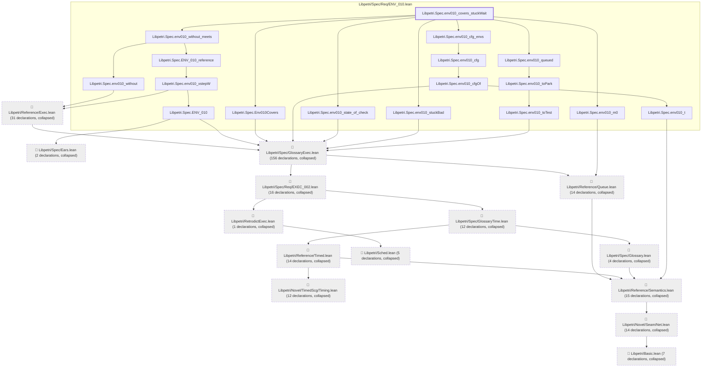

# ENV-010

Generated by `scripts/proof-graph.py` from `proof-graph.json`. Do not edit.

Theorems carrying this ID:

- `Libpetri.Spec.clashExec_env010_guard` (theorem, `Libpetri/Spec/ClashesExec.lean:551`)
- `Libpetri.Spec.clashExec_quiescentArmed` (theorem, `Libpetri/Spec/ClashesExec.lean:496`)
- `Libpetri.Spec.env010_covers_hold` (theorem, `Libpetri/Spec/Req/ENV_010.lean:402`)
- `Libpetri.Spec.env010_covers_muteWait` (theorem, `Libpetri/Spec/Req/ENV_010.lean:383`)
- `Libpetri.Spec.env010_covers_noInject` (theorem, `Libpetri/Spec/Req/ENV_010.lean:420`)
- `Libpetri.Spec.env010_covers_stuckWait` (theorem, `Libpetri/Spec/Req/ENV_010.lean:438`)

> **Note:** the full tree has 353 nodes (limit 60), so it is drawn as one diagram per theorem (6 theorems).

### `Libpetri.Spec.clashExec_env010_guard`

> Rule: this theorem's tree has 309 nodes (limit 60); every file other than its own is collapsed into one node, leaving 21.

### `Libpetri.Spec.clashExec_quiescentArmed`

> Rule: this theorem's tree has 316 nodes (limit 60); every file other than its own is collapsed into one node, leaving 24.

### `Libpetri.Spec.env010_covers_hold`

> Rule: this theorem's tree has 318 nodes (limit 60); every file other than its own is collapsed into one node, leaving 29.

### `Libpetri.Spec.env010_covers_muteWait`

> Rule: this theorem's tree has 319 nodes (limit 60); every file other than its own is collapsed into one node, leaving 30.

### `Libpetri.Spec.env010_covers_noInject`

> Rule: this theorem's tree has 321 nodes (limit 60); every file other than its own is collapsed into one node, leaving 32.

### `Libpetri.Spec.env010_covers_stuckWait`

> Rule: this theorem's tree has 320 nodes (limit 60); every file other than its own is collapsed into one node, leaving 31.

Axioms used:

- `Libpetri.Spec.clashExec_env010_guard`: `Quot.sound`, `propext`
- `Libpetri.Spec.clashExec_quiescentArmed`: `Quot.sound`, `propext`
- `Libpetri.Spec.env010_covers_hold`: `Quot.sound`, `propext`
- `Libpetri.Spec.env010_covers_muteWait`: `Quot.sound`, `propext`
- `Libpetri.Spec.env010_covers_noInject`: `Quot.sound`, `propext`
- `Libpetri.Spec.env010_covers_stuckWait`: `Quot.sound`, `propext`
