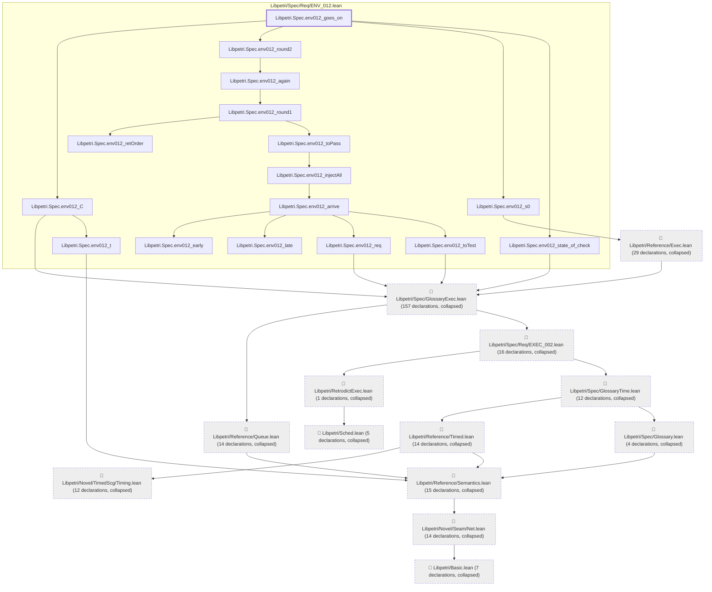
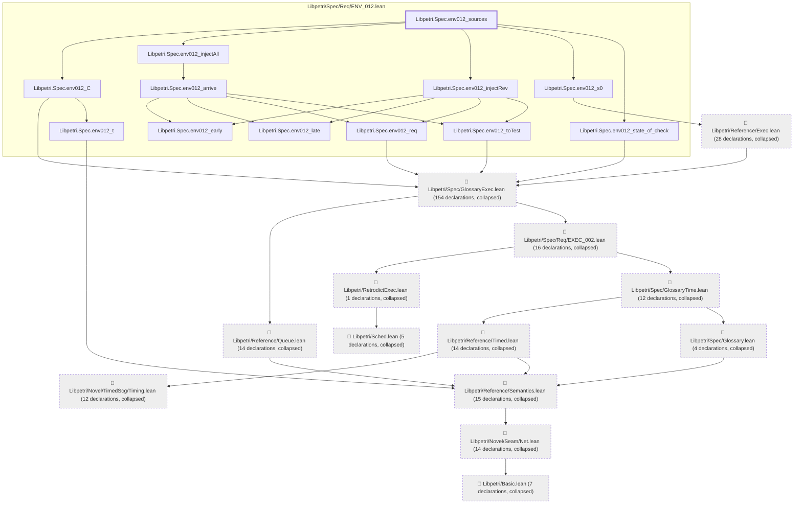
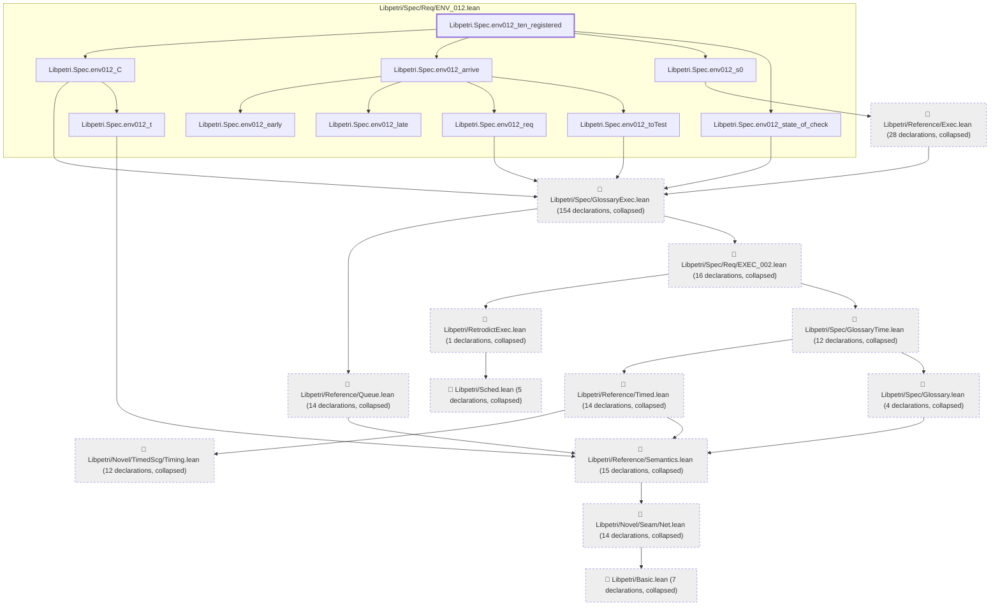

# ENV-012

Generated by `scripts/proof-graph.py` from `proof-graph.json`. Do not edit.

Theorems carrying this ID:

- `Libpetri.Spec.env012_goes_on` (theorem, `Libpetri/Spec/Req/ENV_012.lean:310`)
- `Libpetri.Spec.env012_reacts` (theorem, `Libpetri/Spec/Req/ENV_012.lean:228`)
- `Libpetri.Spec.env012_sources` (theorem, `Libpetri/Spec/Req/ENV_012.lean:200`)
- `Libpetri.Spec.env012_ten_registered` (theorem, `Libpetri/Spec/Req/ENV_012.lean:176`)

> **Note:** the full tree has 320 nodes (limit 60), so it is drawn as one diagram per theorem (4 theorems).

### `Libpetri.Spec.env012_goes_on`

> Rule: this theorem's tree has 316 nodes (limit 60); every file other than its own is collapsed into one node, leaving 29.

### `Libpetri.Spec.env012_reacts`

> Rule: this theorem's tree has 312 nodes (limit 60); every file other than its own is collapsed into one node, leaving 29.

### `Libpetri.Spec.env012_sources`

> Rule: this theorem's tree has 308 nodes (limit 60); every file other than its own is collapsed into one node, leaving 25.

### `Libpetri.Spec.env012_ten_registered`

> Rule: this theorem's tree has 306 nodes (limit 60); every file other than its own is collapsed into one node, leaving 23.

Axioms used:

- `Libpetri.Spec.env012_goes_on`: `Quot.sound`, `propext`
- `Libpetri.Spec.env012_reacts`: `Quot.sound`, `propext`
- `Libpetri.Spec.env012_sources`: `Quot.sound`, `propext`
- `Libpetri.Spec.env012_ten_registered`: `Quot.sound`, `propext`
