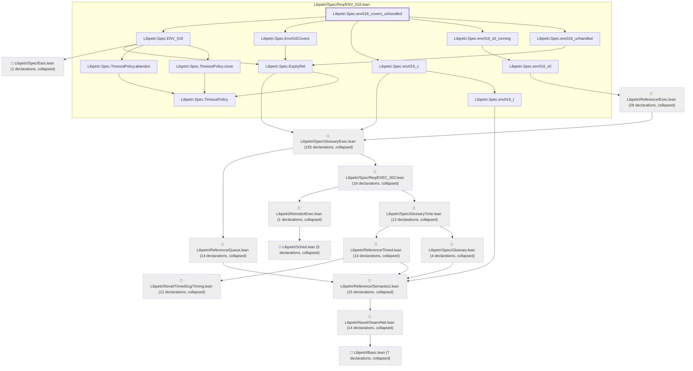

# ENV-016

Generated by `scripts/proof-graph.py` from `proof-graph.json`. Do not edit.

Theorems carrying this ID:

- `Libpetri.Spec.env016_covers_unhandled` (theorem, `Libpetri/Spec/Req/ENV_016.lean:228`)

> **Note:** the full tree has 310 nodes (limit 60).

> Rule: this theorem's tree has 310 nodes (limit 60); every file other than its own is collapsed into one node, leaving 26.

Axioms used:

- `Libpetri.Spec.env016_covers_unhandled`: `Quot.sound`, `propext`
