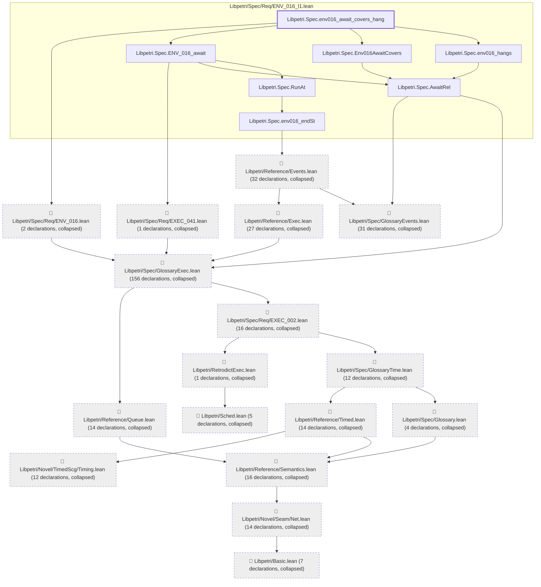
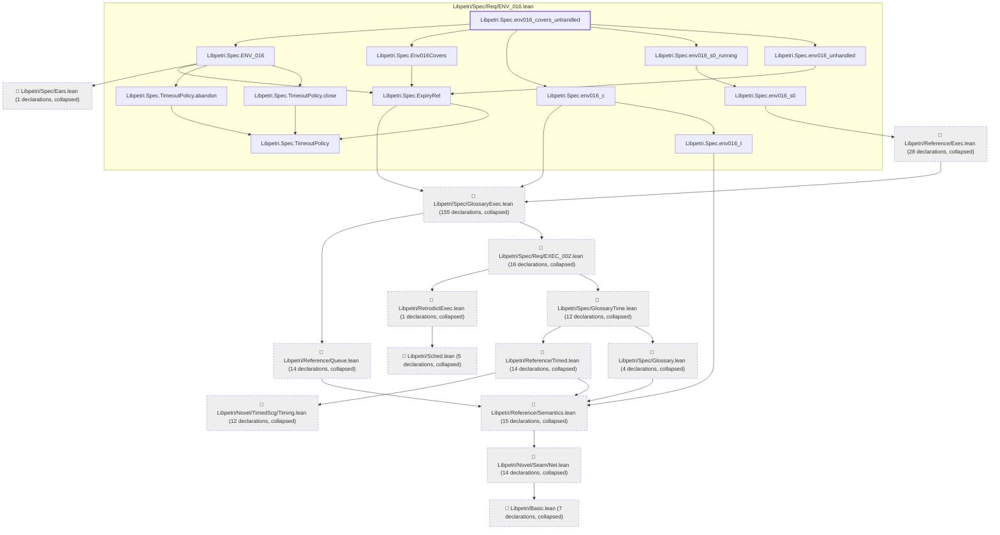

# ENV-016

Generated by `scripts/proof-graph.py` from `proof-graph.json`. Do not edit.

Theorems carrying this ID:

- `Libpetri.Spec.env016_await_covers_hang` (theorem, `Libpetri/Spec/Req/ENV_016_l1.lean:867`)
- `Libpetri.Spec.env016_covers_unhandled` (theorem, `Libpetri/Spec/Req/ENV_016.lean:224`)

> **Note:** the full tree has 384 nodes (limit 60), so it is drawn as one diagram per theorem (2 theorems).

### `Libpetri.Spec.env016_await_covers_hang`

> Rule: this theorem's tree has 371 nodes (limit 60); every file other than its own is collapsed into one node, leaving 24.

### `Libpetri.Spec.env016_covers_unhandled`

> Rule: this theorem's tree has 310 nodes (limit 60); every file other than its own is collapsed into one node, leaving 26.

Axioms used:

- `Libpetri.Spec.env016_await_covers_hang`: `Quot.sound`, `propext`
- `Libpetri.Spec.env016_covers_unhandled`: `Quot.sound`, `propext`
