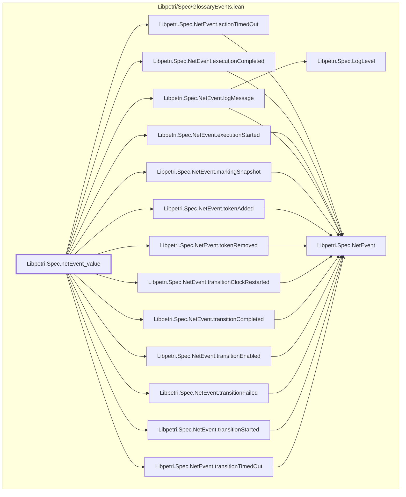

# EVT-001

Generated by `scripts/proof-graph.py` from `proof-graph.json`. Do not edit.

Theorems carrying this ID:

- `Libpetri.Spec.netEvent_value` (theorem, `Libpetri/Spec/GlossaryEvents.lean:342`)

Axioms used:

- `Libpetri.Spec.netEvent_value`: `propext`
