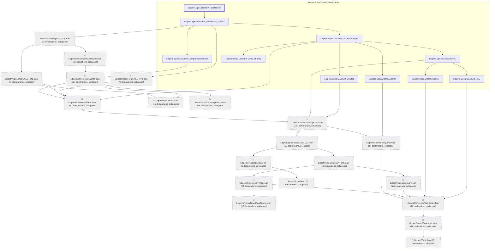
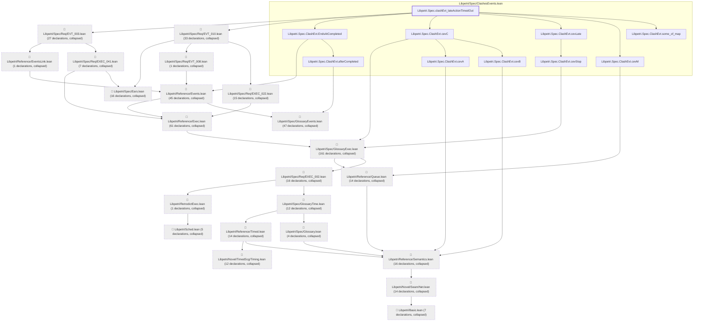

# EVT-003

Generated by `scripts/proof-graph.py` from `proof-graph.json`. Do not edit.

Theorems carrying this ID:

- `Libpetri.Spec.clashEvt_endMarker` (theorem, `Libpetri/Spec/ClashesEvents.lean:254`)
- `Libpetri.Spec.clashEvt_lateActionTimedOut` (theorem, `Libpetri/Spec/ClashesEvents.lean:303`)

> **Note:** the full tree has 553 nodes (limit 60), so it is drawn as one diagram per theorem (2 theorems).

### `Libpetri.Spec.clashEvt_endMarker`

> Rule: this theorem's tree has 478 nodes (limit 60); every file other than its own is collapsed into one node, leaving 30.

### `Libpetri.Spec.clashEvt_lateActionTimedOut`

> Rule: this theorem's tree has 539 nodes (limit 60); every file other than its own is collapsed into one node, leaving 32.

Axioms used:

- `Libpetri.Spec.clashEvt_endMarker`: `Classical.choice`, `Quot.sound`, `propext`
- `Libpetri.Spec.clashEvt_lateActionTimedOut`: `Classical.choice`, `Quot.sound`, `propext`
