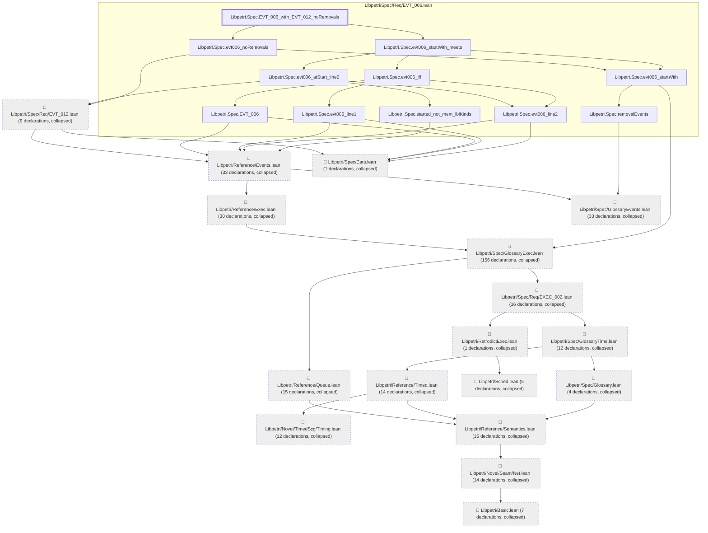

# EVT-006

Generated by `scripts/proof-graph.py` from `proof-graph.json`. Do not edit.

Theorems carrying this ID:

- `Libpetri.Spec.EVT_006_with_EVT_012_noRemovals` (theorem, `Libpetri/Spec/Req/EVT_006.lean:830`)
- `Libpetri.Spec.evt006_payload_matches` (theorem, `Libpetri/Spec/Req/EVT_006.lean:207`)

> **Note:** the full tree has 396 nodes (limit 60), so it is drawn as one diagram per theorem (2 theorems).

### `Libpetri.Spec.EVT_006_with_EVT_012_noRemovals`

> Rule: this theorem's tree has 389 nodes (limit 60); every file other than its own is collapsed into one node, leaving 28.

### `Libpetri.Spec.evt006_payload_matches`

> Rule: this theorem's whole tree, 33 nodes.

```mermaid
flowchart TD
  subgraph g0["Libpetri/Reference/Events.lean"]
    n7228["Libpetri.Spec.EvExec"]
    n7232["Libpetri.Spec.EvExec.step"]
    n12028["Libpetri.Spec.XEvRel"]
  end
  subgraph g1["Libpetri/Reference/Queue.lean"]
    n3335["Libpetri.Reference.QMarking"]
    n4202["Libpetri.Reference.qEmittedTo"]
  end
  subgraph g2["Libpetri/Spec/Ears.lean"]
    n9910["Libpetri.Spec.StepShall"]
  end
  subgraph g3["Libpetri/Spec/GlossaryEvents.lean"]
    n7947["Libpetri.Spec.LogLevel"]
    n9105["Libpetri.Spec.NetEvent"]
    n9106["Libpetri.Spec.NetEvent.actionTimedOut"]
    n9110["Libpetri.Spec.NetEvent.executionCompleted"]
    n9111["Libpetri.Spec.NetEvent.executionStarted"]
    n9115["Libpetri.Spec.NetEvent.logMessage"]
    n9116["Libpetri.Spec.NetEvent.markingSnapshot"]
    n9127["Libpetri.Spec.NetEvent.tokenAdded"]
    n9128["Libpetri.Spec.NetEvent.tokenRemoved"]
    n9130["Libpetri.Spec.NetEvent.transitionClockRestarted"]
    n9131["Libpetri.Spec.NetEvent.transitionCompleted"]
    n9132["Libpetri.Spec.NetEvent.transitionEnabled"]
    n9133["Libpetri.Spec.NetEvent.transitionFailed"]
    n9134["Libpetri.Spec.NetEvent.transitionStarted"]
    n9135["Libpetri.Spec.NetEvent.transitionTimedOut"]
    n20037["Libpetri.Spec.removedAt"]
    n20039["Libpetri.Spec.removedAt_append"]
  end
  subgraph g4["Libpetri/Spec/GlossaryExec.lean"]
    n5874["Libpetri.Spec.Cfg"]
    n12038["Libpetri.Spec.XLbl"]
    n12064["Libpetri.Spec.XLbl.start"]
    n12090["Libpetri.Spec.XSt"]
    n12091["Libpetri.Spec.XSt.M"]
  end
  subgraph g5["Libpetri/Spec/Req/EVT_006.lean"]
    n14869["Libpetri.Spec.evt006_payload_line1"]
    n14870["Libpetri.Spec.evt006_payload_matches"]
    n20030["Libpetri.Spec.removalEvents"]
    n20043["Libpetri.Spec.removedAt_removalEvents"]
  end
  subgraph g6["Libpetri/Spec/Req/EVT_012.lean"]
    n6418["Libpetri.Spec.EVT_012_payload"]
  end
  n6418 --> n7232
  n6418 --> n9910
  n6418 --> n12064
  n6418 --> n12091
  n6418 --> n20037
  n7232 --> n7228
  n7232 --> n12028
  n9106 --> n9105
  n9110 --> n9105
  n9111 --> n9105
  n9115 --> n7947
  n9115 --> n9105
  n9116 --> n9105
  n9127 --> n9105
  n9128 --> n9105
  n9130 --> n9105
  n9131 --> n9105
  n9132 --> n9105
  n9133 --> n9105
  n9134 --> n9105
  n9135 --> n9105
  n12028 --> n5874
  n12028 --> n9105
  n12028 --> n12038
  n12028 --> n12090
  n12064 --> n12038
  n12091 --> n3335
  n12091 --> n12090
  n14869 --> n7232
  n14869 --> n9134
  n14869 --> n9910
  n14869 --> n12064
  n14869 --> n20030
  n14870 --> n6418
  n14870 --> n14869
  n14870 --> n20039
  n14870 --> n20043
  n20030 --> n9128
  n20037 --> n9106
  n20037 --> n9110
  n20037 --> n9111
  n20037 --> n9115
  n20037 --> n9116
  n20037 --> n9127
  n20037 --> n9128
  n20037 --> n9130
  n20037 --> n9131
  n20037 --> n9132
  n20037 --> n9133
  n20037 --> n9134
  n20037 --> n9135
  n20039 --> n20037
  n20043 --> n4202
  n20043 --> n20030
  n20043 --> n20037
  classDef root stroke-width:3px
  classDef locked fill:#fff3cd,stroke:#b8860b
  classDef collapsed fill:#eeeeee,stroke-dasharray:4 4
  class n14870 root
```

Axioms used:

- `Libpetri.Spec.EVT_006_with_EVT_012_noRemovals`: `Quot.sound`, `propext`
- `Libpetri.Spec.evt006_payload_matches`: `propext`
