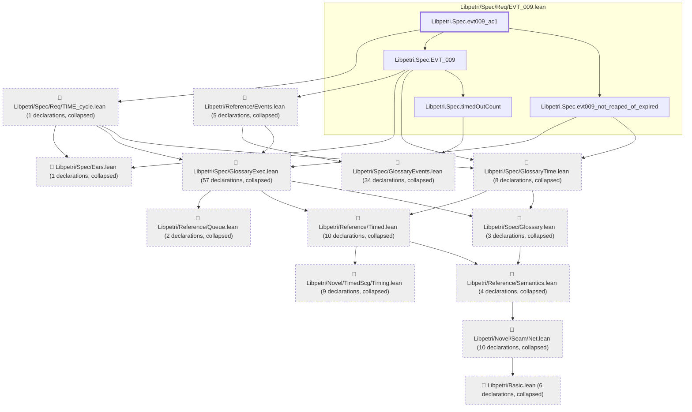
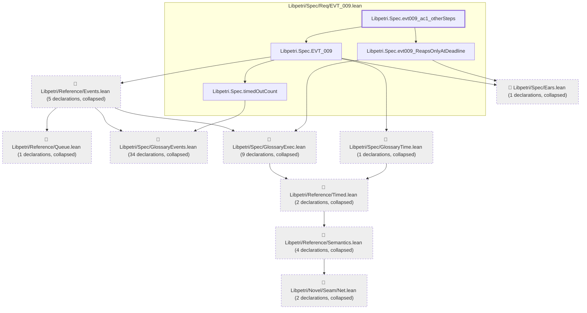
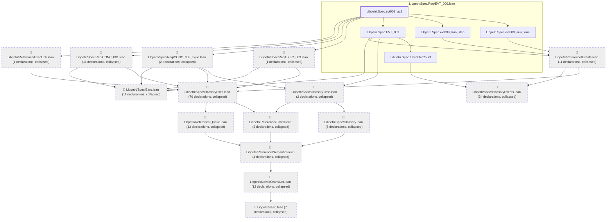
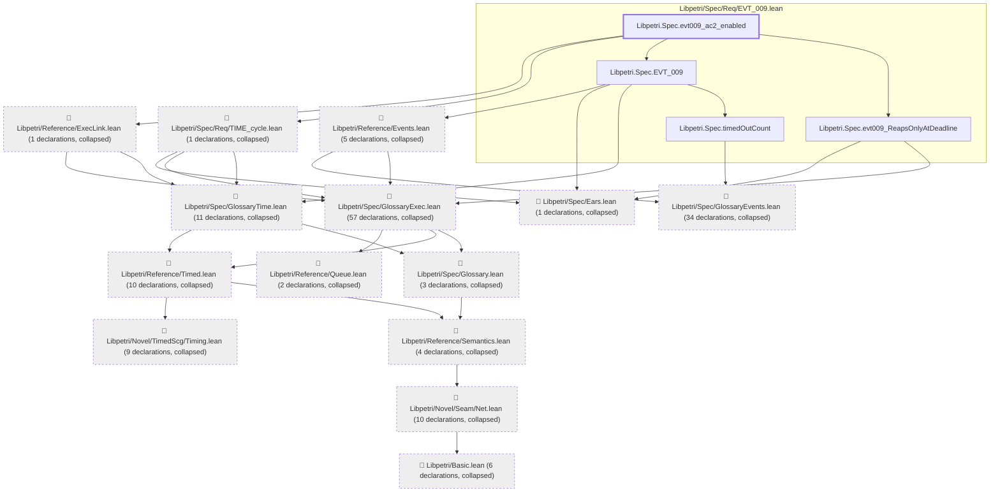
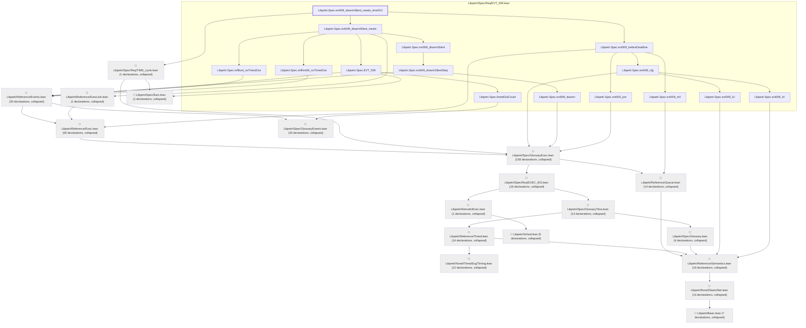

# EVT-009

Generated by `scripts/proof-graph.py` from `proof-graph.json`. Do not edit.

Theorems carrying this ID:

- `Libpetri.Spec.evt009_ac1` (theorem, `Libpetri/Spec/Req/EVT_009.lean:386`)
- `Libpetri.Spec.evt009_ac1_otherSteps` (theorem, `Libpetri/Spec/Req/EVT_009.lean:423`)
- `Libpetri.Spec.evt009_ac2` (theorem, `Libpetri/Spec/Req/EVT_009.lean:455`)
- `Libpetri.Spec.evt009_ac2_enabled` (theorem, `Libpetri/Spec/Req/EVT_009.lean:491`)
- `Libpetri.Spec.evt009_disarmSilent_needs_time013` (theorem, `Libpetri/Spec/Req/EVT_009.lean:906`)

> **Note:** the full tree has 469 nodes (limit 60), so it is drawn as one diagram per theorem (5 theorems).

### `Libpetri.Spec.evt009_ac1`

> Rule: this theorem's tree has 154 nodes (limit 60); every file other than its own is collapsed into one node, leaving 17.

### `Libpetri.Spec.evt009_ac1_otherSteps`

> Rule: this theorem's tree has 63 nodes (limit 60); every file other than its own is collapsed into one node, leaving 13.

### `Libpetri.Spec.evt009_ac2`

> Rule: this theorem's tree has 191 nodes (limit 60); every file other than its own is collapsed into one node, leaving 20.

### `Libpetri.Spec.evt009_ac2_enabled`

> Rule: this theorem's tree has 158 nodes (limit 60); every file other than its own is collapsed into one node, leaving 18.

### `Libpetri.Spec.evt009_disarmSilent_needs_time013`

> Rule: this theorem's tree has 417 nodes (limit 60); every file other than its own is collapsed into one node, leaving 33.

Axioms used:

- `Libpetri.Spec.evt009_ac1`: `propext`
- `Libpetri.Spec.evt009_ac1_otherSteps`: `propext`
- `Libpetri.Spec.evt009_ac2`: `Quot.sound`, `propext`
- `Libpetri.Spec.evt009_ac2_enabled`: `Quot.sound`, `propext`
- `Libpetri.Spec.evt009_disarmSilent_needs_time013`: `Quot.sound`, `propext`
