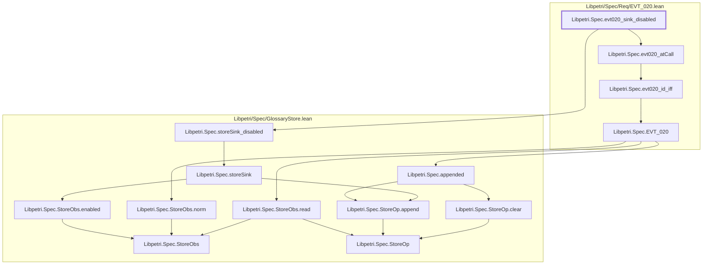

# EVT-020

Generated by `scripts/proof-graph.py` from `proof-graph.json`. Do not edit.

Theorems carrying this ID:

- `Libpetri.Spec.evt020_sink_disabled` (theorem, `Libpetri/Spec/Req/EVT_020.lean:178`)

Axioms used:

- `Libpetri.Spec.evt020_sink_disabled`: `Quot.sound`, `propext`
