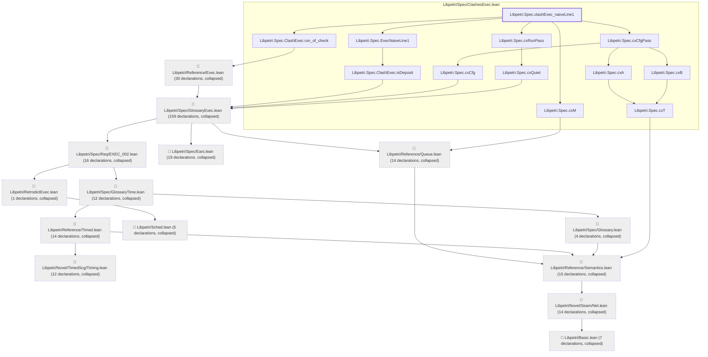
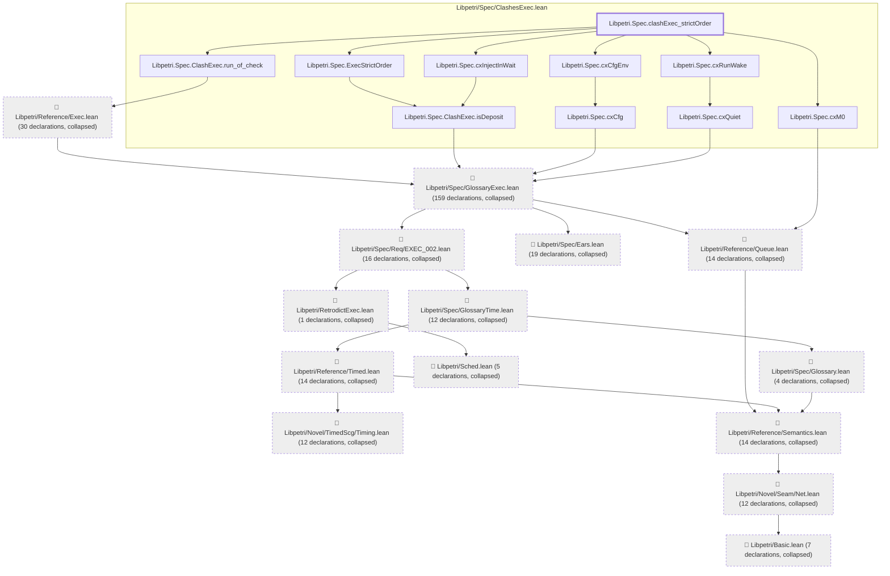

# EXEC-001

Generated by `scripts/proof-graph.py` from `proof-graph.json`. Do not edit.

Theorems carrying this ID:

- `Libpetri.Spec.clashExec_naiveLine1` (theorem, `Libpetri/Spec/ClashesExec.lean:151`)
- `Libpetri.Spec.clashExec_strictOrder` (theorem, `Libpetri/Spec/ClashesExec.lean:188`)
- `Libpetri.Spec.exec001_dirty_set_exact` (theorem, `Libpetri/Spec/Req/EXEC_001.lean:1471`)

> **Note:** the full tree has 363 nodes (limit 60), so it is drawn as one diagram per theorem (3 theorems).

### `Libpetri.Spec.clashExec_naiveLine1`

> Rule: this theorem's tree has 334 nodes (limit 60); every file other than its own is collapsed into one node, leaving 26.

### `Libpetri.Spec.clashExec_strictOrder`

> Rule: this theorem's tree has 329 nodes (limit 60); every file other than its own is collapsed into one node, leaving 24.

### `Libpetri.Spec.exec001_dirty_set_exact`

> Rule: this theorem's whole tree, 29 nodes.

```mermaid
flowchart TD
  subgraph g0["Libpetri/Basic.lean"]
    n8["Libpetri.Card"]
    n9["Libpetri.Card.all"]
    n10["Libpetri.Card.atLeast"]
    n12["Libpetri.Card.exactly"]
    n13["Libpetri.Card.one"]
    n14["Libpetri.Card.required"]
    n134["Libpetri.InSpec"]
    n135["Libpetri.InSpec.card"]
    n138["Libpetri.InSpec.place"]
    n2720["Libpetri.PlaceId"]
    n13126["Libpetri.Transition"]
    n13127["Libpetri.Transition.inhibitors"]
    n13128["Libpetri.Transition.inputs"]
    n13132["Libpetri.Transition.reads"]
  end
  subgraph g1["Libpetri/Compile.lean"]
    n13191["Libpetri.canEnable"]
  end
  subgraph g2["Libpetri/Enablement.lean"]
    n37["Libpetri.EnabledSync"]
    n154["Libpetri.Net"]
    n2714["Libpetri.PBState"]
    n2715["Libpetri.PBState.dirty"]
    n2716["Libpetri.PBState.enabled"]
    n2717["Libpetri.PBState.mk"]
    n2718["Libpetri.PBState.presence"]
    n2719["Libpetri.PBState.ring"]
    n13120["Libpetri.TId"]
    n13475["Libpetri.updateEnablement"]
    n13478["🔒 Libpetri.updateEnablement_sync"]
  end
  subgraph g3["Libpetri/Ring/Core.lean"]
    n2727["Libpetri.Pool"]
    n2743["Libpetri.Pool.cnt"]
  end
  subgraph g4["Libpetri/Spec/Req/EXEC_001.lean"]
    n9972["Libpetri.Spec.exec001_dirty_set_exact"]
  end
  n9 --> n8
  n10 --> n8
  n12 --> n8
  n13 --> n8
  n14 --> n9
  n14 --> n10
  n14 --> n12
  n14 --> n13
  n37 --> n154
  n37 --> n2715
  n37 --> n2716
  n37 --> n2719
  n37 --> n13191
  n135 --> n8
  n135 --> n134
  n138 --> n134
  n138 --> n2720
  n154 --> n13126
  n2715 --> n2714
  n2715 --> n13120
  n2716 --> n2714
  n2716 --> n13120
  n2717 --> n2714
  n2717 --> n2720
  n2717 --> n2727
  n2717 --> n13120
  n2718 --> n2714
  n2718 --> n2720
  n2719 --> n2714
  n2719 --> n2727
  n2743 --> n2720
  n2743 --> n2727
  n9972 --> n13478
  n13127 --> n2720
  n13127 --> n13126
  n13128 --> n134
  n13128 --> n13126
  n13132 --> n2720
  n13132 --> n13126
  n13191 --> n14
  n13191 --> n135
  n13191 --> n138
  n13191 --> n2743
  n13191 --> n13127
  n13191 --> n13128
  n13191 --> n13132
  n13475 --> n154
  n13475 --> n2715
  n13475 --> n2716
  n13475 --> n2717
  n13475 --> n2718
  n13475 --> n2719
  n13475 --> n13191
  n13478 --> n37
  n13478 --> n13475
  classDef root stroke-width:3px
  classDef locked fill:#fff3cd,stroke:#b8860b
  classDef collapsed fill:#eeeeee,stroke-dasharray:4 4
  class n9972 root
  class n13478 locked
```

Axioms used:

- `Libpetri.Spec.clashExec_naiveLine1`: `Quot.sound`, `propext`
- `Libpetri.Spec.clashExec_strictOrder`: `Quot.sound`, `propext`
- `Libpetri.Spec.exec001_dirty_set_exact`: `propext`
