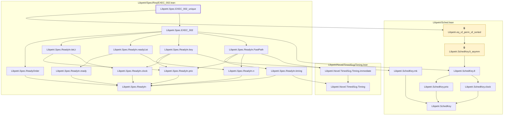
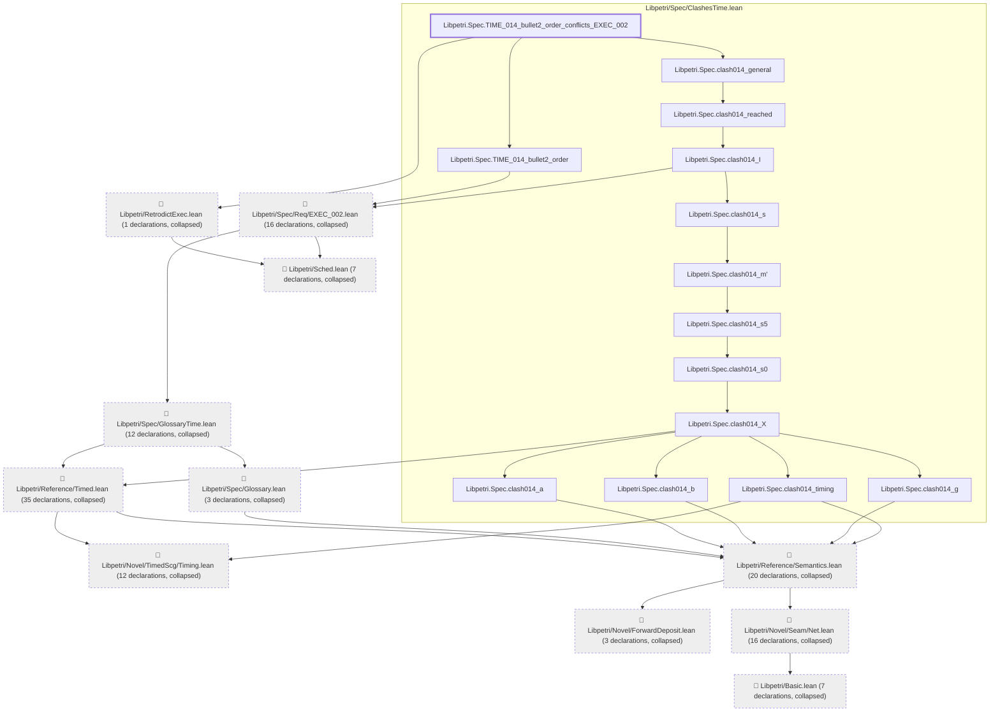
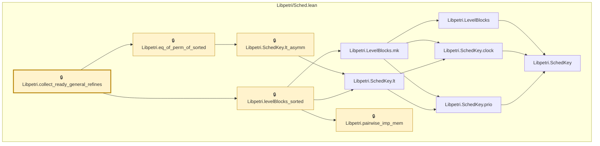
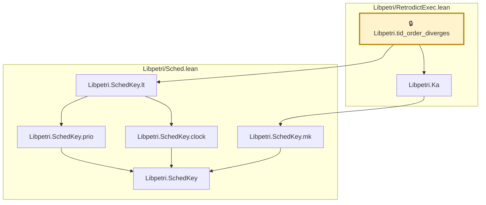

# EXEC-002

Generated by `scripts/proof-graph.py` from `proof-graph.json`. Do not edit.

Theorems carrying this ID:

- `Libpetri.Spec.EXEC_002_unique` (theorem, `Libpetri/Spec/Req/EXEC_002.lean:271`)
- `Libpetri.Spec.TIME_014_bullet2_order_conflicts_EXEC_002` (theorem, `Libpetri/Spec/ClashesTime.lean:198`)
- `Libpetri.collect_ready_general_refines` (theorem, `Libpetri/Sched.lean:174`) 🔒 locked
- `Libpetri.tid_order_diverges` (theorem, `Libpetri/RetrodictExec.lean:49`) 🔒 locked

> **Note:** the full tree has 154 nodes (limit 60), so it is drawn as one diagram per theorem (4 theorems).

### `Libpetri.Spec.EXEC_002_unique`

> Rule: this theorem's whole tree, 22 nodes.

### `Libpetri.Spec.TIME_014_bullet2_order_conflicts_EXEC_002`

> Rule: this theorem's tree has 146 nodes (limit 60); every file other than its own is collapsed into one node, leaving 25.

### `Libpetri.collect_ready_general_refines`

> Rule: this theorem's whole tree, 11 nodes.

### `Libpetri.tid_order_diverges`

> Rule: this theorem's whole tree, 7 nodes.

Axioms used:

- `Libpetri.Spec.EXEC_002_unique`: `Quot.sound`, `propext`
- `Libpetri.Spec.TIME_014_bullet2_order_conflicts_EXEC_002`: `Classical.choice`, `Quot.sound`, `propext`
- `Libpetri.collect_ready_general_refines`: `Quot.sound`, `propext`
- `Libpetri.tid_order_diverges`: `Quot.sound`, `propext`
