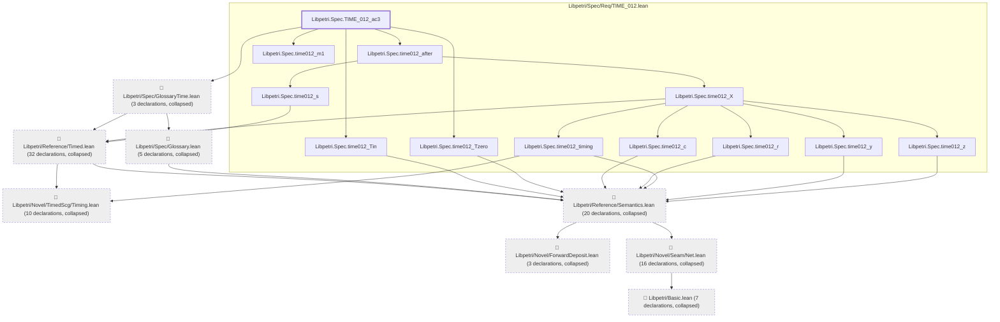
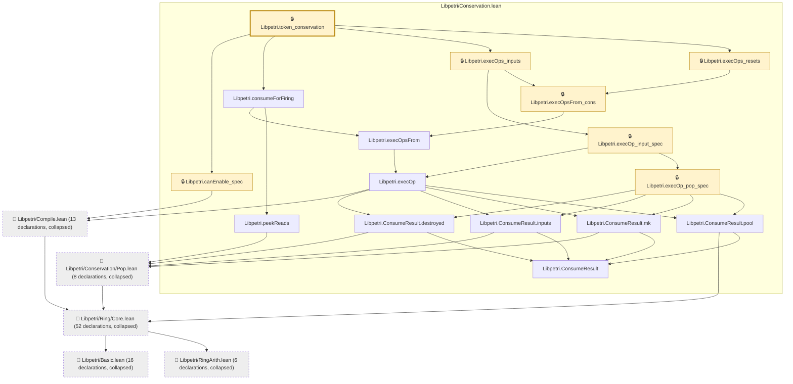

# EXEC-013

Generated by `scripts/proof-graph.py` from `proof-graph.json`. Do not edit.

Theorems carrying this ID:

- `Libpetri.Spec.CORE_034_reference` (theorem, `Libpetri/Spec/Req/CORE_034.lean:75`)
- `Libpetri.Spec.TIME_012_ac3` (theorem, `Libpetri/Spec/Req/TIME_012.lean:389`)
- `Libpetri.consumeForFiring_eq_program` (theorem, `Libpetri/Conservation.lean:324`) 🔒 locked
- `Libpetri.read_reset_order_diverges` (theorem, `Libpetri/RetrodictExec.lean:103`) 🔒 locked
- `Libpetri.token_conservation` (theorem, `Libpetri/Conservation.lean:345`) 🔒 locked

> **Note:** the full tree has 234 nodes (limit 60), so it is drawn as one diagram per theorem (5 theorems).

### `Libpetri.Spec.CORE_034_reference`

> Rule: this theorem's whole tree, 56 nodes.

```mermaid
flowchart TD
  subgraph g0["Libpetri/Basic.lean"]
    n8["Libpetri.Card"]
    n9["Libpetri.Card.all"]
    n10["Libpetri.Card.atLeast"]
    n11["Libpetri.Card.consumesAll"]
    n12["Libpetri.Card.exactly"]
    n13["Libpetri.Card.one"]
    n14["Libpetri.Card.required"]
  end
  subgraph g1["Libpetri/Novel/ForwardDeposit.lean"]
    n665["Libpetri.Novel.ForwardDeposit.Choice"]
    n666["Libpetri.Novel.ForwardDeposit.Choice.action"]
    n667["Libpetri.Novel.ForwardDeposit.Choice.timedOut"]
  end
  subgraph g2["Libpetri/Novel/Seam/Net.lean"]
    n1737["Libpetri.Novel.Seam.NInSpec"]
    n1738["Libpetri.Novel.Seam.NInSpec.card"]
    n1740["Libpetri.Novel.Seam.NInSpec.place"]
    n1755["Libpetri.Novel.Seam.NTransition"]
    n1756["Libpetri.Novel.Seam.NTransition.inhibitors"]
    n1757["Libpetri.Novel.Seam.NTransition.inputs"]
    n1758["Libpetri.Novel.Seam.NTransition.mk"]
    n1759["Libpetri.Novel.Seam.NTransition.name"]
    n1760["Libpetri.Novel.Seam.NTransition.reads"]
    n1761["Libpetri.Novel.Seam.NTransition.resets"]
    n1845["Libpetri.Novel.Seam.depProd"]
    n1850["Libpetri.Novel.Seam.enabledNA"]
    n1863["Libpetri.Novel.Seam.fireNC"]
    n1888["Libpetri.Novel.Seam.nconsumed"]
    n1891["Libpetri.Novel.Seam.nspecAt"]
  end
  subgraph g3["Libpetri/Reference/Semantics.lean"]
    n2710["Libpetri.Reference.Fires"]
    n2717["Libpetri.Reference.Out"]
    n2718["Libpetri.Reference.Out.and"]
    n2719["Libpetri.Reference.Out.branches"]
    n2721["Libpetri.Reference.Out.brecOn.go"]
    n2722["Libpetri.Reference.Out.findTimeout"]
    n2723["Libpetri.Reference.Out.forward"]
    n2724["Libpetri.Reference.Out.place"]
    n2725["Libpetri.Reference.Out.timeout"]
    n2726["Libpetri.Reference.Out.timeoutDeposits"]
    n2727["Libpetri.Reference.Out.xor"]
    n2783["Libpetri.Reference.Trans"]
    n2784["Libpetri.Reference.Trans.core"]
    n2785["Libpetri.Reference.Trans.mk"]
    n2786["Libpetri.Reference.Trans.out"]
    n2787["Libpetri.Reference.Trans.reapable"]
    n2792["Libpetri.Reference.cross"]
    n2793["Libpetri.Reference.deposit"]
  end
  subgraph g4["Libpetri/Spec/Ears.lean"]
    n3547["Libpetri.Spec.StepShall"]
  end
  subgraph g5["Libpetri/Spec/Glossary.lean"]
    n3044["Libpetri.Spec.Consumes"]
    n3046["Libpetri.Spec.CountMarking"]
    n3054["Libpetri.Spec.Deposits"]
    n3180["Libpetri.Spec.FireRel"]
    n3534["Libpetri.Spec.RefFire"]
    n3537["Libpetri.Spec.ResetArc"]
    n3543["Libpetri.Spec.SamePerPlace"]
    n3720["Libpetri.Spec.TokenCount"]
    n4435["Libpetri.Spec.refFire_apply"]
  end
  subgraph g6["Libpetri/Spec/Req/CORE_034.lean"]
    n2973["Libpetri.Spec.CORE_034"]
    n2988["Libpetri.Spec.CORE_034_reference"]
    n4874["Libpetri.Spec.withoutReset"]
  end
  n9 --> n8
  n10 --> n8
  n11 --> n9
  n11 --> n10
  n11 --> n12
  n11 --> n13
  n12 --> n8
  n13 --> n8
  n14 --> n9
  n14 --> n10
  n14 --> n12
  n14 --> n13
  n666 --> n665
  n667 --> n665
  n1738 --> n8
  n1738 --> n1737
  n1740 --> n1737
  n1756 --> n1755
  n1757 --> n1737
  n1757 --> n1755
  n1758 --> n1737
  n1758 --> n1755
  n1759 --> n1755
  n1760 --> n1755
  n1761 --> n1755
  n1850 --> n14
  n1850 --> n1738
  n1850 --> n1740
  n1850 --> n1756
  n1850 --> n1757
  n1850 --> n1760
  n1863 --> n1761
  n1863 --> n1888
  n1888 --> n11
  n1888 --> n14
  n1888 --> n1738
  n1888 --> n1891
  n1891 --> n1740
  n1891 --> n1757
  n2710 --> n1845
  n2710 --> n1850
  n2710 --> n1863
  n2710 --> n2784
  n2710 --> n2786
  n2710 --> n2793
  n2718 --> n2717
  n2719 --> n2721
  n2719 --> n2792
  n2721 --> n2718
  n2721 --> n2723
  n2721 --> n2724
  n2721 --> n2725
  n2721 --> n2727
  n2722 --> n2721
  n2723 --> n2717
  n2724 --> n2717
  n2725 --> n2717
  n2726 --> n2721
  n2726 --> n2792
  n2727 --> n2717
  n2784 --> n1755
  n2784 --> n2783
  n2785 --> n1755
  n2785 --> n2717
  n2785 --> n2783
  n2786 --> n2717
  n2786 --> n2783
  n2787 --> n2783
  n2793 --> n666
  n2793 --> n667
  n2793 --> n2719
  n2793 --> n2722
  n2793 --> n2726
  n2973 --> n3180
  n2973 --> n3537
  n2973 --> n3543
  n2973 --> n3547
  n2973 --> n3720
  n2973 --> n4874
  n2988 --> n2973
  n2988 --> n4435
  n3044 --> n1888
  n3044 --> n2784
  n3044 --> n3046
  n3054 --> n1845
  n3180 --> n2783
  n3534 --> n2710
  n3534 --> n3180
  n3537 --> n1761
  n3537 --> n2784
  n3543 --> n3054
  n3720 --> n3046
  n4435 --> n3044
  n4435 --> n3054
  n4435 --> n3534
  n4435 --> n3537
  n4874 --> n1756
  n4874 --> n1757
  n4874 --> n1758
  n4874 --> n1759
  n4874 --> n1760
  n4874 --> n1761
  n4874 --> n2784
  n4874 --> n2785
  n4874 --> n2786
  n4874 --> n2787
  classDef root stroke-width:3px
  classDef locked fill:#fff3cd,stroke:#b8860b
  classDef collapsed fill:#eeeeee,stroke-dasharray:4 4
  class n2988 root
```

### `Libpetri.Spec.TIME_012_ac3`

> Rule: this theorem's tree has 108 nodes (limit 60); every file other than its own is collapsed into one node, leaving 20.

### `Libpetri.consumeForFiring_eq_program`

> Rule: this theorem's whole tree, 52 nodes.

```mermaid
flowchart TD
  subgraph g0["Libpetri/Basic.lean"]
    n8["Libpetri.Card"]
    n9["Libpetri.Card.all"]
    n10["Libpetri.Card.atLeast"]
    n12["Libpetri.Card.exactly"]
    n13["Libpetri.Card.one"]
    n21["Libpetri.Colour"]
    n134["Libpetri.InSpec"]
    n135["Libpetri.InSpec.card"]
    n138["Libpetri.InSpec.place"]
    n2720["Libpetri.PlaceId"]
    n13126["Libpetri.Transition"]
    n13128["Libpetri.Transition.inputs"]
    n13132["Libpetri.Transition.reads"]
    n13133["Libpetri.Transition.resets"]
  end
  subgraph g1["Libpetri/Compile.lean"]
    n22["Libpetri.ConsumeOp"]
    n23["Libpetri.ConsumeOp.all"]
    n24["Libpetri.ConsumeOp.atLeast"]
    n25["Libpetri.ConsumeOp.n"]
    n26["Libpetri.ConsumeOp.one"]
    n27["Libpetri.ConsumeOp.reset"]
    n13202["Libpetri.compileConsumeOps"]
    n13357["Libpetri.opOfSpec"]
  end
  subgraph g2["Libpetri/Conservation.lean"]
    n28["Libpetri.ConsumeResult"]
    n29["Libpetri.ConsumeResult.destroyed"]
    n30["Libpetri.ConsumeResult.inputs"]
    n31["Libpetri.ConsumeResult.mk"]
    n32["Libpetri.ConsumeResult.pool"]
    n13207["Libpetri.consumeForFiring"]
    n13210["🔒 Libpetri.consumeForFiring_eq_program"]
    n13264["Libpetri.execOp"]
    n13267["Libpetri.execOpsFrom"]
    n13268["🔒 Libpetri.execOpsFrom_append"]
    n13369["Libpetri.peekReads"]
  end
  subgraph g3["Libpetri/Conservation/Pop.lean"]
    n13125["Libpetri.TokenBag"]
    n13148["Libpetri.addBag"]
    n13254["Libpetri.emptyBag"]
    n13371["Libpetri.popN"]
  end
  subgraph g4["Libpetri/Ring/Core.lean"]
    n2727["Libpetri.Pool"]
    n2742["Libpetri.Pool.cap"]
    n2743["Libpetri.Pool.cnt"]
    n2748["Libpetri.Pool.first"]
    n2771["Libpetri.Pool.head"]
    n2789["Libpetri.Pool.len"]
    n2793["Libpetri.Pool.mk"]
    n2794["Libpetri.Pool.nplaces"]
    n2795["Libpetri.Pool.offset"]
    n2797["Libpetri.Pool.peekFirst"]
    n2799["Libpetri.Pool.pool"]
    n2823["Libpetri.Pool.removeFirst"]
    n2842["Libpetri.Pool.slot"]
    n2847["Libpetri.Pool.tail"]
  end
  subgraph g5["Libpetri/RingArith.lean"]
    n13414["Libpetri.ringPos"]
  end
  n9 --> n8
  n10 --> n8
  n12 --> n8
  n13 --> n8
  n23 --> n22
  n23 --> n2720
  n24 --> n22
  n24 --> n2720
  n25 --> n22
  n25 --> n2720
  n26 --> n22
  n26 --> n2720
  n27 --> n22
  n27 --> n2720
  n29 --> n28
  n29 --> n13125
  n30 --> n28
  n30 --> n13125
  n31 --> n28
  n31 --> n2727
  n31 --> n13125
  n32 --> n28
  n32 --> n2727
  n135 --> n8
  n135 --> n134
  n138 --> n134
  n138 --> n2720
  n2742 --> n2720
  n2742 --> n2727
  n2743 --> n2720
  n2743 --> n2727
  n2748 --> n2799
  n2748 --> n2842
  n2771 --> n2720
  n2771 --> n2727
  n2789 --> n2727
  n2793 --> n21
  n2793 --> n2720
  n2793 --> n2727
  n2794 --> n2727
  n2795 --> n2720
  n2795 --> n2727
  n2797 --> n2743
  n2797 --> n2799
  n2797 --> n2842
  n2799 --> n21
  n2799 --> n2727
  n2823 --> n2743
  n2823 --> n2789
  n2823 --> n2793
  n2823 --> n2794
  n2823 --> n2799
  n2823 --> n2842
  n2823 --> n2847
  n2842 --> n2742
  n2842 --> n2771
  n2842 --> n2795
  n2842 --> n13414
  n2847 --> n2720
  n2847 --> n2727
  n13125 --> n21
  n13125 --> n2720
  n13128 --> n134
  n13128 --> n13126
  n13132 --> n2720
  n13132 --> n13126
  n13133 --> n2720
  n13133 --> n13126
  n13148 --> n13125
  n13202 --> n27
  n13202 --> n13128
  n13202 --> n13133
  n13202 --> n13357
  n13207 --> n13128
  n13207 --> n13132
  n13207 --> n13133
  n13207 --> n13267
  n13207 --> n13357
  n13207 --> n13369
  n13210 --> n13202
  n13210 --> n13207
  n13210 --> n13268
  n13254 --> n13125
  n13264 --> n23
  n13264 --> n24
  n13264 --> n25
  n13264 --> n26
  n13264 --> n27
  n13264 --> n29
  n13264 --> n30
  n13264 --> n31
  n13264 --> n32
  n13264 --> n13148
  n13264 --> n13371
  n13267 --> n13264
  n13268 --> n13267
  n13357 --> n9
  n13357 --> n10
  n13357 --> n12
  n13357 --> n13
  n13357 --> n23
  n13357 --> n24
  n13357 --> n25
  n13357 --> n26
  n13357 --> n135
  n13357 --> n138
  n13369 --> n2797
  n13369 --> n13148
  n13369 --> n13254
  n13371 --> n2748
  n13371 --> n2823
  classDef root stroke-width:3px
  classDef locked fill:#fff3cd,stroke:#b8860b
  classDef collapsed fill:#eeeeee,stroke-dasharray:4 4
  class n13210 root
  class n13210,n13268 locked
```

### `Libpetri.read_reset_order_diverges`

> Rule: this theorem's whole tree, 56 nodes.

```mermaid
flowchart TD
  subgraph g0["Libpetri/Basic.lean"]
    n8["Libpetri.Card"]
    n9["Libpetri.Card.all"]
    n10["Libpetri.Card.atLeast"]
    n12["Libpetri.Card.exactly"]
    n13["Libpetri.Card.one"]
    n21["Libpetri.Colour"]
    n132["Libpetri.Guard"]
    n134["Libpetri.InSpec"]
    n135["Libpetri.InSpec.card"]
    n137["Libpetri.InSpec.mk"]
    n138["Libpetri.InSpec.place"]
    n2720["Libpetri.PlaceId"]
    n13126["Libpetri.Transition"]
    n13128["Libpetri.Transition.inputs"]
    n13129["Libpetri.Transition.mk"]
    n13132["Libpetri.Transition.reads"]
    n13133["Libpetri.Transition.resets"]
  end
  subgraph g1["Libpetri/Compile.lean"]
    n22["Libpetri.ConsumeOp"]
    n23["Libpetri.ConsumeOp.all"]
    n24["Libpetri.ConsumeOp.atLeast"]
    n25["Libpetri.ConsumeOp.n"]
    n26["Libpetri.ConsumeOp.one"]
    n27["Libpetri.ConsumeOp.reset"]
    n13357["Libpetri.opOfSpec"]
  end
  subgraph g2["Libpetri/Conservation.lean"]
    n28["Libpetri.ConsumeResult"]
    n29["Libpetri.ConsumeResult.destroyed"]
    n30["Libpetri.ConsumeResult.inputs"]
    n31["Libpetri.ConsumeResult.mk"]
    n32["Libpetri.ConsumeResult.pool"]
    n13207["Libpetri.consumeForFiring"]
    n13264["Libpetri.execOp"]
    n13267["Libpetri.execOpsFrom"]
    n13369["Libpetri.peekReads"]
  end
  subgraph g3["Libpetri/Conservation/Pop.lean"]
    n13125["Libpetri.TokenBag"]
    n13148["Libpetri.addBag"]
    n13254["Libpetri.emptyBag"]
    n13371["Libpetri.popN"]
  end
  subgraph g4["Libpetri/RetrodictExec.lean"]
    n13238["Libpetri.demoPool"]
    n13381["Libpetri.preFixReads"]
    n13399["🔒 Libpetri.read_reset_order_diverges"]
    n13458["Libpetri.tReadReset"]
  end
  subgraph g5["Libpetri/Ring/Core.lean"]
    n2727["Libpetri.Pool"]
    n2742["Libpetri.Pool.cap"]
    n2743["Libpetri.Pool.cnt"]
    n2748["Libpetri.Pool.first"]
    n2771["Libpetri.Pool.head"]
    n2789["Libpetri.Pool.len"]
    n2793["Libpetri.Pool.mk"]
    n2794["Libpetri.Pool.nplaces"]
    n2795["Libpetri.Pool.offset"]
    n2797["Libpetri.Pool.peekFirst"]
    n2799["Libpetri.Pool.pool"]
    n2823["Libpetri.Pool.removeFirst"]
    n2842["Libpetri.Pool.slot"]
    n2847["Libpetri.Pool.tail"]
  end
  subgraph g6["Libpetri/RingArith.lean"]
    n13414["Libpetri.ringPos"]
  end
  n9 --> n8
  n10 --> n8
  n12 --> n8
  n13 --> n8
  n23 --> n22
  n23 --> n2720
  n24 --> n22
  n24 --> n2720
  n25 --> n22
  n25 --> n2720
  n26 --> n22
  n26 --> n2720
  n27 --> n22
  n27 --> n2720
  n29 --> n28
  n29 --> n13125
  n30 --> n28
  n30 --> n13125
  n31 --> n28
  n31 --> n2727
  n31 --> n13125
  n32 --> n28
  n32 --> n2727
  n132 --> n21
  n135 --> n8
  n135 --> n134
  n137 --> n8
  n137 --> n132
  n137 --> n134
  n137 --> n2720
  n138 --> n134
  n138 --> n2720
  n2742 --> n2720
  n2742 --> n2727
  n2743 --> n2720
  n2743 --> n2727
  n2748 --> n2799
  n2748 --> n2842
  n2771 --> n2720
  n2771 --> n2727
  n2789 --> n2727
  n2793 --> n21
  n2793 --> n2720
  n2793 --> n2727
  n2794 --> n2727
  n2795 --> n2720
  n2795 --> n2727
  n2797 --> n2743
  n2797 --> n2799
  n2797 --> n2842
  n2799 --> n21
  n2799 --> n2727
  n2823 --> n2743
  n2823 --> n2789
  n2823 --> n2793
  n2823 --> n2794
  n2823 --> n2799
  n2823 --> n2842
  n2823 --> n2847
  n2842 --> n2742
  n2842 --> n2771
  n2842 --> n2795
  n2842 --> n13414
  n2847 --> n2720
  n2847 --> n2727
  n13125 --> n21
  n13125 --> n2720
  n13128 --> n134
  n13128 --> n13126
  n13129 --> n134
  n13129 --> n2720
  n13129 --> n13126
  n13132 --> n2720
  n13132 --> n13126
  n13133 --> n2720
  n13133 --> n13126
  n13148 --> n13125
  n13207 --> n13128
  n13207 --> n13132
  n13207 --> n13133
  n13207 --> n13267
  n13207 --> n13357
  n13207 --> n13369
  n13238 --> n2793
  n13254 --> n13125
  n13264 --> n23
  n13264 --> n24
  n13264 --> n25
  n13264 --> n26
  n13264 --> n27
  n13264 --> n29
  n13264 --> n30
  n13264 --> n31
  n13264 --> n32
  n13264 --> n13148
  n13264 --> n13371
  n13267 --> n13264
  n13357 --> n9
  n13357 --> n10
  n13357 --> n12
  n13357 --> n13
  n13357 --> n23
  n13357 --> n24
  n13357 --> n25
  n13357 --> n26
  n13357 --> n135
  n13357 --> n138
  n13369 --> n2797
  n13369 --> n13148
  n13369 --> n13254
  n13371 --> n2748
  n13371 --> n2823
  n13381 --> n13128
  n13381 --> n13132
  n13381 --> n13133
  n13381 --> n13267
  n13381 --> n13357
  n13381 --> n13369
  n13399 --> n13207
  n13399 --> n13238
  n13399 --> n13381
  n13399 --> n13458
  n13458 --> n13
  n13458 --> n137
  n13458 --> n13129
  classDef root stroke-width:3px
  classDef locked fill:#fff3cd,stroke:#b8860b
  classDef collapsed fill:#eeeeee,stroke-dasharray:4 4
  class n13399 root
  class n13399 locked
```

### `Libpetri.token_conservation`

> Rule: this theorem's tree has 111 nodes (limit 60); every file other than its own is collapsed into one node, leaving 21.

Axioms used:

- `Libpetri.Spec.CORE_034_reference`: `Quot.sound`, `propext`
- `Libpetri.Spec.TIME_012_ac3`: `propext`
- `Libpetri.consumeForFiring_eq_program`: `Quot.sound`, `propext`
- `Libpetri.read_reset_order_diverges`: none
- `Libpetri.token_conservation`: `Quot.sound`, `propext`
