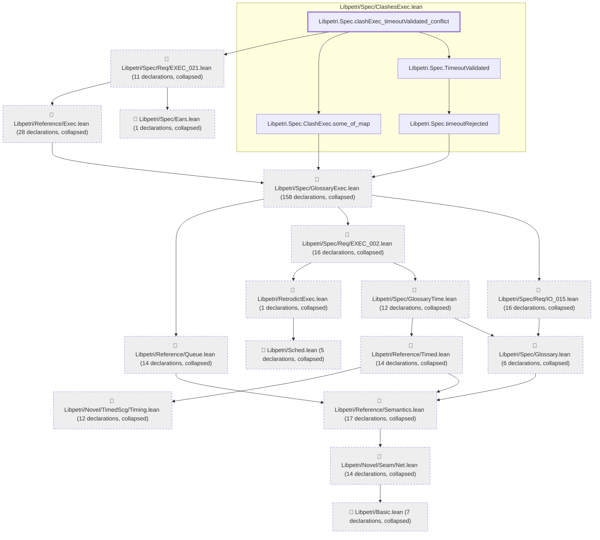

# EXEC-021

Generated by `scripts/proof-graph.py` from `proof-graph.json`. Do not edit.

Theorems carrying this ID:

- `Libpetri.Spec.clashExec_timeoutValidated_conflict` (theorem, `Libpetri/Spec/ClashesExec.lean:321`)

> **Note:** the full tree has 336 nodes (limit 60).

> Rule: this theorem's tree has 336 nodes (limit 60); every file other than its own is collapsed into one node, leaving 20.

Axioms used:

- `Libpetri.Spec.clashExec_timeoutValidated_conflict`: `Classical.choice`, `Quot.sound`, `propext`
