# EXEC-022

Generated by `scripts/proof-graph.py` from `proof-graph.json`. Do not edit.

Theorems carrying this ID:

- `Libpetri.Spec.EVT_010_rust` (theorem, `Libpetri/Spec/Req/EVT_010.lean:590`)

> **Note:** the full tree has 445 nodes (limit 60).

> Rule: this theorem's tree has 445 nodes (limit 60); every file other than its own is collapsed into one node, leaving 50.

```mermaid
flowchart TD
  subgraph g0["Libpetri/Spec/Req/EVT_010.lean"]
    n6420["Libpetri.Spec.EVT_010"]
    n6437["Libpetri.Spec.EVT_010_rust"]
    n15548["Libpetri.Spec.evt010_AgreesAto"]
    n15549["Libpetri.Spec.evt010_AtoFirst"]
    n15551["Libpetri.Spec.evt010_Spent"]
    n15557["Libpetri.Spec.evt010_atoAt"]
    n15558["Libpetri.Spec.evt010_atoAt_agree"]
    n15559["Libpetri.Spec.evt010_atoAt_of"]
    n15560["Libpetri.Spec.evt010_atoFirst_append"]
    n15561["Libpetri.Spec.evt010_atoOf"]
    n15562["Libpetri.Spec.evt010_atoOf_cons"]
    n15573["Libpetri.Spec.evt010_iff"]
    n15575["Libpetri.Spec.evt010_isExpire"]
    n15576["Libpetri.Spec.evt010_isTimeoutOut_iff"]
    n15583["Libpetri.Spec.evt010_lblId"]
    n15584["Libpetri.Spec.evt010_line1"]
    n15585["Libpetri.Spec.evt010_line1_of"]
    n15586["Libpetri.Spec.evt010_line2"]
    n15587["Libpetri.Spec.evt010_line2_of"]
    n15588["Libpetri.Spec.evt010_line3"]
    n15589["Libpetri.Spec.evt010_line3_of"]
    n15593["Libpetri.Spec.evt010_ref"]
    n15594["Libpetri.Spec.evt010_refAto"]
    n15595["Libpetri.Spec.evt010_refBoot"]
    n15596["Libpetri.Spec.evt010_refCount_expire"]
    n15597["Libpetri.Spec.evt010_refCount_fail"]
    n15598["Libpetri.Spec.evt010_refCount_tdeposit"]
    n15601["Libpetri.Spec.evt010_refTdeposit"]
    n15603["Libpetri.Spec.evt010_runLB"]
    n15604["Libpetri.Spec.evt010_runUB"]
    n15605["Libpetri.Spec.evt010_settlesTimeout"]
    n15608["Libpetri.Spec.evt010_stepUB"]
  end
  c0["📁 Libpetri/Basic.lean (7 declarations, collapsed)"]
  c54["📁 Libpetri/Novel/Seam/Net.lean (12 declarations, collapsed)"]
  c66["📁 Libpetri/Novel/TimedScg/Timing.lean (12 declarations, collapsed)"]
  c78["📁 Libpetri/Reference/Events.lean (36 declarations, collapsed)"]
  c80["📁 Libpetri/Reference/Exec.lean (58 declarations, collapsed)"]
  c91["📁 Libpetri/Reference/Queue.lean (14 declarations, collapsed)"]
  c94["📁 Libpetri/Reference/Semantics.lean (14 declarations, collapsed)"]
  c98["📁 Libpetri/Reference/Timed.lean (13 declarations, collapsed)"]
  c103["📁 Libpetri/RetrodictExec.lean (1 declarations, collapsed)"]
  c109["📁 Libpetri/Sched.lean (5 declarations, collapsed)"]
  c131["📁 Libpetri/Spec/Ears.lean (1 declarations, collapsed)"]
  c133["📁 Libpetri/Spec/Glossary.lean (4 declarations, collapsed)"]
  c139["📁 Libpetri/Spec/GlossaryEvents.lean (36 declarations, collapsed)"]
  c140["📁 Libpetri/Spec/GlossaryExec.lean (156 declarations, collapsed)"]
  c147["📁 Libpetri/Spec/GlossaryTime.lean (12 declarations, collapsed)"]
  c217["📁 Libpetri/Spec/Req/EVT_008.lean (1 declarations, collapsed)"]
  c235["📁 Libpetri/Spec/Req/EXEC_002.lean (16 declarations, collapsed)"]
  c242["📁 Libpetri/Spec/Req/EXEC_022.lean (15 declarations, collapsed)"]
  c54 --> c0
  c78 --> c80
  c78 --> c139
  c80 --> c140
  c91 --> c94
  c94 --> c54
  c98 --> c66
  c98 --> c94
  c103 --> c109
  c133 --> c94
  c140 --> c91
  c140 --> c235
  c147 --> c98
  c147 --> c133
  c217 --> c78
  c235 --> c103
  c235 --> c147
  c242 --> c80
  n6420 --> c131
  n6420 --> n15549
  n6420 --> n15561
  n6420 --> n15575
  n6420 --> n15605
  n6437 --> n15593
  n15548 --> c78
  n15548 --> n15583
  n15549 --> c139
  n15551 --> c78
  n15551 --> c242
  n15557 --> c139
  n15557 --> n15583
  n15558 --> n15548
  n15558 --> n15557
  n15559 --> n15557
  n15560 --> n15549
  n15561 --> c78
  n15561 --> n15557
  n15562 --> n15561
  n15573 --> n6420
  n15573 --> n15584
  n15573 --> n15586
  n15573 --> n15588
  n15575 --> c140
  n15576 --> c78
  n15583 --> c140
  n15584 --> c78
  n15584 --> c131
  n15584 --> n15575
  n15584 --> n15583
  n15585 --> n15584
  n15585 --> n15594
  n15586 --> c78
  n15586 --> c131
  n15586 --> n15549
  n15587 --> n15586
  n15588 --> n15561
  n15588 --> n15605
  n15589 --> n15588
  n15589 --> n15603
  n15589 --> n15604
  n15593 --> n15573
  n15593 --> n15585
  n15593 --> n15587
  n15593 --> n15589
  n15593 --> n15595
  n15593 --> n15601
  n15594 --> c78
  n15594 --> n15575
  n15594 --> n15583
  n15595 --> c78
  n15596 --> c78
  n15597 --> c217
  n15598 --> c78
  n15601 --> c78
  n15601 --> n15560
  n15603 --> c242
  n15603 --> n15558
  n15603 --> n15559
  n15603 --> n15562
  n15603 --> n15576
  n15603 --> n15596
  n15603 --> n15597
  n15603 --> n15598
  n15603 --> n15605
  n15604 --> n15558
  n15604 --> n15562
  n15604 --> n15608
  n15605 --> c78
  n15608 --> n15551
  n15608 --> n15557
  n15608 --> n15596
  n15608 --> n15597
  n15608 --> n15598
  classDef root stroke-width:3px
  classDef locked fill:#fff3cd,stroke:#b8860b
  classDef collapsed fill:#eeeeee,stroke-dasharray:4 4
  class n6437 root
  class c0,c54,c66,c78,c80,c91,c94,c98,c103,c109,c131,c133,c139,c140,c147,c217,c235,c242 collapsed
```

Axioms used:

- `Libpetri.Spec.EVT_010_rust`: `Classical.choice`, `Quot.sound`, `propext`
