# EXP-002

Generated by `scripts/proof-graph.py` from `proof-graph.json`. Do not edit.

Theorems carrying this ID:

- `Libpetri.Spec.EXP_002_place_rows` (theorem, `Libpetri/Spec/Req/EXP_002.lean:122`)

```mermaid
flowchart TD
  subgraph g0["Libpetri/Export/Styles.lean"]
    n84["Libpetri.Export.NodeCat"]
    n86["Libpetri.Export.NodeCat.andJunction"]
    n87["Libpetri.Export.NodeCat.end"]
    n88["Libpetri.Export.NodeCat.environment"]
    n89["Libpetri.Export.NodeCat.interfacePort"]
    n93["Libpetri.Export.NodeCat.place"]
    n94["Libpetri.Export.NodeCat.start"]
    n95["Libpetri.Export.NodeCat.syncChannel"]
    n96["Libpetri.Export.NodeCat.terminal"]
    n97["Libpetri.Export.NodeCat.transition"]
    n98["Libpetri.Export.NodeCat.xorJunction"]
    n99["Libpetri.Export.NodeStyle"]
    n102["Libpetri.Export.NodeStyle.mk"]
    n104["Libpetri.Export.NodeStyle.shape"]
    n123["Libpetri.Export.nodeStyle"]
  end
  subgraph g1["Libpetri/Spec/Req/EXP_002.lean"]
    n6934["Libpetri.Spec.EXP_002_place_rows"]
    n9486["Libpetri.Spec.NodeCat.placeRows"]
  end
  n86 --> n84
  n87 --> n84
  n88 --> n84
  n89 --> n84
  n93 --> n84
  n94 --> n84
  n95 --> n84
  n96 --> n84
  n97 --> n84
  n98 --> n84
  n102 --> n99
  n104 --> n99
  n123 --> n86
  n123 --> n87
  n123 --> n88
  n123 --> n89
  n123 --> n93
  n123 --> n94
  n123 --> n95
  n123 --> n96
  n123 --> n97
  n123 --> n98
  n123 --> n102
  n6934 --> n104
  n6934 --> n123
  n6934 --> n9486
  n9486 --> n87
  n9486 --> n88
  n9486 --> n93
  n9486 --> n94
  n9486 --> n96
  classDef root stroke-width:3px
  classDef locked fill:#fff3cd,stroke:#b8860b
  classDef collapsed fill:#eeeeee,stroke-dasharray:4 4
  class n6934 root
```

Axioms used:

- `Libpetri.Spec.EXP_002_place_rows`: none
