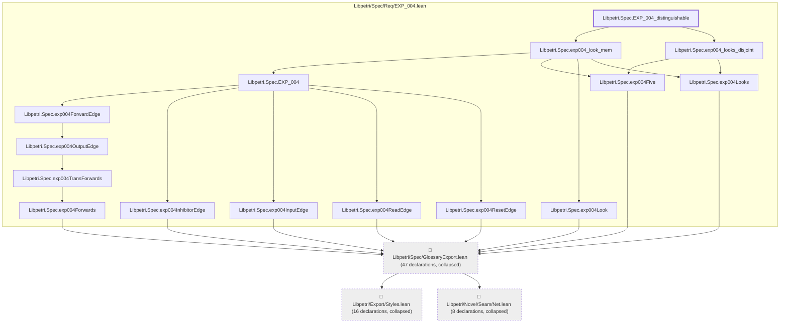

# EXP-004

Generated by `scripts/proof-graph.py` from `proof-graph.json`. Do not edit.

Theorems carrying this ID:

- `Libpetri.Spec.EXP_004_distinguishable` (theorem, `Libpetri/Spec/Req/EXP_004.lean:485`)

> **Note:** the full tree has 86 nodes (limit 60).

> Rule: this theorem's tree has 86 nodes (limit 60); every file other than its own is collapsed into one node, leaving 18.

Axioms used:

- `Libpetri.Spec.EXP_004_distinguishable`: `propext`
