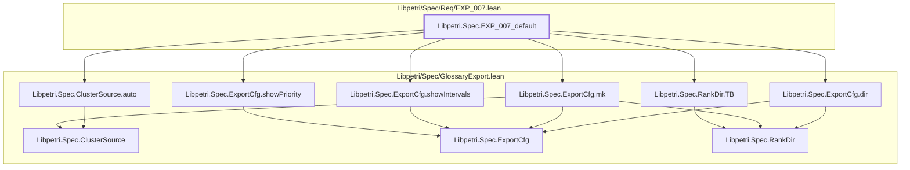

# EXP-007

Generated by `scripts/proof-graph.py` from `proof-graph.json`. Do not edit.

Theorems carrying this ID:

- `Libpetri.Spec.EXP_007_default` (theorem, `Libpetri/Spec/Req/EXP_007.lean:293`)

Axioms used:

- `Libpetri.Spec.EXP_007_default`: none
