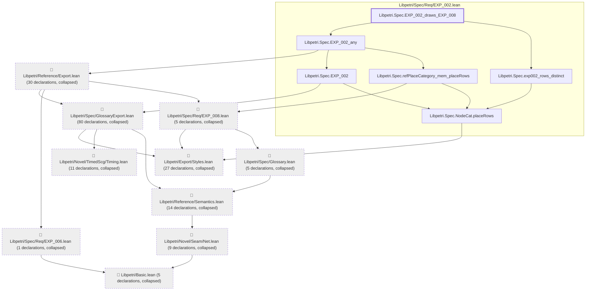

# EXP-008

Generated by `scripts/proof-graph.py` from `proof-graph.json`. Do not edit.

Theorems carrying this ID:

- `Libpetri.Spec.EXP_002_draws_EXP_008` (theorem, `Libpetri/Spec/Req/EXP_002.lean:145`)

> **Note:** the full tree has 193 nodes (limit 60).

> Rule: this theorem's tree has 193 nodes (limit 60); every file other than its own is collapsed into one node, leaving 16.

Axioms used:

- `Libpetri.Spec.EXP_002_draws_EXP_008`: `Classical.choice`, `Quot.sound`, `propext`
