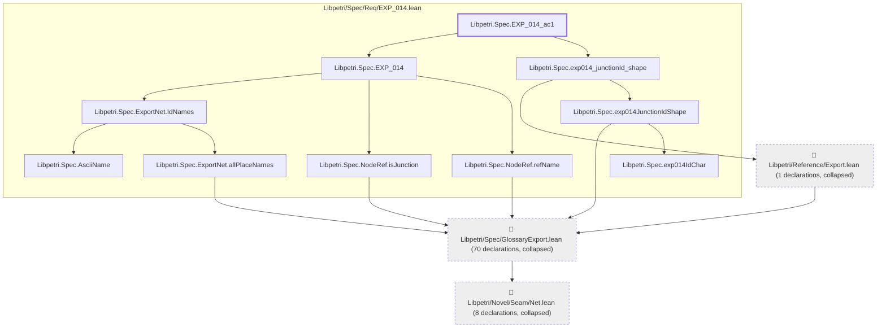
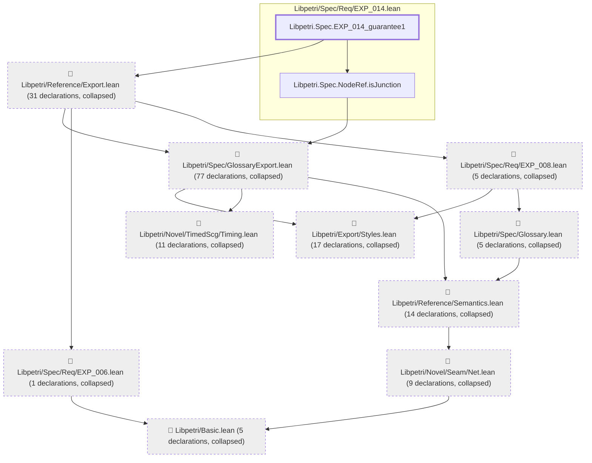

# EXP-014

Generated by `scripts/proof-graph.py` from `proof-graph.json`. Do not edit.

Theorems carrying this ID:

- `Libpetri.Spec.EXP_014_ac1` (theorem, `Libpetri/Spec/Req/EXP_014.lean:695`)
- `Libpetri.Spec.EXP_014_guarantee1` (theorem, `Libpetri/Spec/Req/EXP_014.lean:262`)

> **Note:** the full tree has 210 nodes (limit 60), so it is drawn as one diagram per theorem (2 theorems).

### `Libpetri.Spec.EXP_014_ac1`

> Rule: this theorem's tree has 89 nodes (limit 60); every file other than its own is collapsed into one node, leaving 13.

### `Libpetri.Spec.EXP_014_guarantee1`

> Rule: this theorem's tree has 177 nodes (limit 60); every file other than its own is collapsed into one node, leaving 12.

Axioms used:

- `Libpetri.Spec.EXP_014_ac1`: `Classical.choice`, `Quot.sound`, `propext`
- `Libpetri.Spec.EXP_014_guarantee1`: `Classical.choice`, `Quot.sound`, `propext`
