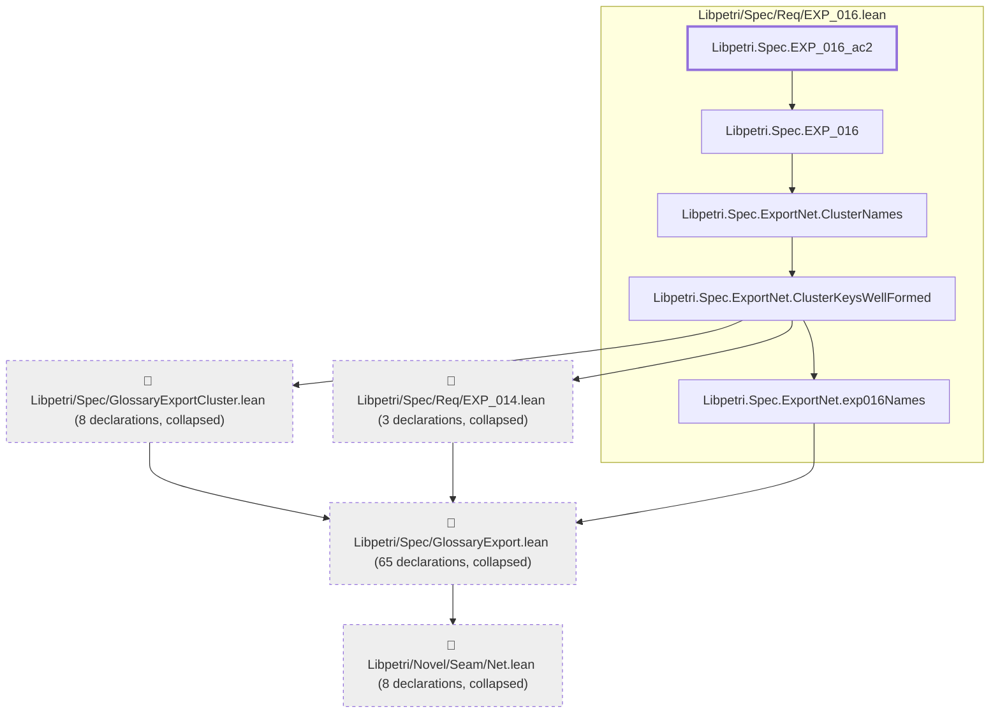
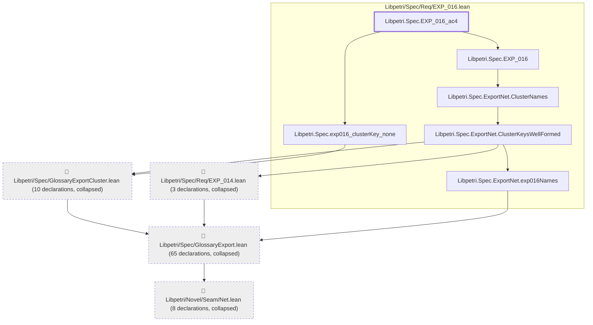
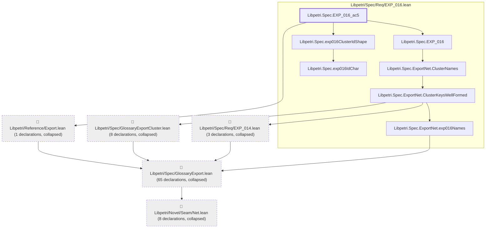

# EXP-016

Generated by `scripts/proof-graph.py` from `proof-graph.json`. Do not edit.

Theorems carrying this ID:

- `Libpetri.Spec.EXP_016_ac2` (theorem, `Libpetri/Spec/Req/EXP_016.lean:564`)
- `Libpetri.Spec.EXP_016_ac4` (theorem, `Libpetri/Spec/Req/EXP_016.lean:588`)
- `Libpetri.Spec.EXP_016_ac5` (theorem, `Libpetri/Spec/Req/EXP_016.lean:618`)

> **Note:** the full tree has 97 nodes (limit 60), so it is drawn as one diagram per theorem (3 theorems).

### `Libpetri.Spec.EXP_016_ac2`

> Rule: this theorem's tree has 89 nodes (limit 60); every file other than its own is collapsed into one node, leaving 9.

### `Libpetri.Spec.EXP_016_ac4`

> Rule: this theorem's tree has 92 nodes (limit 60); every file other than its own is collapsed into one node, leaving 10.

### `Libpetri.Spec.EXP_016_ac5`

> Rule: this theorem's tree has 92 nodes (limit 60); every file other than its own is collapsed into one node, leaving 12.

Axioms used:

- `Libpetri.Spec.EXP_016_ac2`: `Classical.choice`, `Quot.sound`, `propext`
- `Libpetri.Spec.EXP_016_ac4`: `Classical.choice`, `Quot.sound`, `propext`
- `Libpetri.Spec.EXP_016_ac5`: `Classical.choice`, `Quot.sound`, `propext`
