# IO-013

Generated by `scripts/proof-graph.py` from `proof-graph.json`. Do not edit.

Theorems carrying this ID:

- `Libpetri.Spec.EVT_010_reference` (theorem, `Libpetri/Spec/Req/EVT_010.lean:584`)

> **Note:** the full tree has 445 nodes (limit 60).

> Rule: this theorem's tree has 445 nodes (limit 60); every file other than its own is collapsed into one node, leaving 50.

```mermaid
flowchart TD
  subgraph g0["Libpetri/Spec/Req/EVT_010.lean"]
    n6419["Libpetri.Spec.EVT_010"]
    n6435["Libpetri.Spec.EVT_010_reference"]
    n15261["Libpetri.Spec.evt010_AgreesAto"]
    n15262["Libpetri.Spec.evt010_AtoFirst"]
    n15264["Libpetri.Spec.evt010_Spent"]
    n15270["Libpetri.Spec.evt010_atoAt"]
    n15271["Libpetri.Spec.evt010_atoAt_agree"]
    n15272["Libpetri.Spec.evt010_atoAt_of"]
    n15273["Libpetri.Spec.evt010_atoFirst_append"]
    n15274["Libpetri.Spec.evt010_atoOf"]
    n15275["Libpetri.Spec.evt010_atoOf_cons"]
    n15286["Libpetri.Spec.evt010_iff"]
    n15288["Libpetri.Spec.evt010_isExpire"]
    n15289["Libpetri.Spec.evt010_isTimeoutOut_iff"]
    n15296["Libpetri.Spec.evt010_lblId"]
    n15297["Libpetri.Spec.evt010_line1"]
    n15298["Libpetri.Spec.evt010_line1_of"]
    n15299["Libpetri.Spec.evt010_line2"]
    n15300["Libpetri.Spec.evt010_line2_of"]
    n15301["Libpetri.Spec.evt010_line3"]
    n15302["Libpetri.Spec.evt010_line3_of"]
    n15306["Libpetri.Spec.evt010_ref"]
    n15307["Libpetri.Spec.evt010_refAto"]
    n15308["Libpetri.Spec.evt010_refBoot"]
    n15309["Libpetri.Spec.evt010_refCount_expire"]
    n15310["Libpetri.Spec.evt010_refCount_fail"]
    n15311["Libpetri.Spec.evt010_refCount_tdeposit"]
    n15314["Libpetri.Spec.evt010_refTdeposit"]
    n15316["Libpetri.Spec.evt010_runLB"]
    n15317["Libpetri.Spec.evt010_runUB"]
    n15318["Libpetri.Spec.evt010_settlesTimeout"]
    n15321["Libpetri.Spec.evt010_stepUB"]
  end
  c0["📁 Libpetri/Basic.lean (7 declarations, collapsed)"]
  c54["📁 Libpetri/Novel/Seam/Net.lean (12 declarations, collapsed)"]
  c66["📁 Libpetri/Novel/TimedScg/Timing.lean (12 declarations, collapsed)"]
  c78["📁 Libpetri/Reference/Events.lean (36 declarations, collapsed)"]
  c80["📁 Libpetri/Reference/Exec.lean (58 declarations, collapsed)"]
  c91["📁 Libpetri/Reference/Queue.lean (14 declarations, collapsed)"]
  c94["📁 Libpetri/Reference/Semantics.lean (14 declarations, collapsed)"]
  c98["📁 Libpetri/Reference/Timed.lean (13 declarations, collapsed)"]
  c103["📁 Libpetri/RetrodictExec.lean (1 declarations, collapsed)"]
  c109["📁 Libpetri/Sched.lean (5 declarations, collapsed)"]
  c131["📁 Libpetri/Spec/Ears.lean (1 declarations, collapsed)"]
  c132["📁 Libpetri/Spec/Glossary.lean (4 declarations, collapsed)"]
  c138["📁 Libpetri/Spec/GlossaryEvents.lean (36 declarations, collapsed)"]
  c139["📁 Libpetri/Spec/GlossaryExec.lean (156 declarations, collapsed)"]
  c146["📁 Libpetri/Spec/GlossaryTime.lean (12 declarations, collapsed)"]
  c214["📁 Libpetri/Spec/Req/EVT_008.lean (1 declarations, collapsed)"]
  c232["📁 Libpetri/Spec/Req/EXEC_002.lean (16 declarations, collapsed)"]
  c239["📁 Libpetri/Spec/Req/EXEC_022.lean (15 declarations, collapsed)"]
  c54 --> c0
  c78 --> c80
  c78 --> c138
  c80 --> c139
  c91 --> c94
  c94 --> c54
  c98 --> c66
  c98 --> c94
  c103 --> c109
  c132 --> c94
  c139 --> c91
  c139 --> c232
  c146 --> c98
  c146 --> c132
  c214 --> c78
  c232 --> c103
  c232 --> c146
  c239 --> c80
  n6419 --> c131
  n6419 --> n15262
  n6419 --> n15274
  n6419 --> n15288
  n6419 --> n15318
  n6435 --> n15306
  n15261 --> c78
  n15261 --> n15296
  n15262 --> c138
  n15264 --> c78
  n15264 --> c239
  n15270 --> c138
  n15270 --> n15296
  n15271 --> n15261
  n15271 --> n15270
  n15272 --> n15270
  n15273 --> n15262
  n15274 --> c78
  n15274 --> n15270
  n15275 --> n15274
  n15286 --> n6419
  n15286 --> n15297
  n15286 --> n15299
  n15286 --> n15301
  n15288 --> c139
  n15289 --> c78
  n15296 --> c139
  n15297 --> c78
  n15297 --> c131
  n15297 --> n15288
  n15297 --> n15296
  n15298 --> n15297
  n15298 --> n15307
  n15299 --> c78
  n15299 --> c131
  n15299 --> n15262
  n15300 --> n15299
  n15301 --> n15274
  n15301 --> n15318
  n15302 --> n15301
  n15302 --> n15316
  n15302 --> n15317
  n15306 --> n15286
  n15306 --> n15298
  n15306 --> n15300
  n15306 --> n15302
  n15306 --> n15308
  n15306 --> n15314
  n15307 --> c78
  n15307 --> n15288
  n15307 --> n15296
  n15308 --> c78
  n15309 --> c78
  n15310 --> c214
  n15311 --> c78
  n15314 --> c78
  n15314 --> n15273
  n15316 --> c239
  n15316 --> n15271
  n15316 --> n15272
  n15316 --> n15275
  n15316 --> n15289
  n15316 --> n15309
  n15316 --> n15310
  n15316 --> n15311
  n15316 --> n15318
  n15317 --> n15271
  n15317 --> n15275
  n15317 --> n15321
  n15318 --> c78
  n15321 --> n15264
  n15321 --> n15270
  n15321 --> n15309
  n15321 --> n15310
  n15321 --> n15311
  classDef root stroke-width:3px
  classDef locked fill:#fff3cd,stroke:#b8860b
  classDef collapsed fill:#eeeeee,stroke-dasharray:4 4
  class n6435 root
  class c0,c54,c66,c78,c80,c91,c94,c98,c103,c109,c131,c132,c138,c139,c146,c214,c232,c239 collapsed
```

Axioms used:

- `Libpetri.Spec.EVT_010_reference`: `Classical.choice`, `Quot.sound`, `propext`
