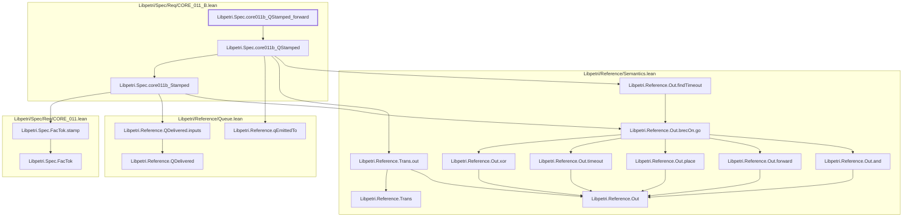

# IO-014

Generated by `scripts/proof-graph.py` from `proof-graph.json`. Do not edit.

Theorems carrying this ID:

- `Libpetri.Novel.ForwardDeposit.forward_exactly_two_breaks_unit_output` (theorem, `Libpetri/Novel/ForwardDeposit.lean:196`)

```mermaid
flowchart TD
  subgraph g0["Libpetri/Basic.lean"]
    n6["Libpetri.CMarking"]
    n8["Libpetri.Card"]
    n9["Libpetri.Card.all"]
    n10["Libpetri.Card.atLeast"]
    n11["Libpetri.Card.consumesAll"]
    n12["Libpetri.Card.exactly"]
    n13["Libpetri.Card.one"]
    n14["Libpetri.Card.required"]
    n21["Libpetri.Colour"]
    n132["Libpetri.Guard"]
    n134["Libpetri.InSpec"]
    n135["Libpetri.InSpec.card"]
    n136["Libpetri.InSpec.guard"]
    n137["Libpetri.InSpec.mk"]
    n138["Libpetri.InSpec.place"]
    n2720["Libpetri.PlaceId"]
    n13126["Libpetri.Transition"]
    n13128["Libpetri.Transition.inputs"]
    n13129["Libpetri.Transition.mk"]
    n13134["Libpetri.UnitOutput"]
    n13204["Libpetri.consumeCount"]
    n13217["Libpetri.consumedAt"]
    n13343["Libpetri.matchCount"]
    n13373["Libpetri.post"]
    n13433["Libpetri.specAt"]
  end
  subgraph g1["Libpetri/Novel/ForwardDeposit.lean"]
    n864["Libpetri.Novel.ForwardDeposit.Choice"]
    n865["Libpetri.Novel.ForwardDeposit.Choice.action"]
    n866["Libpetri.Novel.ForwardDeposit.Choice.timedOut"]
    n867["Libpetri.Novel.ForwardDeposit.Deposit"]
    n869["Libpetri.Novel.ForwardDeposit.OutSpec"]
    n870["Libpetri.Novel.ForwardDeposit.OutSpec.and"]
    n872["Libpetri.Novel.ForwardDeposit.OutSpec.brecOn.go"]
    n873["Libpetri.Novel.ForwardDeposit.OutSpec.forward"]
    n874["Libpetri.Novel.ForwardDeposit.OutSpec.place"]
    n875["Libpetri.Novel.ForwardDeposit.OutSpec.timeout"]
    n876["Libpetri.Novel.ForwardDeposit.OutSpec.xor"]
    n885["Libpetri.Novel.ForwardDeposit.branches"]
    n887["Libpetri.Novel.ForwardDeposit.cross"]
    n891["Libpetri.Novel.ForwardDeposit.deposit"]
    n894["Libpetri.Novel.ForwardDeposit.findTimeout"]
    n904["Libpetri.Novel.ForwardDeposit.forward_exactly_two_breaks_unit_output"]
    n908["Libpetri.Novel.ForwardDeposit.fwd_timeout_deposit"]
    n917["Libpetri.Novel.ForwardDeposit.m0Fwd"]
    n919["Libpetri.Novel.ForwardDeposit.oFwd"]
    n922["Libpetri.Novel.ForwardDeposit.oldRows"]
    n925["Libpetri.Novel.ForwardDeposit.pa"]
    n926["Libpetri.Novel.ForwardDeposit.pb"]
    n927["Libpetri.Novel.ForwardDeposit.pc"]
    n935["Libpetri.Novel.ForwardDeposit.tFwd"]
    n936["Libpetri.Novel.ForwardDeposit.timeoutDeposits"]
  end
  n6 --> n21
  n6 --> n2720
  n9 --> n8
  n10 --> n8
  n11 --> n9
  n11 --> n10
  n11 --> n12
  n11 --> n13
  n12 --> n8
  n13 --> n8
  n14 --> n9
  n14 --> n10
  n14 --> n12
  n14 --> n13
  n132 --> n21
  n135 --> n8
  n135 --> n134
  n136 --> n132
  n136 --> n134
  n137 --> n8
  n137 --> n132
  n137 --> n134
  n137 --> n2720
  n138 --> n134
  n138 --> n2720
  n865 --> n864
  n866 --> n864
  n867 --> n2720
  n870 --> n869
  n872 --> n870
  n872 --> n873
  n872 --> n874
  n872 --> n875
  n872 --> n876
  n873 --> n869
  n873 --> n2720
  n874 --> n869
  n874 --> n2720
  n875 --> n869
  n876 --> n869
  n885 --> n872
  n885 --> n887
  n887 --> n867
  n891 --> n865
  n891 --> n866
  n891 --> n885
  n891 --> n894
  n891 --> n936
  n894 --> n872
  n904 --> n908
  n904 --> n922
  n904 --> n13134
  n908 --> n891
  n908 --> n917
  n908 --> n919
  n908 --> n935
  n908 --> n13217
  n917 --> n6
  n917 --> n925
  n919 --> n873
  n919 --> n874
  n919 --> n875
  n919 --> n876
  n919 --> n925
  n919 --> n926
  n919 --> n927
  n922 --> n885
  n925 --> n2720
  n926 --> n2720
  n927 --> n2720
  n935 --> n12
  n935 --> n137
  n935 --> n925
  n935 --> n13129
  n936 --> n872
  n936 --> n887
  n13128 --> n134
  n13128 --> n13126
  n13129 --> n134
  n13129 --> n2720
  n13129 --> n13126
  n13134 --> n13373
  n13204 --> n11
  n13204 --> n14
  n13204 --> n135
  n13204 --> n13343
  n13217 --> n13204
  n13217 --> n13433
  n13343 --> n6
  n13343 --> n136
  n13343 --> n138
  n13373 --> n2720
  n13433 --> n138
  n13433 --> n13128
  classDef root stroke-width:3px
  classDef locked fill:#fff3cd,stroke:#b8860b
  classDef collapsed fill:#eeeeee,stroke-dasharray:4 4
  class n904 root
```

- `Libpetri.Spec.core011b_QStamped_forward` (theorem, `Libpetri/Spec/Req/CORE_011_B.lean:663`)

> **Note:** the full tree has 68 nodes (limit 60), so it is drawn as one diagram per theorem (2 theorems).

### `Libpetri.Novel.ForwardDeposit.forward_exactly_two_breaks_unit_output`

> Rule: this theorem's whole tree, 50 nodes.

### `Libpetri.Spec.core011b_QStamped_forward`

> Rule: this theorem's whole tree, 18 nodes.

Axioms used:

- `Libpetri.Novel.ForwardDeposit.forward_exactly_two_breaks_unit_output`: `Quot.sound`, `propext`
- `Libpetri.Spec.core011b_QStamped_forward`: `Quot.sound`, `propext`
