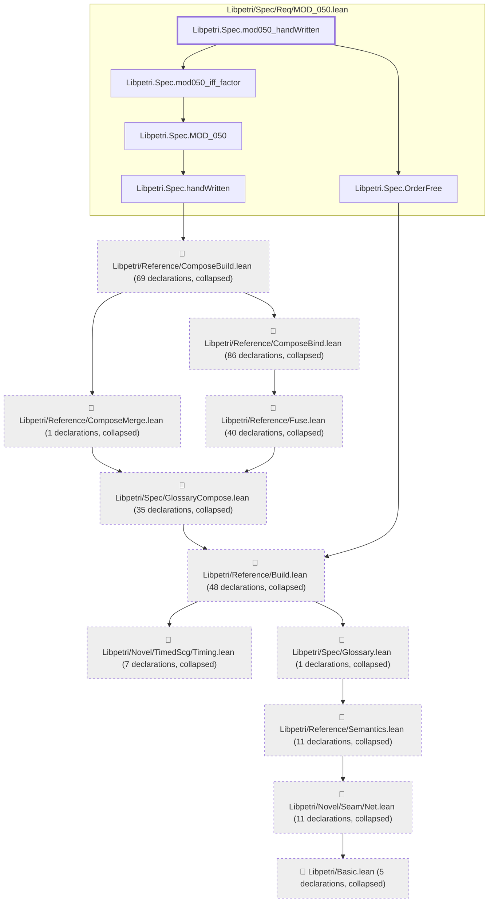

# MOD-023

Generated by `scripts/proof-graph.py` from `proof-graph.json`. Do not edit.

Theorems carrying this ID:

- `Libpetri.Spec.mod050_handWritten` (theorem, `Libpetri/Spec/Req/MOD_050.lean:181`)

> **Note:** the full tree has 319 nodes (limit 60).

> Rule: this theorem's tree has 319 nodes (limit 60); every file other than its own is collapsed into one node, leaving 16.

Axioms used:

- `Libpetri.Spec.mod050_handWritten`: `Classical.choice`, `Quot.sound`, `propext`
