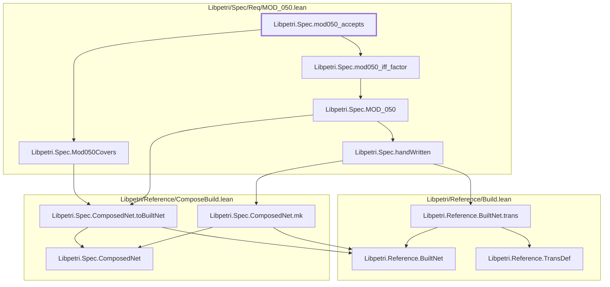

# MOD-050

Generated by `scripts/proof-graph.py` from `proof-graph.json`. Do not edit.

Theorems carrying this ID:

- `Libpetri.Spec.mod050_accepts` (theorem, `Libpetri/Spec/Req/MOD_050.lean:230`)

Axioms used:

- `Libpetri.Spec.mod050_accepts`: none
