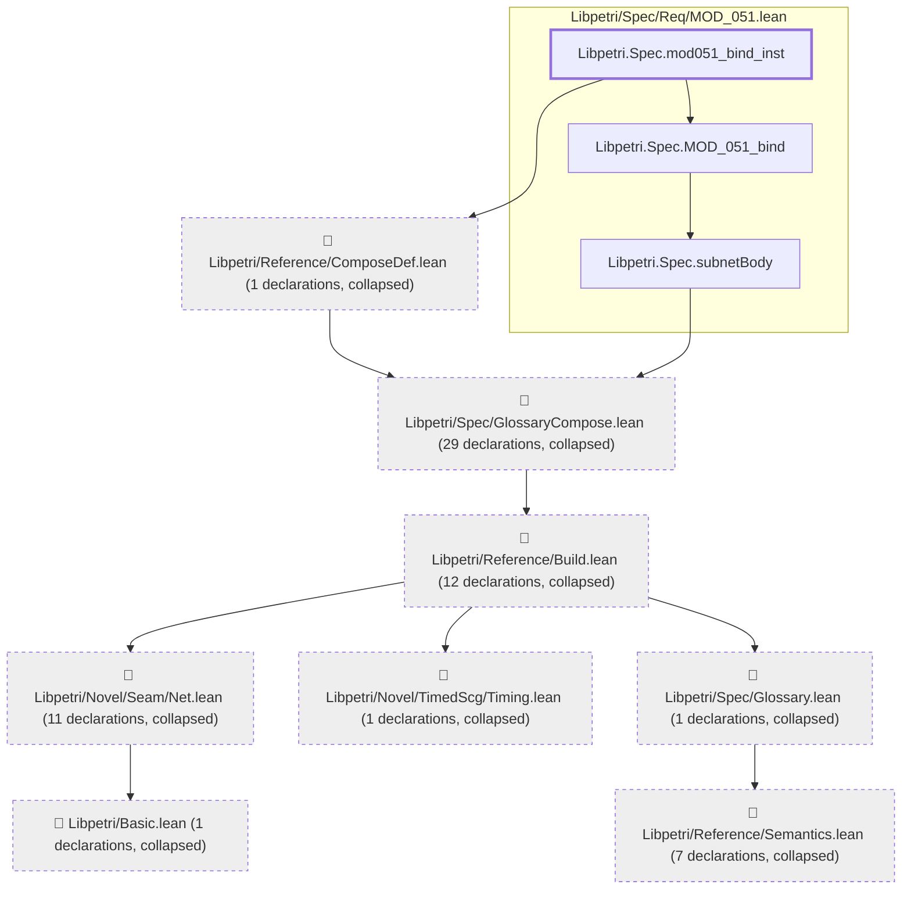
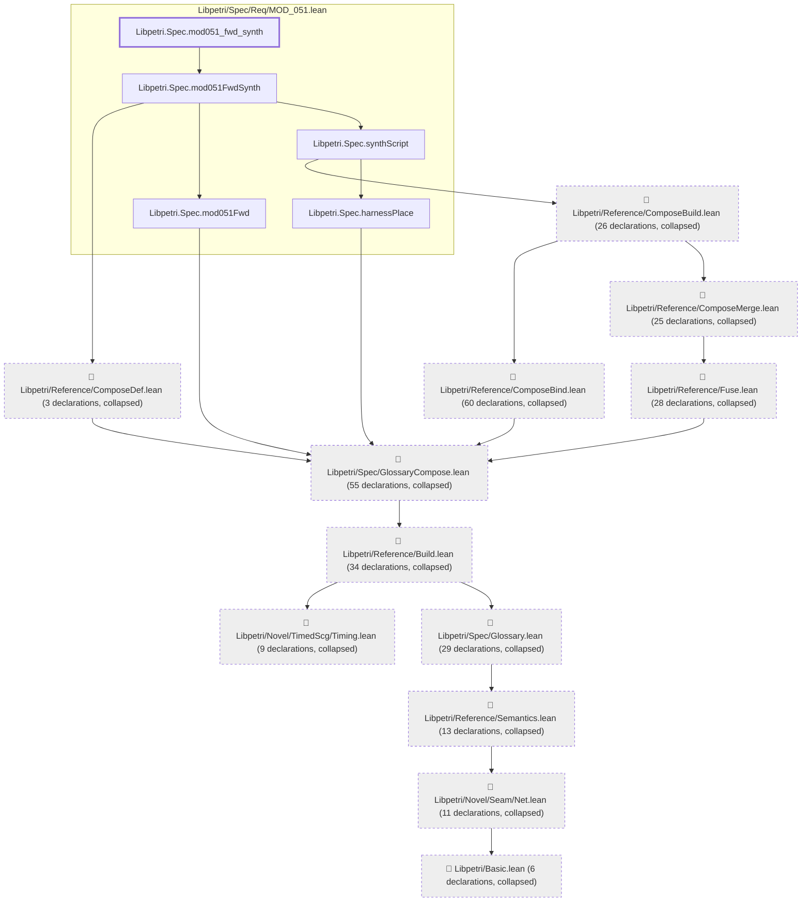

# MOD-051

Generated by `scripts/proof-graph.py` from `proof-graph.json`. Do not edit.

Theorems carrying this ID:

- `Libpetri.Spec.mod051_bind_inst` (theorem, `Libpetri/Spec/Req/MOD_051.lean:878`)
- `Libpetri.Spec.mod051_default` (theorem, `Libpetri/Spec/Req/MOD_051.lean:307`)
- `Libpetri.Spec.mod051_fails_of_build` (theorem, `Libpetri/Spec/Req/MOD_051.lean:321`)
- `Libpetri.Spec.mod051_fwd_synth` (theorem, `Libpetri/Spec/Req/MOD_051.lean:427`)
- `Libpetri.Spec.mod051_ref_covers` (theorem, `Libpetri/Spec/Req/MOD_051.lean:351`)

> **Note:** the full tree has 360 nodes (limit 60), so it is drawn as one diagram per theorem (5 theorems).

### `Libpetri.Spec.mod051_bind_inst`

> Rule: this theorem's tree has 66 nodes (limit 60); every file other than its own is collapsed into one node, leaving 11.

### `Libpetri.Spec.mod051_default`

> Rule: this theorem's tree has 86 nodes (limit 60); every file other than its own is collapsed into one node, leaving 39.

```mermaid
flowchart TD
  subgraph g0["Libpetri/Spec/Req/MOD_051.lean"]
    n8388["Libpetri.Spec.MOD_051"]
    n9964["Libpetri.Spec.SubnetHarness"]
    n9966["Libpetri.Spec.SubnetHarness.props"]
    n9967["Libpetri.Spec.SubnetHarness.sources"]
    n9991["Libpetri.Spec.SubnetReport"]
    n9993["Libpetri.Spec.SubnetReport.results"]
    n9994["Libpetri.Spec.SubnetReport.synth"]
    n9995["Libpetri.Spec.SubnetVerifyFn"]
    n9996["Libpetri.Spec.SubnetVerifyOpts"]
    n9997["Libpetri.Spec.SubnetVerifyOpts.hook"]
    n9998["Libpetri.Spec.SubnetVerifyOpts.mk"]
    n9999["Libpetri.Spec.SubnetVerifyOpts.mode"]
    n11979["Libpetri.Spec.VerifySetup"]
    n11980["Libpetri.Spec.VerifySetup.envs"]
    n11981["Libpetri.Spec.VerifySetup.m0"]
    n11982["Libpetri.Spec.VerifySetup.mk"]
    n11983["Libpetri.Spec.VerifySetup.mode"]
    n11984["Libpetri.Spec.VerifySetup.opts"]
    n11985["Libpetri.Spec.VerifySetup.prop"]
    n14050["Libpetri.Spec.defaultVerifyOpts"]
    n14113["Libpetri.Spec.emptyNM"]
    n16694["Libpetri.Spec.harnessEnvs"]
    n16695["Libpetri.Spec.harnessPlace"]
    n18347["Libpetri.Spec.mod051_default"]
    n18348["Libpetri.Spec.mod051_entry"]
    n20199["Libpetri.Spec.sourcesOk"]
    n20283["Libpetri.Spec.synthScript"]
    n21823["Libpetri.Spec.verifyOne"]
  end
  c53["📁 Libpetri/Novel/Seam/Index.lean (2 declarations, collapsed)"]
  c54["📁 Libpetri/Novel/Seam/Net.lean (2 declarations, collapsed)"]
  c66["📁 Libpetri/Novel/TimedScg/Timing.lean (7 declarations, collapsed)"]
  c71["📁 Libpetri/Reference/Build.lean (10 declarations, collapsed)"]
  c74["📁 Libpetri/Reference/ComposeBuild.lean (5 declarations, collapsed)"]
  c94["📁 Libpetri/Reference/Semantics.lean (6 declarations, collapsed)"]
  c98["📁 Libpetri/Reference/Timed.lean (2 declarations, collapsed)"]
  c135["📁 Libpetri/Spec/GlossaryCompose.lean (16 declarations, collapsed)"]
  c340["📁 Libpetri/Spec/Req/VER_002.lean (1 declarations, collapsed)"]
  c345["📁 Libpetri/Spec/Req/VER_006.lean (3 declarations, collapsed)"]
  c367["📁 Libpetri/Spec/Verifier/Result.lean (4 declarations, collapsed)"]
  c71 --> c98
  c74 --> c71
  c74 --> c135
  c94 --> c54
  c98 --> c66
  c98 --> c94
  c345 --> c367
  c367 --> c53
  c367 --> c98
  c367 --> c340
  n8388 --> n9966
  n8388 --> n9993
  n8388 --> n9994
  n8388 --> n9995
  n8388 --> n14050
  n8388 --> n16694
  n8388 --> n20199
  n8388 --> n20283
  n8388 --> n21823
  n9966 --> c340
  n9966 --> n9964
  n9967 --> n9964
  n9993 --> c367
  n9993 --> n9991
  n9994 --> c74
  n9994 --> n9991
  n9995 --> c135
  n9995 --> n9964
  n9995 --> n9991
  n9995 --> n9996
  n9997 --> c74
  n9997 --> n9996
  n9997 --> n11979
  n9998 --> c74
  n9998 --> c345
  n9998 --> n9996
  n9998 --> n11979
  n9999 --> c345
  n9999 --> n9996
  n11980 --> n11979
  n11981 --> c53
  n11981 --> n11979
  n11982 --> c345
  n11982 --> n11979
  n11983 --> c345
  n11983 --> n11979
  n11984 --> c367
  n11984 --> n11979
  n11985 --> c340
  n11985 --> n11979
  n14050 --> n9998
  n14113 --> c53
  n16694 --> n16695
  n16695 --> c135
  n18347 --> n18348
  n18348 --> n8388
  n20199 --> c135
  n20199 --> n9967
  n20283 --> c74
  n20283 --> n16695
  n21823 --> n9997
  n21823 --> n9999
  n21823 --> n11980
  n21823 --> n11981
  n21823 --> n11982
  n21823 --> n11983
  n21823 --> n11984
  n21823 --> n11985
  n21823 --> n14113
  classDef root stroke-width:3px
  classDef locked fill:#fff3cd,stroke:#b8860b
  classDef collapsed fill:#eeeeee,stroke-dasharray:4 4
  class n18347 root
  class c53,c54,c66,c71,c74,c94,c98,c135,c340,c345,c367 collapsed
```

### `Libpetri.Spec.mod051_fails_of_build`

> Rule: this theorem's tree has 85 nodes (limit 60); every file other than its own is collapsed into one node, leaving 38.

```mermaid
flowchart TD
  subgraph g0["Libpetri/Spec/Req/MOD_051.lean"]
    n8388["Libpetri.Spec.MOD_051"]
    n9964["Libpetri.Spec.SubnetHarness"]
    n9966["Libpetri.Spec.SubnetHarness.props"]
    n9967["Libpetri.Spec.SubnetHarness.sources"]
    n9991["Libpetri.Spec.SubnetReport"]
    n9993["Libpetri.Spec.SubnetReport.results"]
    n9994["Libpetri.Spec.SubnetReport.synth"]
    n9995["Libpetri.Spec.SubnetVerifyFn"]
    n9996["Libpetri.Spec.SubnetVerifyOpts"]
    n9997["Libpetri.Spec.SubnetVerifyOpts.hook"]
    n9998["Libpetri.Spec.SubnetVerifyOpts.mk"]
    n9999["Libpetri.Spec.SubnetVerifyOpts.mode"]
    n11979["Libpetri.Spec.VerifySetup"]
    n11980["Libpetri.Spec.VerifySetup.envs"]
    n11981["Libpetri.Spec.VerifySetup.m0"]
    n11982["Libpetri.Spec.VerifySetup.mk"]
    n11983["Libpetri.Spec.VerifySetup.mode"]
    n11984["Libpetri.Spec.VerifySetup.opts"]
    n11985["Libpetri.Spec.VerifySetup.prop"]
    n14050["Libpetri.Spec.defaultVerifyOpts"]
    n14113["Libpetri.Spec.emptyNM"]
    n16694["Libpetri.Spec.harnessEnvs"]
    n16695["Libpetri.Spec.harnessPlace"]
    n18350["Libpetri.Spec.mod051_fails_of_build"]
    n20199["Libpetri.Spec.sourcesOk"]
    n20283["Libpetri.Spec.synthScript"]
    n21823["Libpetri.Spec.verifyOne"]
  end
  c53["📁 Libpetri/Novel/Seam/Index.lean (2 declarations, collapsed)"]
  c54["📁 Libpetri/Novel/Seam/Net.lean (2 declarations, collapsed)"]
  c66["📁 Libpetri/Novel/TimedScg/Timing.lean (7 declarations, collapsed)"]
  c71["📁 Libpetri/Reference/Build.lean (10 declarations, collapsed)"]
  c74["📁 Libpetri/Reference/ComposeBuild.lean (5 declarations, collapsed)"]
  c94["📁 Libpetri/Reference/Semantics.lean (6 declarations, collapsed)"]
  c98["📁 Libpetri/Reference/Timed.lean (2 declarations, collapsed)"]
  c135["📁 Libpetri/Spec/GlossaryCompose.lean (16 declarations, collapsed)"]
  c340["📁 Libpetri/Spec/Req/VER_002.lean (1 declarations, collapsed)"]
  c345["📁 Libpetri/Spec/Req/VER_006.lean (3 declarations, collapsed)"]
  c367["📁 Libpetri/Spec/Verifier/Result.lean (4 declarations, collapsed)"]
  c71 --> c98
  c74 --> c71
  c74 --> c135
  c94 --> c54
  c98 --> c66
  c98 --> c94
  c345 --> c367
  c367 --> c53
  c367 --> c98
  c367 --> c340
  n8388 --> n9966
  n8388 --> n9993
  n8388 --> n9994
  n8388 --> n9995
  n8388 --> n14050
  n8388 --> n16694
  n8388 --> n20199
  n8388 --> n20283
  n8388 --> n21823
  n9966 --> c340
  n9966 --> n9964
  n9967 --> n9964
  n9993 --> c367
  n9993 --> n9991
  n9994 --> c74
  n9994 --> n9991
  n9995 --> c135
  n9995 --> n9964
  n9995 --> n9991
  n9995 --> n9996
  n9997 --> c74
  n9997 --> n9996
  n9997 --> n11979
  n9998 --> c74
  n9998 --> c345
  n9998 --> n9996
  n9998 --> n11979
  n9999 --> c345
  n9999 --> n9996
  n11980 --> n11979
  n11981 --> c53
  n11981 --> n11979
  n11982 --> c345
  n11982 --> n11979
  n11983 --> c345
  n11983 --> n11979
  n11984 --> c367
  n11984 --> n11979
  n11985 --> c340
  n11985 --> n11979
  n14050 --> n9998
  n14113 --> c53
  n16694 --> n16695
  n16695 --> c135
  n18350 --> n8388
  n20199 --> c135
  n20199 --> n9967
  n20283 --> c74
  n20283 --> n16695
  n21823 --> n9997
  n21823 --> n9999
  n21823 --> n11980
  n21823 --> n11981
  n21823 --> n11982
  n21823 --> n11983
  n21823 --> n11984
  n21823 --> n11985
  n21823 --> n14113
  classDef root stroke-width:3px
  classDef locked fill:#fff3cd,stroke:#b8860b
  classDef collapsed fill:#eeeeee,stroke-dasharray:4 4
  class n18350 root
  class c53,c54,c66,c71,c74,c94,c98,c135,c340,c345,c367 collapsed
```

### `Libpetri.Spec.mod051_fwd_synth`

> Rule: this theorem's tree has 304 nodes (limit 60); every file other than its own is collapsed into one node, leaving 17.

### `Libpetri.Spec.mod051_ref_covers`

> Rule: this theorem's tree has 86 nodes (limit 60); every file other than its own is collapsed into one node, leaving 40.

```mermaid
flowchart TD
  subgraph g0["Libpetri/Spec/Req/MOD_051.lean"]
    n8578["Libpetri.Spec.Mod051Covers"]
    n9964["Libpetri.Spec.SubnetHarness"]
    n9966["Libpetri.Spec.SubnetHarness.props"]
    n9967["Libpetri.Spec.SubnetHarness.sources"]
    n9991["Libpetri.Spec.SubnetReport"]
    n9992["Libpetri.Spec.SubnetReport.mk"]
    n9995["Libpetri.Spec.SubnetVerifyFn"]
    n9996["Libpetri.Spec.SubnetVerifyOpts"]
    n9997["Libpetri.Spec.SubnetVerifyOpts.hook"]
    n9998["Libpetri.Spec.SubnetVerifyOpts.mk"]
    n9999["Libpetri.Spec.SubnetVerifyOpts.mode"]
    n11979["Libpetri.Spec.VerifySetup"]
    n11980["Libpetri.Spec.VerifySetup.envs"]
    n11981["Libpetri.Spec.VerifySetup.m0"]
    n11982["Libpetri.Spec.VerifySetup.mk"]
    n11983["Libpetri.Spec.VerifySetup.mode"]
    n11984["Libpetri.Spec.VerifySetup.opts"]
    n11985["Libpetri.Spec.VerifySetup.prop"]
    n13533["Libpetri.Spec.core043VerifyMsg"]
    n14050["Libpetri.Spec.defaultVerifyOpts"]
    n14113["Libpetri.Spec.emptyNM"]
    n16694["Libpetri.Spec.harnessEnvs"]
    n16695["Libpetri.Spec.harnessPlace"]
    n17386["Libpetri.Spec.missingSourceMsg"]
    n18355["Libpetri.Spec.mod051_ref_covers"]
    n20004["Libpetri.Spec.refVerifySubnet"]
    n20199["Libpetri.Spec.sourcesOk"]
    n20283["Libpetri.Spec.synthScript"]
    n21823["Libpetri.Spec.verifyOne"]
  end
  c53["📁 Libpetri/Novel/Seam/Index.lean (2 declarations, collapsed)"]
  c54["📁 Libpetri/Novel/Seam/Net.lean (2 declarations, collapsed)"]
  c66["📁 Libpetri/Novel/TimedScg/Timing.lean (7 declarations, collapsed)"]
  c71["📁 Libpetri/Reference/Build.lean (10 declarations, collapsed)"]
  c74["📁 Libpetri/Reference/ComposeBuild.lean (5 declarations, collapsed)"]
  c94["📁 Libpetri/Reference/Semantics.lean (6 declarations, collapsed)"]
  c98["📁 Libpetri/Reference/Timed.lean (2 declarations, collapsed)"]
  c135["📁 Libpetri/Spec/GlossaryCompose.lean (15 declarations, collapsed)"]
  c340["📁 Libpetri/Spec/Req/VER_002.lean (1 declarations, collapsed)"]
  c345["📁 Libpetri/Spec/Req/VER_006.lean (3 declarations, collapsed)"]
  c367["📁 Libpetri/Spec/Verifier/Result.lean (4 declarations, collapsed)"]
  c71 --> c98
  c74 --> c71
  c74 --> c135
  c94 --> c54
  c98 --> c66
  c98 --> c94
  c345 --> c367
  c367 --> c53
  c367 --> c98
  c367 --> c340
  n8578 --> n9995
  n8578 --> n20199
  n8578 --> n20283
  n9966 --> c340
  n9966 --> n9964
  n9967 --> n9964
  n9992 --> c74
  n9992 --> c367
  n9992 --> n9991
  n9995 --> c135
  n9995 --> n9964
  n9995 --> n9991
  n9995 --> n9996
  n9997 --> c74
  n9997 --> n9996
  n9997 --> n11979
  n9998 --> c74
  n9998 --> c345
  n9998 --> n9996
  n9998 --> n11979
  n9999 --> c345
  n9999 --> n9996
  n11980 --> n11979
  n11981 --> c53
  n11981 --> n11979
  n11982 --> c345
  n11982 --> n11979
  n11983 --> c345
  n11983 --> n11979
  n11984 --> c367
  n11984 --> n11979
  n11985 --> c340
  n11985 --> n11979
  n14050 --> n9998
  n14113 --> c53
  n16694 --> n16695
  n16695 --> c135
  n18355 --> n8578
  n18355 --> n20004
  n20004 --> n9966
  n20004 --> n9992
  n20004 --> n9995
  n20004 --> n13533
  n20004 --> n14050
  n20004 --> n16694
  n20004 --> n17386
  n20004 --> n20199
  n20004 --> n20283
  n20004 --> n21823
  n20199 --> c135
  n20199 --> n9967
  n20283 --> c74
  n20283 --> n16695
  n21823 --> n9997
  n21823 --> n9999
  n21823 --> n11980
  n21823 --> n11981
  n21823 --> n11982
  n21823 --> n11983
  n21823 --> n11984
  n21823 --> n11985
  n21823 --> n14113
  classDef root stroke-width:3px
  classDef locked fill:#fff3cd,stroke:#b8860b
  classDef collapsed fill:#eeeeee,stroke-dasharray:4 4
  class n18355 root
  class c53,c54,c66,c71,c74,c94,c98,c135,c340,c345,c367 collapsed
```

Axioms used:

- `Libpetri.Spec.mod051_bind_inst`: `Classical.choice`, `Quot.sound`, `propext`
- `Libpetri.Spec.mod051_default`: `Classical.choice`, `Quot.sound`, `propext`
- `Libpetri.Spec.mod051_fails_of_build`: `Classical.choice`, `Quot.sound`, `propext`
- `Libpetri.Spec.mod051_fwd_synth`: `Classical.choice`, `Quot.sound`, `propext`
- `Libpetri.Spec.mod051_ref_covers`: `propext`
