# NU-010

Generated by `scripts/proof-graph.py` from `proof-graph.json`. Do not edit.

Theorems carrying this ID:

- `Libpetri.Spec.NU_010_routeA_mint` (theorem, `Libpetri/Spec/Req/NU_010.lean:888`)
- `Libpetri.Spec.nu010_contract_fresh` (theorem, `Libpetri/Spec/Req/NU_010.lean:422`)
- `Libpetri.Spec.nu010_fallback_unique` (theorem, `Libpetri/Spec/Req/NU_010.lean:324`)

> **Note:** the full tree has 80 nodes (limit 60), so it is drawn as one diagram per theorem (3 theorems).

### `Libpetri.Spec.NU_010_routeA_mint`

> Rule: this theorem's whole tree, 35 nodes.

```mermaid
flowchart TD
  subgraph g0["Libpetri/Basic.lean"]
    n8["Libpetri.Card"]
    n9["Libpetri.Card.all"]
    n10["Libpetri.Card.atLeast"]
    n12["Libpetri.Card.exactly"]
    n13["Libpetri.Card.one"]
    n14["Libpetri.Card.required"]
    n134["Libpetri.InSpec"]
    n135["Libpetri.InSpec.card"]
    n138["Libpetri.InSpec.place"]
    n2723["Libpetri.PlaceId"]
    n21910["Libpetri.Transition"]
    n21912["Libpetri.Transition.inputs"]
    n22162["Libpetri.pre"]
    n22217["Libpetri.specAt"]
  end
  subgraph g1["Libpetri/Novel/ForwardDeposit.lean"]
    n867["Libpetri.Novel.ForwardDeposit.Deposit"]
  end
  subgraph g2["Libpetri/Novel/RouteA/Model.lean"]
    n1179["Libpetri.Novel.RouteA.Cls"]
    n1180["Libpetri.Novel.RouteA.Cls.consume"]
    n1181["Libpetri.Novel.RouteA.Cls.join"]
    n1182["Libpetri.Novel.RouteA.Cls.mint"]
    n1184["Libpetri.Novel.RouteA.Cls.untouched"]
  end
  subgraph g3["Libpetri/Novel/RouteA/Plan.lean"]
    n1217["Libpetri.Novel.RouteA.Gate"]
    n1226["Libpetri.Novel.RouteA.MatchInfo"]
    n1227["Libpetri.Novel.RouteA.MatchInfo.keys"]
    n1229["Libpetri.Novel.RouteA.MatchInfo.relays"]
    n1391["Libpetri.Novel.RouteA.SrcRow"]
    n1392["Libpetri.Novel.RouteA.SrcRow.d"]
    n1393["Libpetri.Novel.RouteA.SrcRow.declared"]
    n1396["Libpetri.Novel.RouteA.SrcRow.ms"]
    n1397["Libpetri.Novel.RouteA.SrcRow.t"]
    n1398["Libpetri.Novel.RouteA.SrcRow.tw"]
    n1422["Libpetri.Novel.RouteA.classifyRowG"]
    n1424["Libpetri.Novel.RouteA.classifyRowG_mint_gate"]
    n1501["Libpetri.Novel.RouteA.shippedGate"]
    n1503["Libpetri.Novel.RouteA.shipped_mint"]
  end
  subgraph g4["Libpetri/Spec/Req/NU_010.lean"]
    n8644["Libpetri.Spec.NU_010_routeA_mint"]
  end
  n9 --> n8
  n10 --> n8
  n12 --> n8
  n13 --> n8
  n14 --> n9
  n14 --> n10
  n14 --> n12
  n14 --> n13
  n135 --> n8
  n135 --> n134
  n138 --> n134
  n138 --> n2723
  n867 --> n2723
  n1180 --> n1179
  n1180 --> n2723
  n1181 --> n1179
  n1181 --> n2723
  n1182 --> n1179
  n1182 --> n2723
  n1184 --> n1179
  n1217 --> n1391
  n1217 --> n2723
  n1227 --> n1226
  n1227 --> n2723
  n1229 --> n1226
  n1229 --> n2723
  n1392 --> n867
  n1392 --> n1391
  n1393 --> n1391
  n1396 --> n1226
  n1396 --> n1391
  n1397 --> n1391
  n1397 --> n21910
  n1398 --> n1391
  n1398 --> n2723
  n1422 --> n867
  n1422 --> n1180
  n1422 --> n1181
  n1422 --> n1182
  n1422 --> n1184
  n1422 --> n1227
  n1422 --> n1229
  n1422 --> n22162
  n1424 --> n1422
  n1501 --> n1217
  n1501 --> n1393
  n1501 --> n1398
  n1503 --> n1392
  n1503 --> n1396
  n1503 --> n1397
  n1503 --> n1424
  n1503 --> n1501
  n8644 --> n1503
  n21912 --> n134
  n21912 --> n21910
  n22162 --> n14
  n22162 --> n135
  n22162 --> n22217
  n22217 --> n138
  n22217 --> n21912
  classDef root stroke-width:3px
  classDef locked fill:#fff3cd,stroke:#b8860b
  classDef collapsed fill:#eeeeee,stroke-dasharray:4 4
  class n8644 root
```

### `Libpetri.Spec.nu010_contract_fresh`

> Rule: this theorem's whole tree, 39 nodes.

```mermaid
flowchart TD
  subgraph g0["Libpetri/Reference/NuMint.lean"]
    n3079["Libpetri.Reference.MintContract"]
    n3080["Libpetri.Reference.MintEv"]
    n3081["Libpetri.Reference.MintEv.boundary"]
    n3082["Libpetri.Reference.MintEv.call"]
    n3084["Libpetri.Reference.MintRun"]
    n3088["Libpetri.Reference.MintRun.boundary"]
    n3089["Libpetri.Reference.MintRun.call"]
    n3090["Libpetri.Reference.MintRun.nil"]
    n3091["Libpetri.Reference.MintSt"]
    n3092["Libpetri.Reference.MintSt.ctr"]
    n3093["Libpetri.Reference.MintSt.mk"]
    n3094["Libpetri.Reference.MintSt.scope"]
    n3095["Libpetri.Reference.MintSys"]
    n3096["Libpetri.Reference.MintSys.St"]
    n3097["Libpetri.Reference.MintSys.init"]
    n3098["Libpetri.Reference.MintSys.mint"]
    n3099["Libpetri.Reference.MintSys.mk"]
    n3100["Libpetri.Reference.MintSys.next"]
    n3102["Libpetri.Reference.MintedUnder"]
    n3616["Libpetri.Reference.calls"]
    n3643["Libpetri.Reference.colon_not_mem_repr"]
    n4064["Libpetri.Reference.mintName"]
    n4066["Libpetri.Reference.mintName_counter_inj"]
    n4067["Libpetri.Reference.mintName_inj"]
    n4070["Libpetri.Reference.mintName_toList"]
    n4073["Libpetri.Reference.mintSeq"]
    n4074["Libpetri.Reference.mintSeq_counters"]
    n4078["Libpetri.Reference.mintSeq_nodup"]
    n4079["Libpetri.Reference.mint_digit_of_mem_repr"]
    n4080["Libpetri.Reference.mint_split_first"]
    n4081["Libpetri.Reference.mint_split_last"]
    n4082["Libpetri.Reference.mintedUnder_unique"]
    n4405["Libpetri.Reference.refMint"]
    n4408["Libpetri.Reference.refMintSys"]
    n4456["Libpetri.Reference.refRun_eq"]
    n4461["Libpetri.Reference.refRun_mintedUnder"]
    n4463["Libpetri.Reference.refRun_nodup"]
  end
  subgraph g1["Libpetri/Spec/Req/NU_010.lean"]
    n8631["Libpetri.Spec.NU_010_contract"]
    n18622["Libpetri.Spec.nu010_contract_fresh"]
  end
  n3081 --> n3080
  n3082 --> n3080
  n3084 --> n3080
  n3084 --> n3096
  n3088 --> n3081
  n3088 --> n3084
  n3088 --> n3100
  n3089 --> n3082
  n3089 --> n3084
  n3089 --> n3098
  n3090 --> n3084
  n3092 --> n3091
  n3093 --> n3091
  n3094 --> n3091
  n3096 --> n3095
  n3097 --> n3096
  n3098 --> n3096
  n3099 --> n3095
  n3100 --> n3096
  n3102 --> n4064
  n3616 --> n3081
  n3616 --> n3082
  n3643 --> n4079
  n4066 --> n3643
  n4066 --> n4070
  n4066 --> n4081
  n4067 --> n3643
  n4067 --> n4070
  n4067 --> n4081
  n4070 --> n4064
  n4073 --> n4405
  n4074 --> n4073
  n4078 --> n4066
  n4078 --> n4074
  n4081 --> n4080
  n4082 --> n3102
  n4082 --> n4067
  n4405 --> n3092
  n4405 --> n3093
  n4405 --> n3094
  n4405 --> n4064
  n4408 --> n3099
  n4408 --> n4405
  n4456 --> n3088
  n4456 --> n3089
  n4456 --> n3090
  n4456 --> n3616
  n4456 --> n4073
  n4456 --> n4408
  n4461 --> n3097
  n4461 --> n3102
  n4461 --> n4074
  n4461 --> n4456
  n4463 --> n4078
  n4463 --> n4456
  n18622 --> n3079
  n18622 --> n4082
  n18622 --> n4461
  n18622 --> n4463
  n18622 --> n8631
  classDef root stroke-width:3px
  classDef locked fill:#fff3cd,stroke:#b8860b
  classDef collapsed fill:#eeeeee,stroke-dasharray:4 4
  class n18622 root
```

### `Libpetri.Spec.nu010_fallback_unique`

> Rule: this theorem's whole tree, 25 nodes.

```mermaid
flowchart TD
  subgraph g0["Libpetri/Reference/NuMint.lean"]
    n3080["Libpetri.Reference.MintEv"]
    n3081["Libpetri.Reference.MintEv.boundary"]
    n3082["Libpetri.Reference.MintEv.call"]
    n3084["Libpetri.Reference.MintRun"]
    n3088["Libpetri.Reference.MintRun.boundary"]
    n3089["Libpetri.Reference.MintRun.call"]
    n3090["Libpetri.Reference.MintRun.nil"]
    n3095["Libpetri.Reference.MintSys"]
    n3096["Libpetri.Reference.MintSys.St"]
    n3098["Libpetri.Reference.MintSys.mint"]
    n3099["Libpetri.Reference.MintSys.mk"]
    n3100["Libpetri.Reference.MintSys.next"]
    n3643["Libpetri.Reference.colon_not_mem_repr"]
    n3839["Libpetri.Reference.hash_not_mem_repr"]
    n4064["Libpetri.Reference.mintName"]
    n4066["Libpetri.Reference.mintName_counter_inj"]
    n4070["Libpetri.Reference.mintName_toList"]
    n4079["Libpetri.Reference.mint_digit_of_mem_repr"]
    n4080["Libpetri.Reference.mint_split_first"]
    n4081["Libpetri.Reference.mint_split_last"]
  end
  subgraph g1["Libpetri/Spec/Req/NU_010.lean"]
    n18626["Libpetri.Spec.nu010_fallbackSys"]
    n18627["Libpetri.Spec.nu010_fallback_run"]
    n18628["Libpetri.Spec.nu010_fallback_unique"]
    n18630["Libpetri.Spec.nu010_hashFmt"]
    n18631["Libpetri.Spec.nu010_hashFmt_counter_inj"]
  end
  n3081 --> n3080
  n3082 --> n3080
  n3084 --> n3080
  n3084 --> n3096
  n3088 --> n3081
  n3088 --> n3084
  n3088 --> n3100
  n3089 --> n3082
  n3089 --> n3084
  n3089 --> n3098
  n3090 --> n3084
  n3096 --> n3095
  n3098 --> n3096
  n3099 --> n3095
  n3100 --> n3096
  n3643 --> n4079
  n3839 --> n4079
  n4066 --> n3643
  n4066 --> n4070
  n4066 --> n4081
  n4070 --> n4064
  n4081 --> n4080
  n18626 --> n3099
  n18627 --> n3088
  n18627 --> n3089
  n18627 --> n3090
  n18627 --> n18626
  n18628 --> n4066
  n18628 --> n18627
  n18628 --> n18631
  n18631 --> n3839
  n18631 --> n4081
  n18631 --> n18630
  classDef root stroke-width:3px
  classDef locked fill:#fff3cd,stroke:#b8860b
  classDef collapsed fill:#eeeeee,stroke-dasharray:4 4
  class n18628 root
```

Axioms used:

- `Libpetri.Spec.NU_010_routeA_mint`: `Quot.sound`, `propext`
- `Libpetri.Spec.nu010_contract_fresh`: `Classical.choice`, `Quot.sound`, `propext`
- `Libpetri.Spec.nu010_fallback_unique`: `Classical.choice`, `Quot.sound`, `propext`
