# NU-011

Generated by `scripts/proof-graph.py` from `proof-graph.json`. Do not edit.

Theorems carrying this ID:

- `Libpetri.Spec.nu011_ac2` (theorem, `Libpetri/Spec/Req/NU_011.lean:352`)
- `Libpetri.Spec.nu011_ac6` (theorem, `Libpetri/Spec/Req/NU_011.lean:312`)
- `Libpetri.Spec.nu011_collision` (theorem, `Libpetri/Spec/Req/NU_011.lean:305`)
- `Libpetri.Spec.nu011_default_draw_accepted` (theorem, `Libpetri/Spec/Req/NU_011.lean:338`)
- `Libpetri.Spec.nu011_default_not_runId` (theorem, `Libpetri/Spec/Req/NU_011.lean:345`)
- `Libpetri.Spec.nu011_fromId_fixed` (theorem, `Libpetri/Spec/Req/NU_011.lean:650`)
- `Libpetri.Spec.nu011_host_replay` (theorem, `Libpetri/Spec/Req/NU_011.lean:365`)
- `Libpetri.Spec.nu011_lineage_nodup` (theorem, `Libpetri/Spec/Req/NU_011.lean:396`)
- `Libpetri.Spec.nu011_lineage_of_format` (theorem, `Libpetri/Spec/Req/NU_011.lean:223`)
- `Libpetri.Spec.nu011_parse` (theorem, `Libpetri/Spec/Req/NU_011.lean:297`)
- `Libpetri.Spec.nu011_replay` (theorem, `Libpetri/Spec/Req/NU_011.lean:280`)

```mermaid
flowchart TD
  subgraph g0["Libpetri/Reference/NuMint.lean"]
    n3080["Libpetri.Reference.MintEv"]
    n3081["Libpetri.Reference.MintEv.boundary"]
    n3082["Libpetri.Reference.MintEv.call"]
    n3084["Libpetri.Reference.MintRun"]
    n3095["Libpetri.Reference.MintSys"]
    n3096["Libpetri.Reference.MintSys.St"]
    n3097["Libpetri.Reference.MintSys.init"]
    n3102["Libpetri.Reference.MintedUnder"]
    n3378["Libpetri.Reference.ScopeCheck"]
    n3616["Libpetri.Reference.calls"]
    n3643["Libpetri.Reference.colon_not_mem_repr"]
    n4064["Libpetri.Reference.mintName"]
    n4067["Libpetri.Reference.mintName_inj"]
    n4068["Libpetri.Reference.mintName_inj_of_valid"]
    n4070["Libpetri.Reference.mintName_toList"]
    n4079["Libpetri.Reference.mint_digit_of_mem_repr"]
    n4080["Libpetri.Reference.mint_split_first"]
    n4081["Libpetri.Reference.mint_split_last"]
    n4082["Libpetri.Reference.mintedUnder_unique"]
    n4508["Libpetri.Reference.refValidScope"]
    n4510["Libpetri.Reference.refValidScope_iff"]
    n4511["Libpetri.Reference.refValidScope_noHash"]
  end
  subgraph g1["Libpetri/Spec/Req/NU_011.lean"]
    n6080["Libpetri.Spec.DefaultUnfixed"]
    n8667["Libpetri.Spec.NU_011_default"]
    n8671["Libpetri.Spec.NU_011_format"]
    n8681["Libpetri.Spec.NU_011_host"]
    n8685["Libpetri.Spec.NU_011_lineage"]
    n18645["Libpetri.Spec.nu011_ac2"]
    n18646["Libpetri.Spec.nu011_ac6"]
    n18649["Libpetri.Spec.nu011_collision"]
    n18652["Libpetri.Spec.nu011_default_accepted"]
    n18653["Libpetri.Spec.nu011_default_draw_accepted"]
    n18654["Libpetri.Spec.nu011_default_not_runId"]
    n18655["Libpetri.Spec.nu011_fromId"]
    n18656["Libpetri.Spec.nu011_fromId_fixed"]
    n18661["Libpetri.Spec.nu011_hexDigits"]
    n18662["Libpetri.Spec.nu011_hexId"]
    n18665["Libpetri.Spec.nu011_host_replay"]
    n18666["Libpetri.Spec.nu011_lineage_nodup"]
    n18667["Libpetri.Spec.nu011_lineage_of_format"]
    n18668["Libpetri.Spec.nu011_mintedUnder"]
    n18669["Libpetri.Spec.nu011_noHash"]
    n18673["Libpetri.Spec.nu011_parse"]
    n18679["Libpetri.Spec.nu011_replay"]
  end
  n3081 --> n3080
  n3082 --> n3080
  n3084 --> n3080
  n3084 --> n3096
  n3096 --> n3095
  n3097 --> n3096
  n3102 --> n4064
  n3616 --> n3081
  n3616 --> n3082
  n3643 --> n4079
  n4067 --> n3643
  n4067 --> n4070
  n4067 --> n4081
  n4068 --> n4067
  n4068 --> n4511
  n4070 --> n4064
  n4081 --> n4080
  n4082 --> n3102
  n4082 --> n4067
  n4508 --> n3378
  n4510 --> n4508
  n4511 --> n4510
  n8667 --> n18661
  n8671 --> n3084
  n8671 --> n3097
  n8671 --> n3378
  n8671 --> n3616
  n8671 --> n4064
  n8685 --> n3084
  n8685 --> n3097
  n8685 --> n3378
  n18645 --> n18667
  n18646 --> n18673
  n18649 --> n4064
  n18652 --> n4510
  n18652 --> n18661
  n18653 --> n8667
  n18653 --> n18652
  n18654 --> n6080
  n18655 --> n18662
  n18656 --> n6080
  n18656 --> n18655
  n18665 --> n8681
  n18665 --> n18667
  n18666 --> n8685
  n18667 --> n4082
  n18667 --> n8685
  n18667 --> n18668
  n18667 --> n18669
  n18668 --> n3102
  n18668 --> n8671
  n18669 --> n8671
  n18673 --> n4068
  n18679 --> n8671
  classDef root stroke-width:3px
  classDef locked fill:#fff3cd,stroke:#b8860b
  classDef collapsed fill:#eeeeee,stroke-dasharray:4 4
  class n18645,n18646,n18649,n18653,n18654,n18656,n18665,n18666,n18667,n18673,n18679 root
```

Axioms used:

- `Libpetri.Spec.nu011_ac2`: `Classical.choice`, `Quot.sound`, `propext`
- `Libpetri.Spec.nu011_ac6`: `Classical.choice`, `Quot.sound`, `propext`
- `Libpetri.Spec.nu011_collision`: `propext`
- `Libpetri.Spec.nu011_default_draw_accepted`: `Classical.choice`, `Quot.sound`, `propext`
- `Libpetri.Spec.nu011_default_not_runId`: none
- `Libpetri.Spec.nu011_fromId_fixed`: none
- `Libpetri.Spec.nu011_host_replay`: `Classical.choice`, `Quot.sound`, `propext`
- `Libpetri.Spec.nu011_lineage_nodup`: `Quot.sound`, `propext`
- `Libpetri.Spec.nu011_lineage_of_format`: `Classical.choice`, `Quot.sound`, `propext`
- `Libpetri.Spec.nu011_parse`: `Classical.choice`, `Quot.sound`, `propext`
- `Libpetri.Spec.nu011_replay`: `Classical.choice`, `Quot.sound`, `propext`
