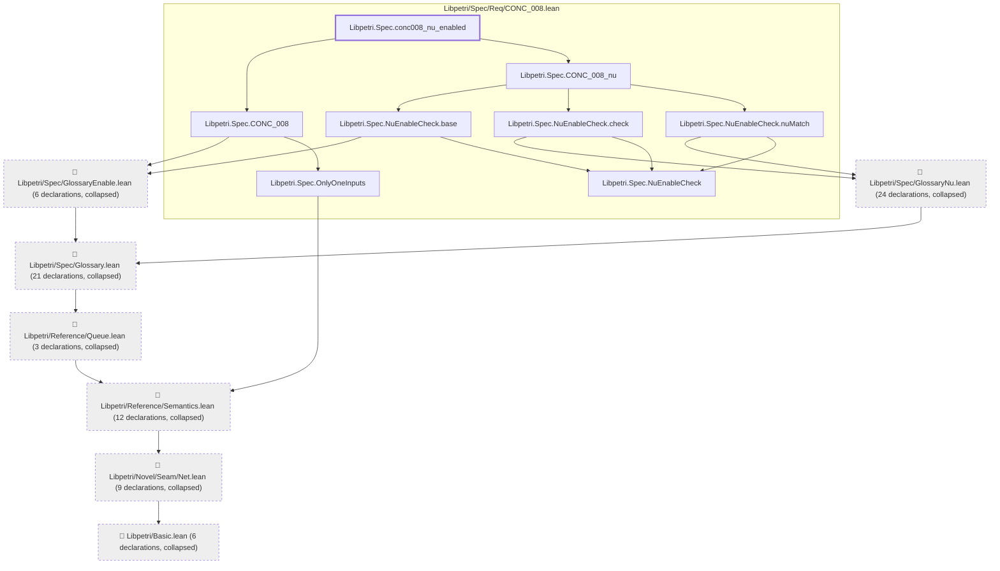
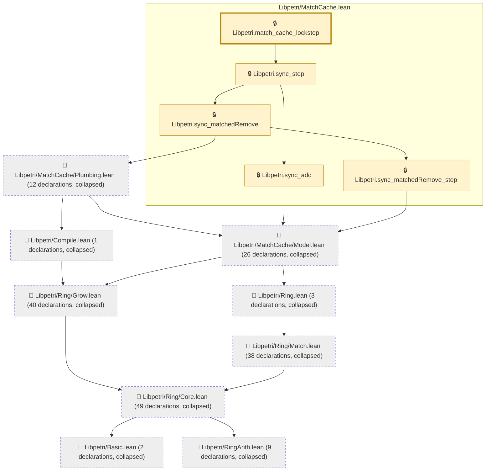
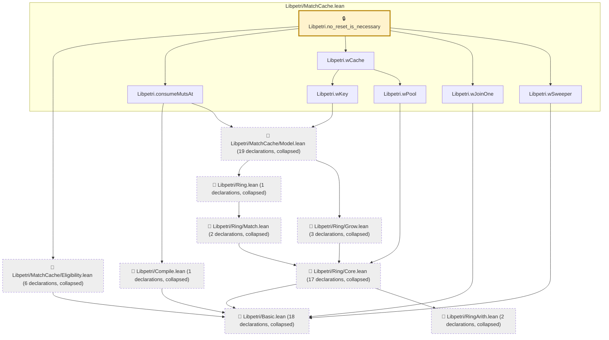
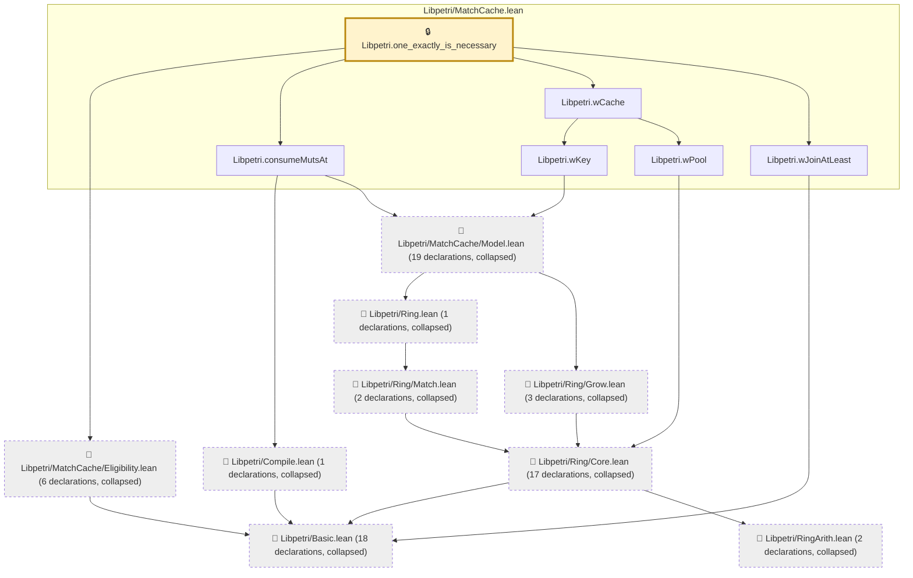
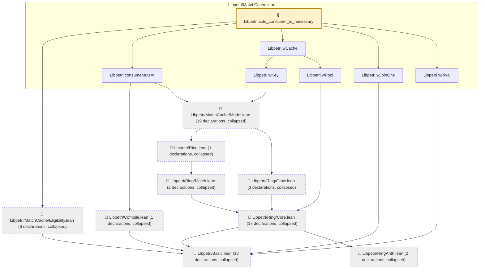

# NU-020

Generated by `scripts/proof-graph.py` from `proof-graph.json`. Do not edit.

Theorems carrying this ID:

- `Libpetri.Spec.conc008_nu_enabled` (theorem, `Libpetri/Spec/Req/CONC_008.lean:819`)
- `Libpetri.fire_muts_lockstep` (theorem, `Libpetri/MatchCache.lean:347`) 🔒 locked
- `Libpetri.match_cache_lockstep` (theorem, `Libpetri/MatchCache.lean:215`) 🔒 locked
- `Libpetri.no_reset_is_necessary` (theorem, `Libpetri/MatchCache.lean:482`) 🔒 locked
- `Libpetri.one_exactly_is_necessary` (theorem, `Libpetri/MatchCache.lean:441`) 🔒 locked
- `Libpetri.sole_consumer_is_necessary` (theorem, `Libpetri/MatchCache.lean:465`) 🔒 locked

> **Note:** the full tree has 321 nodes (limit 60), so it is drawn as one diagram per theorem (6 theorems).

### `Libpetri.Spec.conc008_nu_enabled`

> Rule: this theorem's tree has 89 nodes (limit 60); every file other than its own is collapsed into one node, leaving 15.

### `Libpetri.fire_muts_lockstep`

> Rule: this theorem's whole tree, 51 nodes.

```mermaid
flowchart TD
  subgraph g0["Libpetri/Basic.lean"]
    n8["Libpetri.Card"]
    n9["Libpetri.Card.all"]
    n10["Libpetri.Card.atLeast"]
    n12["Libpetri.Card.exactly"]
    n13["Libpetri.Card.one"]
    n14["Libpetri.Card.required"]
    n21["Libpetri.Colour"]
    n134["Libpetri.InSpec"]
    n135["Libpetri.InSpec.card"]
    n138["Libpetri.InSpec.place"]
    n2720["Libpetri.PlaceId"]
    n13126["Libpetri.Transition"]
    n13128["Libpetri.Transition.inputs"]
    n13133["Libpetri.Transition.resets"]
    n13433["Libpetri.specAt"]
  end
  subgraph g1["Libpetri/Compile.lean"]
    n13205["Libpetri.consumeCountAt"]
  end
  subgraph g2["Libpetri/MatchCache.lean"]
    n13212["Libpetri.consumeMutsAt"]
    n13285["🔒 Libpetri.fire_muts_lockstep"]
    n13292["🔒 Libpetri.foreign_fire_emits_nothing"]
    n13359["🔒 Libpetri.owner_fire_emits_lockstep"]
  end
  subgraph g3["Libpetri/MatchCache/Eligibility.lean"]
    n124["Libpetri.FastPathEligible"]
    n125["Libpetri.FastPathEligible.fixed_count"]
    n127["Libpetri.FastPathEligible.no_reset"]
    n128["Libpetri.FastPathEligible.owner"]
    n129["Libpetri.FastPathEligible.sole_consumer"]
    n13218["Libpetri.consumerTids"]
    n13219["🔒 Libpetri.consumerTids_ge"]
    n13220["🔒 Libpetri.consumerTids_nil"]
    n13221["🔒 Libpetri.consumerTids_single"]
    n13288["Libpetri.fixedRequired"]
    n13302["Libpetri.inputConsumers"]
    n13411["Libpetri.requiredOf"]
    n13412["Libpetri.resetTarget"]
    n13413["🔒 Libpetri.resetTarget_false"]
    n13438["Libpetri.specTids"]
    n13439["🔒 Libpetri.specTids_length"]
    n13440["🔒 Libpetri.specTids_mem"]
  end
  subgraph g4["Libpetri/MatchCache/Model.lean"]
    n141["Libpetri.KeyOf"]
    n147["Libpetri.LockstepMut"]
    n148["Libpetri.Mut"]
    n149["Libpetri.Mut.add"]
    n150["Libpetri.Mut.consumeFirst"]
    n151["Libpetri.Mut.matchedConsume"]
    n152["Libpetri.Mut.reset"]
    n153["Libpetri.Name"]
    n13155["🔒 Libpetri.any_eq_false_all"]
    n13156["🔒 Libpetri.append_eq_nil'"]
    n13227["🔒 Libpetri.countP_zero_all"]
    n13289["🔒 Libpetri.flatMap_if_nil"]
    n13290["🔒 Libpetri.flatMap_if_single"]
    n13332["Libpetri.keyPred"]
  end
  n9 --> n8
  n10 --> n8
  n12 --> n8
  n13 --> n8
  n14 --> n9
  n14 --> n10
  n14 --> n12
  n14 --> n13
  n124 --> n2720
  n124 --> n13126
  n125 --> n124
  n125 --> n13411
  n127 --> n124
  n127 --> n13412
  n128 --> n124
  n129 --> n124
  n129 --> n13302
  n135 --> n8
  n135 --> n134
  n138 --> n134
  n138 --> n2720
  n141 --> n21
  n141 --> n153
  n147 --> n149
  n147 --> n150
  n147 --> n151
  n147 --> n152
  n147 --> n13332
  n149 --> n21
  n149 --> n148
  n150 --> n148
  n151 --> n21
  n151 --> n148
  n151 --> n153
  n152 --> n148
  n13128 --> n134
  n13128 --> n13126
  n13133 --> n2720
  n13133 --> n13126
  n13205 --> n9
  n13205 --> n10
  n13205 --> n12
  n13205 --> n13
  n13212 --> n14
  n13212 --> n135
  n13212 --> n138
  n13212 --> n150
  n13212 --> n151
  n13212 --> n152
  n13212 --> n13128
  n13212 --> n13133
  n13212 --> n13205
  n13218 --> n13128
  n13218 --> n13438
  n13219 --> n13218
  n13219 --> n13440
  n13220 --> n13156
  n13220 --> n13218
  n13220 --> n13439
  n13221 --> n13219
  n13221 --> n13220
  n13285 --> n147
  n13285 --> n13292
  n13285 --> n13359
  n13288 --> n9
  n13288 --> n10
  n13288 --> n12
  n13288 --> n13
  n13290 --> n13227
  n13290 --> n13289
  n13292 --> n127
  n13292 --> n129
  n13292 --> n13155
  n13292 --> n13212
  n13292 --> n13221
  n13292 --> n13227
  n13292 --> n13289
  n13292 --> n13413
  n13302 --> n13218
  n13332 --> n141
  n13359 --> n125
  n13359 --> n127
  n13359 --> n128
  n13359 --> n129
  n13359 --> n13155
  n13359 --> n13212
  n13359 --> n13221
  n13359 --> n13290
  n13359 --> n13332
  n13359 --> n13413
  n13411 --> n135
  n13411 --> n13288
  n13411 --> n13433
  n13412 --> n13133
  n13413 --> n13412
  n13433 --> n138
  n13433 --> n13128
  n13438 --> n138
  n13439 --> n13438
  n13440 --> n13438
  classDef root stroke-width:3px
  classDef locked fill:#fff3cd,stroke:#b8860b
  classDef collapsed fill:#eeeeee,stroke-dasharray:4 4
  class n13285 root
  class n13155,n13156,n13219,n13220,n13221,n13227,n13285,n13289,n13290,n13292,n13359,n13413,n13439,n13440 locked
```

### `Libpetri.match_cache_lockstep`

> Rule: this theorem's tree has 185 nodes (limit 60); every file other than its own is collapsed into one node, leaving 14.

### `Libpetri.no_reset_is_necessary`

> Rule: this theorem's tree has 76 nodes (limit 60); every file other than its own is collapsed into one node, leaving 16.

### `Libpetri.one_exactly_is_necessary`

> Rule: this theorem's tree has 75 nodes (limit 60); every file other than its own is collapsed into one node, leaving 15.

### `Libpetri.sole_consumer_is_necessary`

> Rule: this theorem's tree has 76 nodes (limit 60); every file other than its own is collapsed into one node, leaving 16.

Axioms used:

- `Libpetri.Spec.conc008_nu_enabled`: `Quot.sound`, `propext`
- `Libpetri.fire_muts_lockstep`: `Quot.sound`, `propext`
- `Libpetri.match_cache_lockstep`: `Classical.choice`, `Quot.sound`, `propext`
- `Libpetri.no_reset_is_necessary`: none
- `Libpetri.one_exactly_is_necessary`: none
- `Libpetri.sole_consumer_is_necessary`: none
