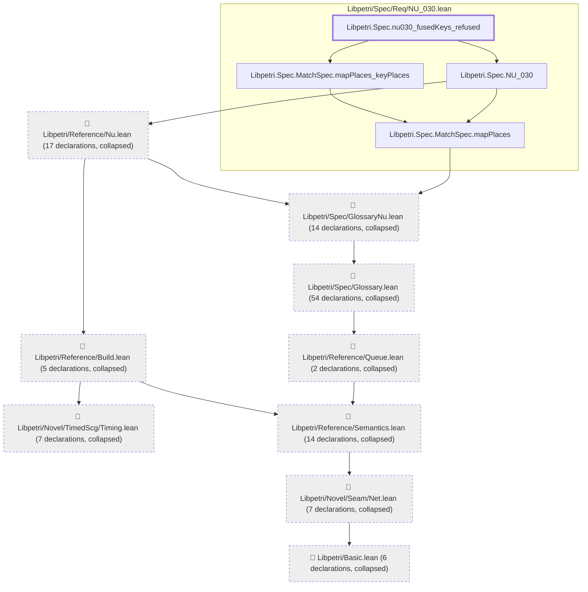
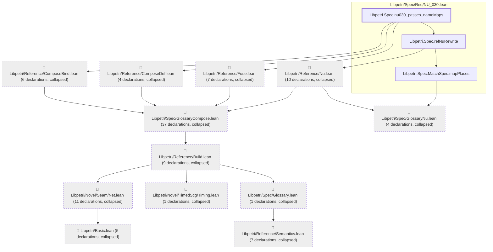

# NU-030

Generated by `scripts/proof-graph.py` from `proof-graph.json`. Do not edit.

Theorems carrying this ID:

- `Libpetri.Spec.nu030_fusedKeys_refused` (theorem, `Libpetri/Spec/Req/NU_030.lean:304`)
- `Libpetri.Spec.nu030_instanceNames_disjoint` (theorem, `Libpetri/Spec/Req/NU_030.lean:335`)
- `Libpetri.Spec.nu030_keysOnInputs` (theorem, `Libpetri/Spec/Req/NU_030.lean:254`)
- `Libpetri.Spec.nu030_oneExecution` (theorem, `Libpetri/Spec/Req/NU_030.lean:349`)
- `Libpetri.Spec.nu030_passes_nameMaps` (theorem, `Libpetri/Spec/Req/NU_030.lean:189`)
- `Libpetri.Spec.nu030_relaysOnOutputs` (theorem, `Libpetri/Spec/Req/NU_030.lean:271`)

> **Note:** the full tree has 244 nodes (limit 60), so it is drawn as one diagram per theorem (6 theorems).

### `Libpetri.Spec.nu030_fusedKeys_refused`

> Rule: this theorem's tree has 130 nodes (limit 60); every file other than its own is collapsed into one node, leaving 13.

### `Libpetri.Spec.nu030_instanceNames_disjoint`

> Rule: this theorem's whole tree, 54 nodes.

```mermaid
flowchart TD
  subgraph g0["Libpetri/Novel/Seam/Net.lean"]
    n1936["Libpetri.Novel.Seam.NInSpec"]
    n1939["Libpetri.Novel.Seam.NInSpec.place"]
    n1955["Libpetri.Novel.Seam.NTransition"]
    n1957["Libpetri.Novel.Seam.NTransition.inputs"]
    n1959["Libpetri.Novel.Seam.NTransition.name"]
  end
  subgraph g1["Libpetri/Novel/TimedScg/Timing.lean"]
    n2435["Libpetri.Novel.TimedScg.Timing"]
    n2442["Libpetri.Novel.TimedScg.Timing.deadline"]
    n2444["Libpetri.Novel.TimedScg.Timing.delayed"]
    n2446["Libpetri.Novel.TimedScg.Timing.exact"]
    n2448["Libpetri.Novel.TimedScg.Timing.immediate"]
    n2450["Libpetri.Novel.TimedScg.Timing.reapable"]
    n2462["Libpetri.Novel.TimedScg.Timing.window"]
  end
  subgraph g2["Libpetri/Reference/Build.lean"]
    n3459["Libpetri.Reference.TransDef"]
    n3463["Libpetri.Reference.TransDef.core"]
    n3467["Libpetri.Reference.TransDef.out"]
    n3471["Libpetri.Reference.TransDef.timing"]
    n3472["Libpetri.Reference.TransDef.toTrans"]
  end
  subgraph g3["Libpetri/Reference/Nu.lean"]
    n3131["Libpetri.Reference.NuDef"]
    n3133["Libpetri.Reference.NuDef.mspec"]
    n3136["Libpetri.Reference.NuDef.toTransDef"]
  end
  subgraph g4["Libpetri/Reference/NuMint.lean"]
    n3643["Libpetri.Reference.colon_not_mem_repr"]
    n4064["Libpetri.Reference.mintName"]
    n4067["Libpetri.Reference.mintName_inj"]
    n4070["Libpetri.Reference.mintName_toList"]
    n4079["Libpetri.Reference.mint_digit_of_mem_repr"]
    n4080["Libpetri.Reference.mint_split_first"]
    n4081["Libpetri.Reference.mint_split_last"]
  end
  subgraph g5["Libpetri/Reference/Semantics.lean"]
    n3288["Libpetri.Reference.Out"]
    n3289["Libpetri.Reference.Out.and"]
    n3292["Libpetri.Reference.Out.brecOn.go"]
    n3294["Libpetri.Reference.Out.forward"]
    n3295["Libpetri.Reference.Out.place"]
    n3296["Libpetri.Reference.Out.timeout"]
    n3298["Libpetri.Reference.Out.xor"]
    n3454["Libpetri.Reference.Trans"]
    n3455["Libpetri.Reference.Trans.core"]
    n3456["Libpetri.Reference.Trans.mk"]
    n3457["Libpetri.Reference.Trans.out"]
  end
  subgraph g6["Libpetri/Spec/Glossary.lean"]
    n9544["Libpetri.Spec.OutputArc"]
    n16709["Libpetri.Spec.inPlaces"]
    n19403["Libpetri.Spec.outPlaces"]
  end
  subgraph g7["Libpetri/Spec/GlossaryCompose.lean"]
    n10927["Libpetri.Spec.ValidPrefix"]
    n19481["Libpetri.Spec.preL"]
    n19482["Libpetri.Spec.preL_inj"]
    n19483["Libpetri.Spec.preS"]
    n19487["Libpetri.Spec.preS_inj"]
  end
  subgraph g8["Libpetri/Spec/GlossaryNu.lean"]
    n8458["Libpetri.Spec.MatchSpec"]
    n8460["Libpetri.Spec.MatchSpec.keys"]
    n8465["Libpetri.Spec.MatchSpec.mk"]
    n8467["Libpetri.Spec.MatchSpec.relays"]
  end
  subgraph g9["Libpetri/Spec/Req/NU_030.lean"]
    n8461["Libpetri.Spec.MatchSpec.mapPlaces"]
    n8749["Libpetri.Spec.NU_030"]
    n18785["Libpetri.Spec.nu030_instanceMints_disjoint"]
    n18786["Libpetri.Spec.nu030_instanceNames_disjoint"]
  end
  n1939 --> n1936
  n1957 --> n1936
  n1957 --> n1955
  n1959 --> n1955
  n2442 --> n2435
  n2444 --> n2435
  n2446 --> n2435
  n2448 --> n2435
  n2450 --> n2442
  n2450 --> n2444
  n2450 --> n2446
  n2450 --> n2448
  n2450 --> n2462
  n2462 --> n2435
  n3133 --> n3131
  n3133 --> n8458
  n3136 --> n3131
  n3136 --> n3459
  n3289 --> n3288
  n3292 --> n3289
  n3292 --> n3294
  n3292 --> n3295
  n3292 --> n3296
  n3292 --> n3298
  n3294 --> n3288
  n3295 --> n3288
  n3296 --> n3288
  n3298 --> n3288
  n3455 --> n1955
  n3455 --> n3454
  n3456 --> n1955
  n3456 --> n3288
  n3456 --> n3454
  n3457 --> n3288
  n3457 --> n3454
  n3463 --> n1955
  n3463 --> n3459
  n3467 --> n3288
  n3467 --> n3459
  n3471 --> n2435
  n3471 --> n3459
  n3472 --> n2450
  n3472 --> n3456
  n3472 --> n3463
  n3472 --> n3467
  n3472 --> n3471
  n3643 --> n4079
  n4067 --> n3643
  n4067 --> n4070
  n4067 --> n4081
  n4070 --> n4064
  n4081 --> n4080
  n8460 --> n8458
  n8461 --> n8460
  n8461 --> n8465
  n8461 --> n8467
  n8465 --> n8458
  n8467 --> n8458
  n8749 --> n1959
  n8749 --> n3133
  n8749 --> n3136
  n8749 --> n3472
  n8749 --> n8461
  n8749 --> n9544
  n8749 --> n16709
  n9544 --> n3457
  n9544 --> n19403
  n16709 --> n1939
  n16709 --> n1957
  n16709 --> n3455
  n18785 --> n4067
  n18785 --> n19487
  n18786 --> n8749
  n18786 --> n18785
  n19403 --> n3292
  n19482 --> n19481
  n19487 --> n10927
  n19487 --> n19482
  n19487 --> n19483
  classDef root stroke-width:3px
  classDef locked fill:#fff3cd,stroke:#b8860b
  classDef collapsed fill:#eeeeee,stroke-dasharray:4 4
  class n18786 root
```

### `Libpetri.Spec.nu030_keysOnInputs`

> Rule: this theorem's whole tree, 48 nodes.

```mermaid
flowchart TD
  subgraph g0["Libpetri/Novel/Seam/Net.lean"]
    n1936["Libpetri.Novel.Seam.NInSpec"]
    n1939["Libpetri.Novel.Seam.NInSpec.place"]
    n1955["Libpetri.Novel.Seam.NTransition"]
    n1957["Libpetri.Novel.Seam.NTransition.inputs"]
    n1959["Libpetri.Novel.Seam.NTransition.name"]
  end
  subgraph g1["Libpetri/Novel/TimedScg/Timing.lean"]
    n2435["Libpetri.Novel.TimedScg.Timing"]
    n2442["Libpetri.Novel.TimedScg.Timing.deadline"]
    n2444["Libpetri.Novel.TimedScg.Timing.delayed"]
    n2446["Libpetri.Novel.TimedScg.Timing.exact"]
    n2448["Libpetri.Novel.TimedScg.Timing.immediate"]
    n2450["Libpetri.Novel.TimedScg.Timing.reapable"]
    n2462["Libpetri.Novel.TimedScg.Timing.window"]
  end
  subgraph g2["Libpetri/Reference/Build.lean"]
    n3459["Libpetri.Reference.TransDef"]
    n3463["Libpetri.Reference.TransDef.core"]
    n3467["Libpetri.Reference.TransDef.out"]
    n3471["Libpetri.Reference.TransDef.timing"]
    n3472["Libpetri.Reference.TransDef.toTrans"]
  end
  subgraph g3["Libpetri/Reference/Nu.lean"]
    n3131["Libpetri.Reference.NuDef"]
    n3133["Libpetri.Reference.NuDef.mspec"]
    n3134["Libpetri.Reference.NuDef.toNuTrans"]
    n3136["Libpetri.Reference.NuDef.toTransDef"]
  end
  subgraph g4["Libpetri/Reference/Semantics.lean"]
    n3288["Libpetri.Reference.Out"]
    n3289["Libpetri.Reference.Out.and"]
    n3292["Libpetri.Reference.Out.brecOn.go"]
    n3294["Libpetri.Reference.Out.forward"]
    n3295["Libpetri.Reference.Out.place"]
    n3296["Libpetri.Reference.Out.timeout"]
    n3298["Libpetri.Reference.Out.xor"]
    n3454["Libpetri.Reference.Trans"]
    n3455["Libpetri.Reference.Trans.core"]
    n3456["Libpetri.Reference.Trans.mk"]
    n3457["Libpetri.Reference.Trans.out"]
  end
  subgraph g5["Libpetri/Spec/Glossary.lean"]
    n9544["Libpetri.Spec.OutputArc"]
    n16709["Libpetri.Spec.inPlaces"]
    n19403["Libpetri.Spec.outPlaces"]
  end
  subgraph g6["Libpetri/Spec/GlossaryNu.lean"]
    n7923["Libpetri.Spec.KeysOnInputs"]
    n8458["Libpetri.Spec.MatchSpec"]
    n8459["Libpetri.Spec.MatchSpec.keyPlaces"]
    n8460["Libpetri.Spec.MatchSpec.keys"]
    n8465["Libpetri.Spec.MatchSpec.mk"]
    n8467["Libpetri.Spec.MatchSpec.relays"]
    n9265["Libpetri.Spec.NuTrans"]
    n9266["Libpetri.Spec.NuTrans.base"]
    n9267["Libpetri.Spec.NuTrans.mk"]
  end
  subgraph g7["Libpetri/Spec/Req/NU_030.lean"]
    n8461["Libpetri.Spec.MatchSpec.mapPlaces"]
    n8462["Libpetri.Spec.MatchSpec.mapPlaces_keyPlaces"]
    n8749["Libpetri.Spec.NU_030"]
    n18791["Libpetri.Spec.nu030_keysOnInputs"]
  end
  n1939 --> n1936
  n1957 --> n1936
  n1957 --> n1955
  n1959 --> n1955
  n2442 --> n2435
  n2444 --> n2435
  n2446 --> n2435
  n2448 --> n2435
  n2450 --> n2442
  n2450 --> n2444
  n2450 --> n2446
  n2450 --> n2448
  n2450 --> n2462
  n2462 --> n2435
  n3133 --> n3131
  n3133 --> n8458
  n3134 --> n3133
  n3134 --> n3136
  n3134 --> n3472
  n3134 --> n9267
  n3136 --> n3131
  n3136 --> n3459
  n3289 --> n3288
  n3292 --> n3289
  n3292 --> n3294
  n3292 --> n3295
  n3292 --> n3296
  n3292 --> n3298
  n3294 --> n3288
  n3295 --> n3288
  n3296 --> n3288
  n3298 --> n3288
  n3455 --> n1955
  n3455 --> n3454
  n3456 --> n1955
  n3456 --> n3288
  n3456 --> n3454
  n3457 --> n3288
  n3457 --> n3454
  n3463 --> n1955
  n3463 --> n3459
  n3467 --> n3288
  n3467 --> n3459
  n3471 --> n2435
  n3471 --> n3459
  n3472 --> n2450
  n3472 --> n3456
  n3472 --> n3463
  n3472 --> n3467
  n3472 --> n3471
  n7923 --> n8459
  n7923 --> n9266
  n7923 --> n16709
  n8459 --> n8460
  n8460 --> n8458
  n8461 --> n8460
  n8461 --> n8465
  n8461 --> n8467
  n8462 --> n8459
  n8462 --> n8461
  n8465 --> n8458
  n8467 --> n8458
  n8749 --> n1959
  n8749 --> n3133
  n8749 --> n3136
  n8749 --> n3472
  n8749 --> n8461
  n8749 --> n9544
  n8749 --> n16709
  n9266 --> n3454
  n9266 --> n9265
  n9267 --> n3454
  n9267 --> n8458
  n9267 --> n9265
  n9544 --> n3457
  n9544 --> n19403
  n16709 --> n1939
  n16709 --> n1957
  n16709 --> n3455
  n18791 --> n3134
  n18791 --> n7923
  n18791 --> n8462
  n18791 --> n8749
  n19403 --> n3292
  classDef root stroke-width:3px
  classDef locked fill:#fff3cd,stroke:#b8860b
  classDef collapsed fill:#eeeeee,stroke-dasharray:4 4
  class n18791 root
```

### `Libpetri.Spec.nu030_oneExecution`

> Rule: this theorem's whole tree, 33 nodes.

```mermaid
flowchart TD
  subgraph g0["Libpetri/Reference/NuMint.lean"]
    n3080["Libpetri.Reference.MintEv"]
    n3081["Libpetri.Reference.MintEv.boundary"]
    n3082["Libpetri.Reference.MintEv.call"]
    n3084["Libpetri.Reference.MintRun"]
    n3088["Libpetri.Reference.MintRun.boundary"]
    n3089["Libpetri.Reference.MintRun.call"]
    n3090["Libpetri.Reference.MintRun.nil"]
    n3091["Libpetri.Reference.MintSt"]
    n3092["Libpetri.Reference.MintSt.ctr"]
    n3093["Libpetri.Reference.MintSt.mk"]
    n3094["Libpetri.Reference.MintSt.scope"]
    n3095["Libpetri.Reference.MintSys"]
    n3096["Libpetri.Reference.MintSys.St"]
    n3097["Libpetri.Reference.MintSys.init"]
    n3098["Libpetri.Reference.MintSys.mint"]
    n3099["Libpetri.Reference.MintSys.mk"]
    n3100["Libpetri.Reference.MintSys.next"]
    n3616["Libpetri.Reference.calls"]
    n3643["Libpetri.Reference.colon_not_mem_repr"]
    n4064["Libpetri.Reference.mintName"]
    n4066["Libpetri.Reference.mintName_counter_inj"]
    n4070["Libpetri.Reference.mintName_toList"]
    n4073["Libpetri.Reference.mintSeq"]
    n4074["Libpetri.Reference.mintSeq_counters"]
    n4078["Libpetri.Reference.mintSeq_nodup"]
    n4079["Libpetri.Reference.mint_digit_of_mem_repr"]
    n4080["Libpetri.Reference.mint_split_first"]
    n4081["Libpetri.Reference.mint_split_last"]
    n4405["Libpetri.Reference.refMint"]
    n4408["Libpetri.Reference.refMintSys"]
    n4456["Libpetri.Reference.refRun_eq"]
    n4463["Libpetri.Reference.refRun_nodup"]
  end
  subgraph g1["Libpetri/Spec/Req/NU_030.lean"]
    n18798["Libpetri.Spec.nu030_oneExecution"]
  end
  n3081 --> n3080
  n3082 --> n3080
  n3084 --> n3080
  n3084 --> n3096
  n3088 --> n3081
  n3088 --> n3084
  n3088 --> n3100
  n3089 --> n3082
  n3089 --> n3084
  n3089 --> n3098
  n3090 --> n3084
  n3092 --> n3091
  n3093 --> n3091
  n3094 --> n3091
  n3096 --> n3095
  n3097 --> n3096
  n3098 --> n3096
  n3099 --> n3095
  n3100 --> n3096
  n3616 --> n3081
  n3616 --> n3082
  n3643 --> n4079
  n4066 --> n3643
  n4066 --> n4070
  n4066 --> n4081
  n4070 --> n4064
  n4073 --> n4405
  n4074 --> n4073
  n4078 --> n4066
  n4078 --> n4074
  n4081 --> n4080
  n4405 --> n3092
  n4405 --> n3093
  n4405 --> n3094
  n4405 --> n4064
  n4408 --> n3099
  n4408 --> n4405
  n4456 --> n3088
  n4456 --> n3089
  n4456 --> n3090
  n4456 --> n3616
  n4456 --> n4073
  n4456 --> n4408
  n4463 --> n4078
  n4463 --> n4456
  n18798 --> n3097
  n18798 --> n4463
  classDef root stroke-width:3px
  classDef locked fill:#fff3cd,stroke:#b8860b
  classDef collapsed fill:#eeeeee,stroke-dasharray:4 4
  class n18798 root
```

### `Libpetri.Spec.nu030_passes_nameMaps`

> Rule: this theorem's tree has 105 nodes (limit 60); every file other than its own is collapsed into one node, leaving 15.

### `Libpetri.Spec.nu030_relaysOnOutputs`

> Rule: this theorem's whole tree, 43 nodes.

```mermaid
flowchart TD
  subgraph g0["Libpetri/Novel/Seam/Net.lean"]
    n1936["Libpetri.Novel.Seam.NInSpec"]
    n1939["Libpetri.Novel.Seam.NInSpec.place"]
    n1955["Libpetri.Novel.Seam.NTransition"]
    n1957["Libpetri.Novel.Seam.NTransition.inputs"]
    n1959["Libpetri.Novel.Seam.NTransition.name"]
  end
  subgraph g1["Libpetri/Novel/TimedScg/Timing.lean"]
    n2435["Libpetri.Novel.TimedScg.Timing"]
    n2442["Libpetri.Novel.TimedScg.Timing.deadline"]
    n2444["Libpetri.Novel.TimedScg.Timing.delayed"]
    n2446["Libpetri.Novel.TimedScg.Timing.exact"]
    n2448["Libpetri.Novel.TimedScg.Timing.immediate"]
    n2450["Libpetri.Novel.TimedScg.Timing.reapable"]
    n2462["Libpetri.Novel.TimedScg.Timing.window"]
  end
  subgraph g2["Libpetri/Reference/Build.lean"]
    n3459["Libpetri.Reference.TransDef"]
    n3463["Libpetri.Reference.TransDef.core"]
    n3467["Libpetri.Reference.TransDef.out"]
    n3471["Libpetri.Reference.TransDef.timing"]
    n3472["Libpetri.Reference.TransDef.toTrans"]
  end
  subgraph g3["Libpetri/Reference/Nu.lean"]
    n3131["Libpetri.Reference.NuDef"]
    n3133["Libpetri.Reference.NuDef.mspec"]
    n3136["Libpetri.Reference.NuDef.toTransDef"]
  end
  subgraph g4["Libpetri/Reference/Semantics.lean"]
    n3288["Libpetri.Reference.Out"]
    n3289["Libpetri.Reference.Out.and"]
    n3292["Libpetri.Reference.Out.brecOn.go"]
    n3294["Libpetri.Reference.Out.forward"]
    n3295["Libpetri.Reference.Out.place"]
    n3296["Libpetri.Reference.Out.timeout"]
    n3298["Libpetri.Reference.Out.xor"]
    n3454["Libpetri.Reference.Trans"]
    n3455["Libpetri.Reference.Trans.core"]
    n3456["Libpetri.Reference.Trans.mk"]
    n3457["Libpetri.Reference.Trans.out"]
  end
  subgraph g5["Libpetri/Spec/Glossary.lean"]
    n9544["Libpetri.Spec.OutputArc"]
    n16709["Libpetri.Spec.inPlaces"]
    n19403["Libpetri.Spec.outPlaces"]
  end
  subgraph g6["Libpetri/Spec/GlossaryNu.lean"]
    n8458["Libpetri.Spec.MatchSpec"]
    n8460["Libpetri.Spec.MatchSpec.keys"]
    n8465["Libpetri.Spec.MatchSpec.mk"]
    n8466["Libpetri.Spec.MatchSpec.relayPlaces"]
    n8467["Libpetri.Spec.MatchSpec.relays"]
  end
  subgraph g7["Libpetri/Spec/Req/NU_030.lean"]
    n8461["Libpetri.Spec.MatchSpec.mapPlaces"]
    n8464["Libpetri.Spec.MatchSpec.mapPlaces_relayPlaces"]
    n8749["Libpetri.Spec.NU_030"]
    n18804["Libpetri.Spec.nu030_relaysOnOutputs"]
  end
  n1939 --> n1936
  n1957 --> n1936
  n1957 --> n1955
  n1959 --> n1955
  n2442 --> n2435
  n2444 --> n2435
  n2446 --> n2435
  n2448 --> n2435
  n2450 --> n2442
  n2450 --> n2444
  n2450 --> n2446
  n2450 --> n2448
  n2450 --> n2462
  n2462 --> n2435
  n3133 --> n3131
  n3133 --> n8458
  n3136 --> n3131
  n3136 --> n3459
  n3289 --> n3288
  n3292 --> n3289
  n3292 --> n3294
  n3292 --> n3295
  n3292 --> n3296
  n3292 --> n3298
  n3294 --> n3288
  n3295 --> n3288
  n3296 --> n3288
  n3298 --> n3288
  n3455 --> n1955
  n3455 --> n3454
  n3456 --> n1955
  n3456 --> n3288
  n3456 --> n3454
  n3457 --> n3288
  n3457 --> n3454
  n3463 --> n1955
  n3463 --> n3459
  n3467 --> n3288
  n3467 --> n3459
  n3471 --> n2435
  n3471 --> n3459
  n3472 --> n2450
  n3472 --> n3456
  n3472 --> n3463
  n3472 --> n3467
  n3472 --> n3471
  n8460 --> n8458
  n8461 --> n8460
  n8461 --> n8465
  n8461 --> n8467
  n8464 --> n8461
  n8464 --> n8466
  n8465 --> n8458
  n8466 --> n8467
  n8467 --> n8458
  n8749 --> n1959
  n8749 --> n3133
  n8749 --> n3136
  n8749 --> n3472
  n8749 --> n8461
  n8749 --> n9544
  n8749 --> n16709
  n9544 --> n3457
  n9544 --> n19403
  n16709 --> n1939
  n16709 --> n1957
  n16709 --> n3455
  n18804 --> n8464
  n18804 --> n8749
  n19403 --> n3292
  classDef root stroke-width:3px
  classDef locked fill:#fff3cd,stroke:#b8860b
  classDef collapsed fill:#eeeeee,stroke-dasharray:4 4
  class n18804 root
```

Axioms used:

- `Libpetri.Spec.nu030_fusedKeys_refused`: `Classical.choice`, `Quot.sound`, `propext`
- `Libpetri.Spec.nu030_instanceNames_disjoint`: `Classical.choice`, `Quot.sound`, `propext`
- `Libpetri.Spec.nu030_keysOnInputs`: `Quot.sound`, `propext`
- `Libpetri.Spec.nu030_oneExecution`: `Classical.choice`, `Quot.sound`, `propext`
- `Libpetri.Spec.nu030_passes_nameMaps`: `Classical.choice`, `Quot.sound`, `propext`
- `Libpetri.Spec.nu030_relaysOnOutputs`: `Quot.sound`, `propext`
