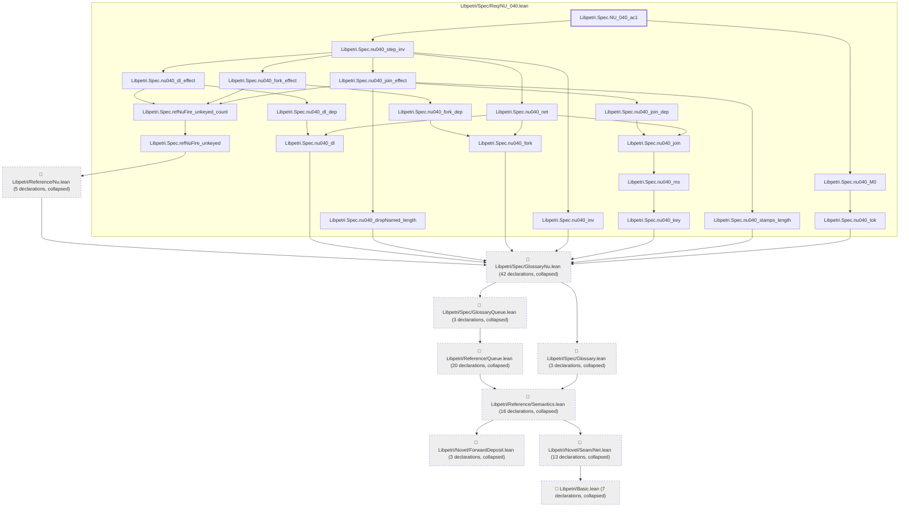
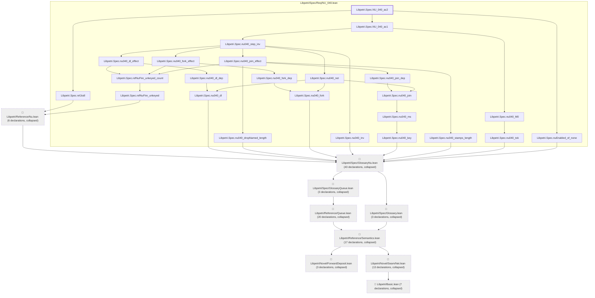

# NU-040

Generated by `scripts/proof-graph.py` from `proof-graph.json`. Do not edit.

Theorems carrying this ID:

- `Libpetri.Spec.NU_040_ac1` (theorem, `Libpetri/Spec/Req/NU_040.lean:488`)
- `Libpetri.Spec.NU_040_ac2` (theorem, `Libpetri/Spec/Req/NU_040.lean:503`)

> **Note:** the full tree has 139 nodes (limit 60), so it is drawn as one diagram per theorem (2 theorems).

### `Libpetri.Spec.NU_040_ac1`

> Rule: this theorem's tree has 133 nodes (limit 60); every file other than its own is collapsed into one node, leaving 30.

### `Libpetri.Spec.NU_040_ac2`

> Rule: this theorem's tree has 139 nodes (limit 60); every file other than its own is collapsed into one node, leaving 33.

Axioms used:

- `Libpetri.Spec.NU_040_ac1`: `Classical.choice`, `Quot.sound`, `propext`
- `Libpetri.Spec.NU_040_ac2`: `Classical.choice`, `Quot.sound`, `propext`
